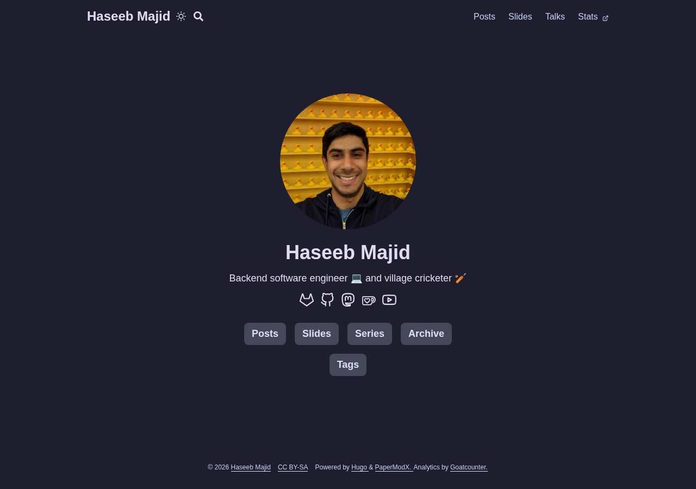
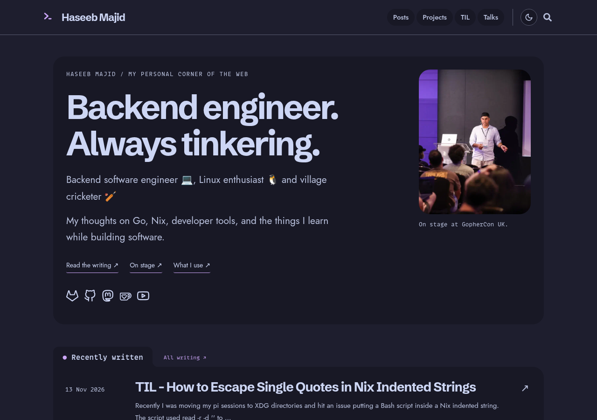
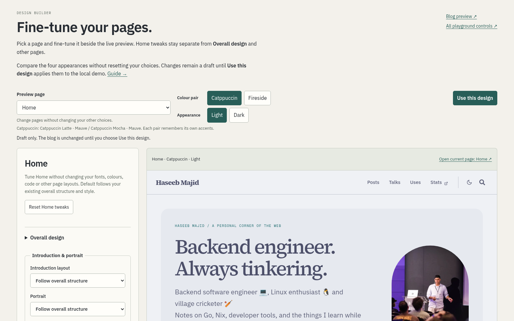
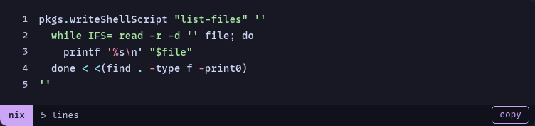

Back in 2022 I wrote about [why I moved from Gatsby to Hugo for this
blog](/posts/2022-11-17-why-i-moved-from-gatsby-to-hugo-for-this-blog/). In that post I said I went with an existing
theme (PaperModX) because I am no designer, and I didn't want to maintain a bunch of custom code again.

Well, four years later, this site now runs on a theme I built myself 🤣. So this is version 5 of the site. Still Hugo,
but PaperModX is gone. In this post I'll go over why I moved, how I did it (spoiler, with a lot of help from AI agents)
and what changed.

## Technologies Used

- [Hugo](https://gohugo.io/)
  - My own theme, no more git submodule or fork
  - Using the newer Hugo v0.146 layout structure (`_partials`, `_shortcodes`, `_markup`)
- Hosted on [GitLab Pages](https://docs.gitlab.com/user/project/pages/)
- Branch previews in GitLab CI at preview.haseebmajid.dev
- Nix flake for the dev shell
- [Umami](https://umami.is/) for analytics, but no more page view counts on posts

## Why Move?

My PaperModX theme was a fork, of a fork, of a fork. Over the years I kept overriding bits of it. A partial here, some
extra CSS there, a few shortcodes I needed for my posts. By the end I had more overrides than I'd like to admit, and
I didn't really know which bits of the theme I was even using anymore. Things like comments
share icons and instantclick were all there, and I used none of them.

The other reason, probably the main one. A lot of blogs use PaperMod, and I wanted the site to feel
a bit more like mine.

## GoLab

This all started at [GoLab](https://golab.io/) this year, where I was giving a [talk on Kafka and
EDA](/talks/go-labs-kafka-eda/). I met [Davide Imola](https://www.davideimola.dev/) there and he showed me his slides
and his website. I really liked both.

So when I got home the slides came first. I took some ideas from his [presentations
repo](https://github.com/davideimola/presentations) for my own Slidev decks, and I ended up moving my slides into
their own repo too. Then I looked at his website again, the about page, the SVG art on his blog posts and his sharing
page. I thought, can I make my blog feel like this but still use Catppuccin? Thanks Davide!

## How I Built It

So again I am no designer, that hasn't changed. But this time I had AI agents to help. I did all of this using
[pi](https://github.com/badlogic/pi-mono) as my coding agent, mostly with GPT models, with some DeepSeek and Claude
thrown in. It took me about 9 days, mostly evenings. I wanted to see how far I could get, without impacting
the load time of the site and even improve it. The quality of the CSS looks fine to me (and the HTML) but again
I'm no expert.

### Design Lab

I asked the LLM to create a design page where I could pick my favourite style from a bunch of variations.
I didn't really know what I wanted, so I let it suggest stuff then I could ask it to merge versions. Or try again etc.

For example, it made 5
different OG card designs, and I picked one of them (more on that in [how I generate open graph images with
Hugo](/posts/2026-11-17-how-i-generate-open-graph-images-with-hugo/)).

For code blocks I wanted them to look like my Neovim setup, so they now have a little Neovim status bar. There is also
a terminal style for shell output.

A few other things that helped:

- A notes widget on the local dev site, where I could leave a comment on any part of the page, and the agent would
  pick it up. It got removed before shipping.
- The agent taking screenshots with Playwright to check its own work.
- Having the agent ask me questions area by area (home page, table of contents, site history etc), rather than it
  guessing what I wanted.

### Planning the port

Once I was happy with the design, I needed to get it into the real blog. The big decision was do I keep PaperModX and
restyle it, or start from scratch. I went with starting from scratch. Then I broke the work down into a "map" with a
bunch of tickets. Port the layouts, code blocks, palette toggle, search, content, and the last ticket was to delete all
the functionality I didn't use. These planning docs never went into the git history, I just kept them locally as a
reference.

### Lots of sessions

This was way too much work for a single session, the agent would run out of context. So at the end of each session I
had it write a handover doc, and the next session would read it and carry on. I ended up with about 27 of these handover
docs, and close to 40 tickets, by the end.

### Reviews

Before merging I had fresh agents, with no context of the work, review the branch. Things like contrast, performance,
RSS feeds and stuff that would block shipping. They did find real bugs, the sidenotes broke lists, and the image zoom
didn't close when you pressed Escape. Those all became new tickets which got fixed.

Near the end I also asked, if this was a brand new repo, without PaperModX, how would we structure it? I had two
agents suggest and debate it, and they landed on Hugo's newer layout structure.

## What Changed

- A new design, with light/dark mode and a Catppuccin or Fireside palette (try the toggle in the footer)
- Code blocks that look like Neovim, and a terminal style for shell output
- Sidenotes, code tabs, and code diffs
- A TIL section, series pages and a projects page
- A [site history](/site-history/) page, which shows each version of the site as a git log
- Open graph images generated by Hugo at build time, no more committed cover images
- Slides moved to their own repo, with redirects so the old links still work
- Deleted a lot of CSS, JS and partials I never used

## Was it worth it?

I think so. If I'm honest, I don't think I would've done this without AI. Back in 2022 the whole point of moving to
Hugo was so I didn't have to put effort into maintaining the site. Designing and building a theme from scratch is
exactly the kind of thing I would've started and never finished.

The funny thing is, I now own all of the theme code, which is what I was trying to avoid with PaperModX. My overrides
alone were about 6,200 lines of layouts, CSS and JS, sitting on top of the whole PaperModX theme. Now the entire theme
is about 7,000 lines, and I actually know its currently all used. The theme was great way to migrate my blog to Hugo.

So hopefully I will be blogging more often again 🤣, only about 5 posts this year which is not a lot for me.

## 👴 Older iterations

You can see all the older versions of this site on the [site history](/site-history/) page.
