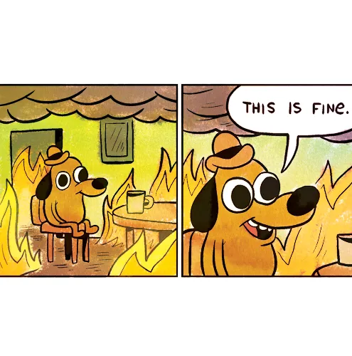

# Beyond the Happy Path: Failure Recovery with Go and Kafka

<div class="mt-6 text-lg opacity-80">Haseeb Majid · Go Labs</div>

---

## Introduction

- Haseeb Majid
  - Backend Software Engineer at [Nala](https://www.nala.com/)
  - <https://haseebmajid.dev>
- Loves cats 🐱
- Avid cricketer 🏏
- 🌱 Amateur Gardener

<!--
-->

---

<div style="display: grid; grid-template-columns: minmax(0, 3fr) minmax(0, 2fr); align-items: center; gap: 32px;">

<RoughDiagram diagram="happy-path" :step="$clicks" talk />

<div class="transfer-captions" style="text-align: left; font-size: 24px; line-height: 1.4;">
  <div v-click.fade-in="1" class="transfer-step" style="font-size: 32px; font-weight: 700; color: #94e2d5;">1. Charge</div>
  <div v-click.fade-in="1" class="transfer-detail" style="margin: 8px 0 28px;">Collections charges the customer.</div>
  <div v-click.fade-in="2" class="transfer-step" style="font-size: 32px; font-weight: 700; color: #cba6f7;">2. Payout</div>
  <div v-click.fade-in="2" class="transfer-detail" style="margin: 8px 0 28px;">Disbursements requests the bank payout.</div>
  <div v-click.fade-in="3" class="transfer-step" style="font-size: 32px; font-weight: 700; color: #a6e3a1;">3. Receipt</div>
  <div v-click.fade-in="3" class="transfer-detail" style="margin-top: 8px;">Notifications sends the receipt.</div>
</div>

</div>

<!--
- Happy path

[click]
- Charge

[click]
- Payout; caller waits

[click]
- Receipt
- Coupling, timeouts, retry storms
-->

---
layout: statement
---

# 🎄 Holiday rush

Imagine 1,000 payouts waiting.

Same synchronous chain.

<!--
- Holiday rush
- Bank down?
-->

---


---

<v-switch>
<template #0>

<div style="display: grid; grid-template-columns: minmax(0, 3fr) minmax(0, 2fr); align-items: center; gap: 32px;">

<RoughDiagram diagram="slow-bank" :step="0" talk />

<div class="transfer-captions" style="text-align: left; font-size: 24px; line-height: 1.4;">
  <div class="transfer-step" style="font-size: 32px; font-weight: 700; color: #89b4fa;">Synchronous chain</div>
  <div class="transfer-detail" style="margin-top: 8px;">More holiday transfers. Every caller still waits on downstream work.</div>
</div>

</div>

</template>
<template #1>

<div style="display: grid; grid-template-columns: minmax(0, 3fr) minmax(0, 2fr); align-items: center; gap: 32px;">

<RoughDiagram diagram="slow-bank" :step="1" talk />

<div class="transfer-captions" style="text-align: left; font-size: 24px; line-height: 1.4;">
  <div class="transfer-step" style="font-size: 32px; font-weight: 700; color: #f38ba8;">1. Bank failure</div>
  <div class="transfer-detail" style="margin-top: 8px;">The partner bank is slow or unavailable.</div>
</div>

</div>

</template>
<template #2>

<div style="display: grid; grid-template-columns: minmax(0, 3fr) minmax(0, 2fr); align-items: center; gap: 32px;">

<RoughDiagram diagram="slow-bank" :step="2" talk />

<div class="transfer-captions" style="text-align: left; font-size: 24px; line-height: 1.4;">
  <div class="transfer-step" style="font-size: 32px; font-weight: 700; color: #fab387;">2. Timeouts</div>
  <div class="transfer-detail" style="margin-top: 8px;">Waiting upstream calls time out. Downstream failure spreads through the chain.</div>
</div>

</div>

</template>
<template #3>

<div style="display: grid; grid-template-columns: minmax(0, 3fr) minmax(0, 2fr); align-items: center; gap: 32px;">

<RoughDiagram diagram="slow-bank" :step="3" talk />

<div class="transfer-captions" style="text-align: left; font-size: 24px; line-height: 1.4;">
  <div class="transfer-step" style="font-size: 32px; font-weight: 700; color: #fab387;">3. Retry storm</div>
  <div class="transfer-detail" style="margin-top: 8px;">Client retries add load and can repeat the same payment request.</div>
</div>

</div>

</template>
</v-switch>

<p v-show="$clicks > 0" style="text-align: center; font-size: 18px; color: #a6adc8;">Illustrative waiting-request counts</p>

<!--
- What can fail?
- Waiting counts are illustrative snapshots, not incident measurements or values to sum across services

[click]
- Bank timeout; unknown outcome
- Three payouts waiting in Disbursements; receipts wait too

[click]
- Cascading timeouts
- Forty requests waiting at each upstream service shown; these can be the same nested requests

[click]
- Retry storm; duplicate payments
- Repeated dashed arrows show retry amplification; 300 waiting calls is illustrative
-->

---

## Event-driven architecture

---
zoom: 0.8
---

<div style="display: grid; grid-template-columns: minmax(0, 3fr) minmax(0, 2fr); align-items: center; gap: 32px;">

<RoughDiagram diagram="event-flow" :step="$clicks" talk />

<div v-show="$clicks < 4" class="transfer-captions" style="text-align: left; font-size: 24px; line-height: 1.4;">
  <div v-click.fade-in="1" class="transfer-step" style="font-size: 32px; font-weight: 700; color: #94e2d5;">1. Publish completion</div>
  <div v-click.fade-in="1" class="transfer-detail" style="margin: 8px 0 28px;">Collections publishes completion.</div>
  <div v-click.fade-in="2" class="transfer-step" style="font-size: 32px; font-weight: 700; color: #cba6f7;">2. Request payout</div>
  <div v-click.fade-in="2" class="transfer-detail" style="margin: 8px 0 28px;">Disbursements calls the bank.</div>
  <div v-click.fade-in="3" class="transfer-step" style="font-size: 32px; font-weight: 700; color: #a6e3a1;">3. Send receipt</div>
  <div v-click.fade-in="3" class="transfer-detail" style="margin-top: 8px;">Notifications sends the receipt.</div>
</div>

<div v-click="4" v-show="$clicks >= 4" class="transfer-captions" style="text-align: left; font-size: 24px; line-height: 1.4;">
  <div class="transfer-step" style="font-size: 32px; font-weight: 700; color: #f38ba8;">4. Bank down</div>
  <div class="transfer-detail" style="margin-top: 8px;">Collections keeps working. Payouts and receipts wait.</div>
</div>

</div>

<!--
- Decoupling

[click]
- Charge confirmed → publish

[click]
- Consume → bank payout

[click]
- Payout confirmed → receipt

[click]
- Now the bank goes down: collections still charges and publishes
- Pending payouts accumulate in the collections topic; their receipts wait
- The outage no longer spreads back through the synchronous chain
-->

---

# Kafka Crash Course

<p class="slide-subtitle">without Otters 🦦</p>


---

<v-clicks at="1">

- <strong style="color: #f9e2af;">Events</strong>: basic units of data
- <strong style="color: #fab387;">Topics</strong>: <span style="display: inline-block; white-space: nowrap;" v-mark="{ at: 2, type: 'circle', color: '#fab387', padding: 3 }">events</span> are organized into topics
- <strong style="color: #89b4fa;">Partitions</strong>: allow us to <span style="display: inline-block; white-space: nowrap;" v-mark="{ at: 3, type: 'underline', color: '#89b4fa', padding: 2 }">scale topics</span>

</v-clicks>

<style>
.slidev-vclick-target {
  transition: opacity 220ms ease;
}
.slidev-vclick-hidden {
  transform: none;
  filter: none;
}
</style>

---

<v-clicks at="1">

- <strong style="color: #94e2d5;">Producer</strong>: <span style="display: inline-block; white-space: nowrap;" v-mark="{ at: 1, type: 'underline', color: '#94e2d5', padding: 2 }">publishes</span> event to topic
- <strong style="color: #cba6f7;">Consumer</strong>: subscribes to topic and <span style="display: inline-block; white-space: nowrap;" v-mark="{ at: 2, type: 'underline', color: '#cba6f7', padding: 2 }">receives events</span>
- <strong style="color: #b4befe;">Consumer Group</strong>: Usually multiple instances of the <span style="display: inline-block; white-space: nowrap;" v-mark="{ at: 3, type: 'box', color: '#b4befe', padding: 3 }">same service</span>, consuming events <span style="display: inline-block; white-space: nowrap;" v-mark="{ at: 3, type: 'highlight', color: 'rgba(180,190,254,0.25)', padding: 2 }">in parallel</span>

</v-clicks>

<style>
.slidev-vclick-target {
  transition: opacity 220ms ease;
}
.slidev-vclick-hidden {
  transform: none;
  filter: none;
}
</style>

<!--
- Durable log
- Partitions = scale
- Groups share work
-->

---
class: code-fit
---

<div class="code-focus code-reserve-tall focus-lines-3" :class="$clicks >= 4 ? 'focus-start-10' : 'focus-start-6'">

````md magic-move {at:1, duration:500}
```go
type Event struct {
    Payload       json.RawMessage `json:"payload"`
}
```
```go
type Event struct {
    ID            uuid.UUID       `json:"id"`
    Payload       json.RawMessage `json:"payload"`
}
```
```go {7-9}
type Event struct {
    ID            uuid.UUID       `json:"id"`
    Type          string          `json:"type"`
    Payload       json.RawMessage `json:"payload"`
}

const (
    TypeCollectionCompleted = "collections.completed.v1"
)
```
````

</div>

<div v-click.fade-in="4" class="event-name-breakdown mt-4 text-center">
  <span class="inline-block" v-mark="{ at: 3, type: 'box', color: '#94e2d5', padding: 3 }">collections</span>.<span class="inline-block" v-mark="{ at: 4, type: 'underline', color: '#a6e3a1', padding: 2 }">completed</span>.<span class="inline-block" v-mark="{ at: 4, type: 'circle', color: '#b4befe', padding: 3 }">v1</span>
</div>

<style>
.event-name-breakdown {
  font-family: 'MonoLisa', monospace;
  font-size: 28px;
  line-height: 1.5;
  white-space: nowrap;
  transition: opacity 220ms ease;
}
.event-name-breakdown.slidev-vclick-hidden { transform: none; filter: none; }
</style>

<!--
- Payload

[click]
- Stable event ID

[click]
- Type ≠ topic

[click]
- Metadata; correlation = workflow

[click]
- Domain · fact · version
-->

---
class: code-fit
---

```json
{
  "id": "92bf4e5a-3a1e-4d6f-8db8-1f7d865bd46a",
  "type": "collections.completed.v1",
  "source": "collections",
  "correlation_id": "transfer-a",
  "time": "2026-06-01T10:30:00Z",
  "schema_version": 1,
  "payload": {
    "collection_id": "collection-42",
    "amount_minor": 10000,
    "currency": "GBP"
  }
}
```

<!--
- GBP 100; minor units
- Collection complete ≠ payout complete
-->

---
class: code-lg
---


<div class="code-focus" :style="{ '--focus-start': $clicks < 2 ? 2 : $clicks === 2 ? 3 : 1, '--focus-lines': $clicks < 3 ? 1 : 3 }">

````md magic-move {at:1, duration:500}
```go {all|3|4}
client, err := kgo.NewClient(
    kgo.SeedBrokers("localhost:9092"),
    kgo.DefaultProduceTopic("collections"),
    kgo.RequiredAcks(kgo.AllISRAcks()),
)
if err != nil { return err }
defer client.Close()
```
```go {all|2-4}
err := client.ProduceSync(ctx, &kgo.Record{
    Topic: "collections",
    Key:   []byte(collection.ID.String()),
    Value: eventJSON,
}).FirstErr()
```
````

</div>

<!--
- Setup: `go get github.com/twmb/franz-go`
- Client

[click]
- collections topic

[click]
- AllISRAcks: wait for acknowledgements from the current in-sync replica set
- Pair replication with appropriate min.insync.replicas; acks alone does not guarantee multiple surviving copies
- Kafka acknowledgements do not make bank side effects exactly once

[click]
- Publish

[click]
- Key; event; ack/error
-->

---
class: diagram-compact
clicks: 3
---

<RoughDiagram diagram="worker-scaling" :step="$clicks" talk />

<!--
- One owner per partition/group
- One worker; three partitions

[click]
- Worker 2 → P1

[click]
- Worker 3 → P2

[click]
- Worker 4 idle; partition limit
-->

---
clicks: 2
---

<div class="offset-board">
  <div class="offset-log">
    <strong class="offset-topic">collections · partition 0</strong>
    <span v-click="2" class="offset-log-end">log end = 5</span>
    <div v-click="2" class="offset-lag-selection"><span>Lag</span></div>
    <div class="offset-records">
      <div
        v-for="(event, offset) in ['created', 'completed', 'updated', 'completed', 'created']"
        :key="offset"
        class="offset-record"
        :class="{
          'is-disbursement': offset === 1,
          'is-reconciliation': offset === ($clicks >= 1 ? 4 : 3),
          'is-lag': $clicks >= 2 && offset >= 1,
        }"
      >
        <div class="offset-node" v-mark="{ at: true, type: 'box', color: 'var(--node-color)', padding: 0, strokeWidth: 2.5, animationDuration: 1 }">
          <strong>offset {{ offset }}</strong>
          <span>{{ event }}</span>
        </div>
      </div>
    </div>
  </div>
  <div class="offset-bookmark offset-bookmark-disbursements">
    <div class="offset-bookmark-tip"></div>
    <div class="offset-bookmark-stem"></div>
    <div class="offset-bookmark-label offset-node" v-mark="{ at: true, type: 'box', color: 'var(--bookmark-color)', padding: 0, strokeWidth: 2.5, animationDuration: 1 }">
      <strong>Disbursements</strong>
      <span>committed next = 1</span>
    </div>
  </div>
  <div
    v-motion
    :initial="{ x: 0 }"
    :enter="{ x: 0 }"
    :click-1="{ x: 220, transition: { duration: 550 } }"
    :click-2="{ x: 220 }"
    class="offset-bookmark offset-bookmark-reconciliation"
  >
    <div class="offset-bookmark-tip"></div>
    <div class="offset-bookmark-stem"></div>
    <div class="offset-bookmark-label offset-node" v-mark="{ at: true, type: 'box', color: 'var(--bookmark-color)', padding: 0, strokeWidth: 2.5, animationDuration: 1 }">
      <strong>Reconciliation</strong>
      <span>committed next = {{ $clicks >= 1 ? 4 : 3 }}</span>
    </div>
  </div>
</div>

<style>
.offset-board { position: relative; width: 1100px; height: 395px; margin: 45px auto 0; font-family: 'Patrick Hand', 'Poppins', sans-serif; letter-spacing: 0.02em; }
.offset-log { position: absolute; inset: 0 0 auto; height: 220px; border: 3px solid #fab387; background: rgba(30,30,46,.9); }
.offset-topic { position: absolute; top: 18px; left: 20px; font-size: 24px; font-weight: 500; color: #cdd6f4; }
.offset-log-end { position: absolute; top: 20px; right: 20px; font-size: 24px; color: #f5c2e7; }
.offset-records { position: absolute; top: 96px; left: -3px; display: grid; grid-template-columns: repeat(5, 220px); }
.offset-record { position: relative; width: 190px; height: 90px; margin: 0 15px; --node-color: #7f849c; --node-hatch: rgba(127,132,156,.16); }
.offset-node { display: flex; flex-direction: column; align-items: center; justify-content: center; gap: 8px; width: 190px; height: 90px; color: #e6e9f7; background: repeating-linear-gradient(135deg, transparent 0 6px, var(--node-hatch) 6px 7.5px, transparent 7.5px 13px); line-height: 1.1; }
.offset-node strong { font-size: 24px; font-weight: 500; }
.offset-node span { font-size: 22px; }
.offset-record.is-disbursement { --node-color: #b4befe; --node-hatch: rgba(203,166,247,.22); }
.offset-record.is-reconciliation { --node-color: #89b4fa; --node-hatch: rgba(137,180,250,.22); }
.offset-record.is-lag { --node-color: #f5c2e7; --node-hatch: rgba(245,194,231,.22); }
.offset-lag-selection { position: absolute; top: 75px; left: 222px; right: 2px; height: 125px; border: 3px dashed #f5c2e7; }
.offset-lag-selection span { position: absolute; top: -19px; left: 50%; translate: -50% 0; padding: 0 12px; background: #1e1e2e; color: #f5c2e7; font-size: 24px; font-weight: 500; }
.offset-bookmark { position: absolute; top: 235px; width: 190px; color: var(--bookmark-color); }
.offset-bookmark-disbursements { left: 235px; --bookmark-color: #b4befe; --node-hatch: rgba(203,166,247,.22); }
.offset-bookmark-reconciliation { left: 675px; --bookmark-color: #89b4fa; --node-hatch: rgba(137,180,250,.22); }
.offset-bookmark-tip { width: 0; height: 0; margin: 0 auto; border-left: 8px solid transparent; border-right: 8px solid transparent; border-bottom: 12px solid var(--bookmark-color); }
.offset-bookmark-stem { width: 0; height: 28px; margin: 0 auto; border-left: 2px dashed var(--bookmark-color); }
.offset-bookmark-label { width: 190px; }
</style>

<!--
- Offset = bookmark, not event ID
- Independent group checkpoints

[click]
- Reconciliation → 4; Disbursements stuck
- Fetched ≠ committed

[click]
- Disbursements lag: 5 − 1 = 4
- Offsets 1–4 pending
-->

---
class: code-fit
---

<div class="consumer-example code-focus" :style="{ '--focus-start': [2, 7, 13][Math.min($clicks, 2)], '--focus-lines': [3, 6, 3][Math.min($clicks, 2)] }">

````md magic-move {at:1, duration:500}
```go {3-5}
client, err := kgo.NewClient(
    kgo.SeedBrokers("localhost:9092"),
    kgo.ConsumerGroup("disbursements"),
    kgo.ConsumeTopics("collections"),
    kgo.DisableAutoCommit(),
)
if err != nil { return err }
defer client.Close()
```

```go {8-13}
func consume(ctx context.Context, client *kgo.Client) error {
    defer client.Close()
    for {
        fetches := client.PollFetches(ctx)
        if errs := fetches.Errors(); len(errs) > 0 {
            return errs[0].Err
        }
        for _, r := range fetches.Records() {
            if err := handleCollectionCompleted(ctx, r); err != nil {
                return err // stop all processing
            }
            if err := client.CommitRecords(ctx, r); err != nil {
                return err
            }
        }
    }
}
```

```go {14-16}
func handleCollectionCompleted(
    ctx context.Context,
    r *kgo.Record,
) error {
    var event Event
    if err := json.Unmarshal(r.Value, &event); err != nil {
        return err
    }

    if event.Type != TypeCollectionCompleted {
        return nil // not an event this handler processes
    }

    payoutCtx, cancel := context.WithTimeout(ctx, 3*time.Second)
    defer cancel()
    return disburse(payoutCtx, event.ID, event.Payload)
}
```
````

</div>

<!--
- Manual commits

[click]
- Poll → handle → commit
- Failure → stop; restart can replay

[click]
- Decode → filter → payout; highlight the bank-call deadline
- 3 seconds is illustrative; choose a deadline for the dependency
- A timeout leaves the outcome unknown: the bank may already have paid
- Retry with the same bank-enforced idempotency key; a timeout is not proof of failure
-->

---
class: diagram-compact
clicks: 6
---

<RoughDiagram diagram="partition-log" :step="$clicks" talk />


<!--
- Append-only log: closed segments stay; new records join the active segment.
- Illustrative append order, not a claim about Kafka's default partitioner.

[click]
- Event 1 → P0, offset 4.

[click]
- Event 2 → P1, its own offset 4.

[click]
- Event 3 → P2, its own offset 4. No topic-wide order.

[click]
- Event 4 → P0, offset 5. The earlier event remains.

[click]
- Event 5 → P1, offset 5.

[click]
- Event 6 → P2, offset 5. Same keyed records instead stay together in a partition.
- Retention; reset offset → replay.
-->

---


<!--
- Replicated logs
-->

---
class: diagram-compact
---

<RoughDiagram diagram="replication" :step="$clicks" talk />

<!--
- Setup: `kafka-topics.sh --create --bootstrap-server localhost:9092 --topic collections --partitions 3 --replication-factor 3`
- Three partitions; replication factor 3 requires three brokers
- Parallelism ≠ replication; RF 1 is for demos only
- Leader + two followers
- Leader fails → in-sync replica
-->

---

# What if a consumer dies?

---
clicks: 3
---

<RoughDiagram diagram="worker-failure" :step="$clicks" talk />

<!--
- One consumer group: Worker 1 owns P0, Worker 2 owns P1, Worker 3 owns P2
- Transfer A at offset 42 is in flight; the committed next offset is still 42

[click]
- Worker 1 dies; the coordinator detects the failure
- P0 waits for reassignment; P1 and P2 retain their owners with cooperative-sticky

[click]
- Reassign P0 to Worker 2; P1 and P2 need not move

[click]
- Worker 2 resumes P0 from committed next offset 42
- Transfer A is replayed, even if Worker 1 already performed its side effect
- This is why the handler needs idempotency
-->

---
class: diagram-compact
clicks: 3
---

<RoughDiagram diagram="rebalance" :step="$clicks" talk />

<style>
.slidev-vclick-target { transition: opacity 220ms ease; }
.slidev-vclick-hidden { transform: none; filter: none; }
</style>

<!--
- Same consumer group; two workers own three partitions.
- Slow handlers can lose ownership and replay repeatedly if they exceed the relevant processing/rebalance window
- With BlockRebalanceOnPoll, bound work below RebalanceTimeout; otherwise coordinate in-flight work with partition-revocation callbacks
- Cooperative-sticky reduces moved partitions; it does not make slow handlers safe

[click]
- Worker 3 joins. Existing assignments are retained for now.

[click]
- Revoke and release P2 from Worker 1 before assigning it elsewhere.
- P0 and P1 keep consuming.

[click]
- Assign P2 to Worker 3; consumption resumes.
- Cooperative-sticky moves only the partition that needs a new owner.
-->

---
class: code-lg
---

<div class="group-balancer-example code-focus focus-start-5 focus-lines-1">

````md magic-move {at:1, duration:500}
```go {6}
client, err := kgo.NewClient(
    kgo.SeedBrokers("localhost:9092"),
    kgo.ConsumerGroup("disbursements"),
    kgo.ConsumeTopics("collections"),
    kgo.DisableAutoCommit(),
    kgo.Balancers(kgo.RoundRobinBalancer()),
)
```
```go {6}
client, err := kgo.NewClient(
    kgo.SeedBrokers("localhost:9092"),
    kgo.ConsumerGroup("disbursements"),
    kgo.ConsumeTopics("collections"),
    kgo.DisableAutoCommit(),
    kgo.Balancers(kgo.CooperativeStickyBalancer()),
)
```
````

</div>

<!--
- Round robin: eager

[click]
- Cooperative sticky: fewer moves; default
-->


---
clicks: 2
---

<RoughDiagram diagram="shutdown-contexts" :step="$clicks" talk />

<div class="transfer-captions" style="text-align: center; font-size: 24px; line-height: 1.4;">
  <div class="transfer-step" style="font-size: 32px; font-weight: 700;" :style="{ color: $clicks === 1 ? '#f38ba8' : '#a6e3a1' }">{{ ['Two independent contexts', 'Cancel polling, not current work', 'Finish → commit → close'][Math.min($clicks, 2)] }}</div>
  <div class="transfer-detail" style="margin-top: 8px;">{{ ['Transfer A is already processing at offset 42.', 'SIGTERM cancels pollCtx. workCtx keeps its own deadline.', 'If handling or commit fails, stop; leave the record for replay.'][Math.min($clicks, 2)] }}</div>
</div>

<!--
- Two roots: signal.NotifyContext for polling; Background + timeout for current work
- Example assumes manual commits and coordinated partition ownership

[click]
- SIGTERM cancels pollCtx: interrupt the poll or stop before the next one
- It does not cancel workCtx, which is not a child of pollCtx
- The current handler and commit share an illustrative 10-second deadline

[click]
- Success path: Transfer A handled, next offset 43 committed, then loop exits and client closes
- On handler error, do not commit; on failed commit, replay remains possible
- Graceful shutdown still needs idempotency and must fit the deployment grace period
-->

---
class: code-lg
---

````md magic-move {at:1, duration:500}
```go {1-3}
// Poll with this context.
pollCtx, stop := signal.NotifyContext(context.Background(),
    os.Interrupt, syscall.SIGTERM)
defer stop()
defer client.Close()
```
```go {1-3|5-7|all}
// Finish the already-polled record independently.
workCtx, cancel := context.WithTimeout(
    context.Background(), 10*time.Second)
err := handleCollectionCompleted(workCtx, r)
if err == nil {
    err = client.CommitRecords(workCtx, r)
}
cancel()
if err != nil { return err }
```
````

<!--
- Excerpt, not a complete consumer loop: r is the record already being processed
- Signal setup runs once; the work excerpt runs inside the existing loop
- Poll with pollCtx; handle cancellation as shutdown and do not start another poll

[click]
- Replace setup with current-record handling: workCtx is rooted independently

[click]
- Highlight commit only after successful handling

[click]
- Show the complete work excerpt
- workCtx is independent of the signal context, so SIGTERM does not cancel the current handler or commit
- Disable auto-commit; commit only after handling succeeds; on error stop without advancing this record
- The 10-second work budget is illustrative; fit handler, commit and client close inside the deployment grace period
- Graceful shutdown does not eliminate replay: a crash or failed commit still requires idempotency
- Group rebalances run independently of polling: coordinate revocation with OnPartitionsRevoked, or use BlockRebalanceOnPoll with AllowRebalance and bounded processing
- With BlockRebalanceOnPoll, use CloseAllowingRebalance on exit to avoid blocking Close; keep work within RebalanceTimeout
- Source: https://github.com/twmb/franz-go/blob/master/docs/producing-and-consuming.md
- API: https://pkg.go.dev/github.com/twmb/franz-go/pkg/kgo
-->

---
clicks: 3
---

<RoughDiagram diagram="bank-crash" :step="$clicks" talk />

<div class="transfer-captions" style="text-align: left; font-size: 24px; line-height: 1.4;">
  <div class="transfer-step" style="font-size: 32px; font-weight: 700;" :style="{ color: ['#a6e3a1', '#f38ba8', '#f38ba8', '#a6e3a1'][Math.min($clicks, 3)] }">{{ ['Bank paid', '1. Crash before commit', '2. Replay without a key', '3. With a stable key'][Math.min($clicks, 3)] }}</div>
  <div class="transfer-detail" style="margin-top: 8px;">{{ ['Payment succeeded. The offset is not committed yet.', 'Disbursements crashes. Kafka still has offset 42 as the next record to read.', 'After restart, Kafka delivers Transfer A again. The bank pays twice.', 'Use the same key on the original call and replay. The bank returns the original result; then commit.'][Math.min($clicks, 3)] }}</div>
</div>

<!--
- Bank paid; commit pending

[click]
- Disbursements crashes before its commit reaches Kafka
- Restart resumes at offset 42 → Kafka delivers Transfer A again

[click]
- Without bank-enforced idempotency, replay pays Transfer A twice
- Offset 42 is handled again; committing cannot undo the duplicate

[click]
- Alternative: the original bank call AND replay both use key Transfer A
- Bank enforces idempotency and returns the original result; commit safely
- This prevents a duplicate, not reverses one that already happened
-->

---
class: code-fit
---

<div class="code-focus" :class="$clicks < 3 ? 'focus-start-2 focus-lines-3' : 'focus-start-1 focus-lines-1'">

````md magic-move {at:1, duration:500}
```go {all|3-5}
var status string
err := db.QueryRow(ctx,
    `SELECT status FROM processed_events WHERE event_id = $1`,
    e.ID,
).Scan(&status)
if err != nil && !errors.Is(err, pgx.ErrNoRows) {
    return err
} // no row: first attempt; continue
```
```go {all|2}
if status == "paid" {
    return nil // duplicate — skip
}
```
````

</div>


<!--
- Decode

[click]
- Lookup

[click]
- Event ID

[click]
- Already paid?

[click]
- Skip duplicate
-->

---

## What if the bank stays down?

<!--
- Transient → retry; permanent → DLQ
- Timeout: unknown outcome; same bank key
-->

---



<!--
- Buffering ≠ recovery
-->

---
class: diagram-compact
---

<div class="retry-overview">

<RoughDiagram diagram="retry" :step="$clicks" talk />

<div class="retry-captions">
  <div v-click.fade-in="1" class="retry-step retry-failure">
    <strong>1. Handling fails</strong>
    <p>Payment unfinished.</p>
  </div>
  <div v-click.fade-in="2" class="retry-step retry-publish">
    <strong>2. Publish retry</strong>
    <p>Wait for acknowledgement.</p>
  </div>
  <div v-click.fade-in="3" class="retry-step retry-commit">
    <strong>3. Commit offset</strong>
    <p>Advance the original checkpoint.</p>
  </div>
  <div v-click.fade-in="4" class="retry-step retry-publish">
    <strong>4. Retry when due</strong>
    <p>A scheduler releases due events.</p>
  </div>
</div>

</div>

<!--
- Backoff
- Add jitter to scheduled retry due times so a recovered dependency does not receive a synchronized retry burst
- Fixed retry tiers alone are not jitter; the scheduler must honor the randomized due time
- Retry-topic retention must cover the maximum retry delay plus expected outage and catch-up time, with margin
- Kafka retention does not pause while an event waits to become due

[click]
- Handler fails

[click]
- Publish retry

[click]
- Publish succeeds → commit original

[click]
- Scheduler → same handler/IDs
- Retries can reorder; dependent steps wait
-->

---
class: diagram-preview-slide
clicks: 6
---

<RoughDiagram diagram="unordered-retry" :step="$clicks" />

<!--
- Four independent transfers; every record is a completed event
- This slide shows progress during retry, not a per-key ordering violation
[click] Transfer A handling fails
[click] Publish A to retry, then commit; partition moves on
[click] Transfer B handled
[click] Transfer C handled
[click] Transfer D handled
[click] Transfer A retries successfully; all four handled
- The later redirect example separately demonstrates ordering for multiple events with the same key
-->

---
class: code-lg
---

## What travels with a retry?

```yaml {all|4|5-6|7-8|9|all}
topic: disbursements.retry.30m
key:   transfer-a
headers:
  retry-count:     "2"
  original-topic:  disbursements
  original-offset: "1842"
  error:           "bank timeout after 30s"
  failed-at:       "2026-12-18T09:14:03Z"
  traceparent:     "00-4bf92f3577b34da6a3ce929d0e0e4736-00f067aa0ba902b7-01"
```

<!--
- Same key + value; only headers change
- This is the fuller metadata envelope, not all implemented by the abbreviated routing code
- That code explicitly updates retry-count and copies existing headers; it does not create all the fields shown here
- Set original-topic/original-offset on the first failure and preserve them across subsequent retry hops
- Error, failed-at and tracing metadata need explicit population by the routing/instrumentation layer
[click] retry-count → picks the next bucket, caps attempts
[click] Where it came from → replay to the right place
[click] Last error + when → debug the DLQ without logs
[click] Trace ID → one trace across every hop
-->

---


<!--
- Retry published; crash before offset commit → duplicate risk
-->

---
class: code-fit
---

````md magic-move {at:1, duration:500}
```go
kgo.ConsumerGroup("disbursements"),
kgo.ConsumeTopics(
    "disbursements.retry.5m",
    "disbursements.retry.30m",
),
kgo.DisableAutoCommit(),
```
````

<!--
- Separate retry group
- Due-time → same handler
- Success → commit; failure → route
-->


---

## What about ordered retries?

---
class: diagram-preview-slide
---

<RoughDiagram diagram="ordered-retry" :step="$clicks" />

<!--
- Redirect preserves per-key order; other keys continue.
- Failed key gets a waiting line; other keys flow
[click] Transfer A created fails
[click] Parked: retry topic + one `.redirect` entry per event
[click] Transfer A updated joins the line
[click] Transfer B handled straight away
[click] Transfer A completed joins the line
[click] Retry due: created succeeds
[click] updated handled
[click] completed handled, last entry tombstoned → Transfer A unparked
-->

---
clicks: 3
---

<RoughDiagram diagram="redirect-compaction" :step="$clicks" />

<!--
- Parked keys are state; every consumer needs them
- Delete retention → old parked key vanishes → order breaks
- Keep forever → grows without bound
[click] Record key = key + event: each tombstone pairs with one waiting record
[click] Compaction keeps the newest per key (the tombstone), then tombstones expire → both gone
[click] Restart / rebalance: replay the topic, set rebuilt
- Topic ≈ events waiting right now
-->

---
layout: statement
---

# Need per-key order?

Redirect. Otherwise, plain retry.

---
class: diagram-compact
---

<div class="retry-overview dlq-flow">

<RoughDiagram diagram="dlq" :step="$clicks" talk />

<div class="retry-captions" style="grid-template-columns: repeat(4, minmax(0, 1fr));">
  <div v-click.fade-in="1" class="retry-step retry-publish">
    <strong>1. Next retry tier</strong>
    <p>5m fails → count 2 → 30m.</p>
  </div>
  <div v-click.fade-in="2" class="retry-step retry-failure">
    <strong>2. Retries exhausted</strong>
    <p>30m fails → count 3. Stop retrying.</p>
  </div>
  <div v-click.fade-in="3" class="retry-step retry-failure">
    <strong>3. Publish to DLQ</strong>
    <p>Keep Transfer A for investigation.</p>
  </div>
  <div v-click.fade-in="4" class="retry-step retry-commit">
    <strong>4. Commit retry offset</strong>
    <p>After DLQ acknowledgement.</p>
  </div>
</div>

</div>

<!--
- Follow Transfer A, initially waiting in .retry.5m with retry-count 1
- Example budget: maxAttempts = 3; count increases when failure is routed

[click]
- 5m attempt fails → retry-count 2 → publish .retry.30m
- Commit the 5m source only after that publish is acknowledged

[click]
- When due, the 30m attempt fails → next count 3 reaches the budget
- No more retry tiers

[click]
- Publish Transfer A to the DLQ, preserving its key and failure context

[click]
- Commit the 30m source only after DLQ acknowledgement
- Next: inspect/fix/replay
-->

---
class: code-fit
---

````md magic-move {at:1, duration:500}
```go
if isPermanent(handleErr) {
    return publishDLQAndCommit(ctx, client, r, handleErr)
}

attempt := retryCount(r) + 1
if attempt >= maxAttempts {
    return publishDLQAndCommit(ctx, client, r, handleErr)
}
```
```go
// Replace the retry-count header.
headers := setHeader(r.Headers, "retry-count", strconv.Itoa(attempt))
```
```go
// In reality this isn't hardcoded
topic := "disbursements.retry.5m"
err := client.ProduceSync(ctx, &kgo.Record{
    Topic:   topic,
    Key:     r.Key,
    Value:   r.Value,
    Headers: headers,
}).FirstErr()
```
```go
// do not commit if retry publish failed
if err != nil { return err }
return client.CommitRecords(ctx, r)
```
````

<!--
- Permanent/exhausted → DLQ
- Permanent: bad JSON or an unsupported event; waiting will not fix it
- Wrap non-retryable errors in a PermanentError type; isPermanent uses errors.As so wrapped errors are recognized
- Retryable: bank timeout or temporary unavailability; retry with the same idempotency key because a timeout leaves the outcome unknown
- A repeatable handler panic can become a poison pill: restart → replay → panic
- If recovering at the handler boundary, capture the stack and alert; route record-specific failures to DLQ by explicit policy, not every panic blindly
- Retry count + bucket
- Publish → commit; preserve IDs
-->

---

## What if we lose the event?

<!--
- State saved, event lost?
- State + event: one transaction
-->

---
clicks: 3
---

<div class="diagram-explanation">

<RoughDiagram diagram="dual-write" :step="$clicks" talk />

<div class="retry-captions">
  <div v-click.fade-in="1" v-show="$clicks < 3" class="retry-step retry-commit">
    <strong>1. DB committed</strong>
    <p>Collection completion is saved.</p>
  </div>
  <div v-click.fade-in="2" v-show="$clicks < 3" class="retry-step retry-failure">
    <strong>2. Publication fails</strong>
    <p>Event not published.</p>
  </div>
  <div v-show="$clicks >= 3" class="retry-step retry-failure">
    <strong>3. Publish first?</strong>
    <p>DB write fails → ghost event.</p>
    <p>Either order breaks.</p>
  </div>
</div>

</div>

<!--
- Two writes

[click]
- DB commits

[click]
- Kafka fails; event lost

[click]
- Alternative order: publish first succeeds, then DB write fails
- Ghost event: consumers see a collection completion that was never saved
- Either order breaks; the next slide shows how outbox closes the gap
-->
---
class: diagram-compact
clicks: 4
---

<div class="diagram-explanation">

<RoughDiagram diagram="outbox" :step="$clicks" talk />

<div class="retry-captions">
  <div v-if="$clicks === 0" class="retry-step retry-commit">
    <strong>Save state + event together</strong>
    <p>One DB transaction, then relay to Kafka.</p>
  </div>
  <div v-else-if="$clicks === 1" class="retry-step retry-commit">
    <strong>1. Commit together</strong>
    <p>State and the Transfer A outbox row are saved atomically.</p>
  </div>
  <div v-else-if="$clicks === 2" class="retry-step retry-failure">
    <strong>2. Relay crashes</strong>
    <p>Nothing published yet. The outbox row is still there.</p>
  </div>
  <div v-else-if="$clicks === 3" class="retry-step retry-commit">
    <strong>3. Restart and publish</strong>
    <p>The relay reads the saved row and publishes Transfer A.</p>
  </div>
  <div v-else class="retry-step retry-commit">
    <strong>4. Handle the event</strong>
    <p>Disbursements handles Transfer A. The event survived the crash.</p>
  </div>
</div>

</div>

<!--
- The transaction saves state and an event to relay; Kafka publication is separate

[click]
- Both state and Transfer A outbox row commit together, or neither does

[click]
- Relay crashes before publishing; the committed outbox row remains durable

[click]
- Relay restarts, finds the pending row, publishes collections.completed.v1
- This example crashes before publish; a crash after publish can still cause duplicates

[click]
- Disbursements handles Transfer A
- Outbox prevents this lost-event gap; consumers still need idempotency
-->

---
class: code-fit
---

````md magic-move {at:1, duration:500}
```go
err := pgx.BeginFunc(ctx, db, func(tx pgx.Tx) error {
    tag, err := tx.Exec(ctx,
        `UPDATE collections SET status='completed'
         WHERE id=$1`,
        collection.ID,
    )
    _, err = tx.Exec(ctx,
        `INSERT INTO outbox (topic, key, value)
         VALUES ($1, $2, $3)`,
        "collections",
        collection.ID.String(),
        collectionCompletedJSON,
    )
}
```
````

<!--
- Charge already confirmed
- Update + insert: commit/rollback together
-->

---

<div class="retry-overview">

<RoughDiagram diagram="relay-shapes" :step="$clicks" talk />

<div class="retry-captions">
  <div v-click.fade-in="1" class="retry-step retry-publish">
    <strong>1. Publish</strong>
    <p>Poll durable outbox rows.</p>
  </div>
  <div v-click.fade-in="2" class="retry-step retry-commit">
    <strong>2. Delete + commit</strong>
    <p>After Kafka acknowledgement.</p>
  </div>
  <div v-click.fade-in="3" class="retry-step retry-failure">
    <strong>3. Keep + retry</strong>
    <p>Publish fails: keep the row.</p>
  </div>
  <div v-click.fade-in="4" class="retry-step retry-failure">
    <strong>4. Duplicate risk</strong>
    <p>Crash before commit: may publish twice.</p>
  </div>
</div>

</div>

<!--
- Outbox relay

[click]
- Lock → publish

[click]
- Delete → commit

[click]
- Failure → rollback/retry

[click]
- Crash after publish → duplicate
-->

---
class: code-lg
---

<div class="code-focus" :style="{ '--focus-start': [5, 1, 1, 2, 8][Math.min($clicks, 4)], '--focus-lines': 1 }">

````md magic-move {at:1, duration:500}
```go {6}
const pollOutbox = `
SELECT id, topic, key, value, headers
FROM outbox
ORDER BY created_at
LIMIT $1
FOR UPDATE SKIP LOCKED`
```
```go {2}
// Inside pgx.BeginFunc: errors roll back the transaction.
rows, err := tx.Query(ctx, pollOutbox, 100)
if err != nil {
    return err
}

messages, err := pgx.CollectRows(rows, scan)
if err != nil {
    return err
}
```
```go {2}
// For each message, inside the same transaction.
if err := publish(ctx, client, m); err != nil {
    return err
}
```
```go {3}
// After Kafka acknowledges this message.
if _, err := tx.Exec(ctx,
    `DELETE FROM outbox WHERE id=$1`, m.ID,
); err != nil {
    return err
}

// After the loop: return nil from the transaction callback.
return nil // BeginFunc commits
```
```go {9}
for {
    if err := drainBatch(ctx); err != nil {
        logErrs(err)
    }

    select {
    case <-ctx.Done():
        return ctx.Err()
    case <-time.After(time.Second):
    }
}
```
````

</div>

<!--
- Select rows; SKIP LOCKED lets another relay claim different rows
- These are scoped excerpts from drainBatch and its polling loop, not standalone implementations
- drainBatch wraps batch reading and the publish/delete loop in pgx.BeginFunc

[click]
- Begin a transaction, lock and read a batch
- Query/scan errors return through BeginFunc and roll back

[click]
- Inside that same transaction, publish each message and wait for Kafka acknowledgement
- A publish error returns immediately; no delete for that message
- The next view shows the delete for that same message; repeat publish/delete for each message

[click]
- Still inside the same loop: delete only after successful publish
- Returning nil from the transaction callback makes BeginFunc commit; an error rolls back
- A crash after publish but before DB commit can cause duplicate delivery

[click]
- Poll again after a delay; cancellation exits the loop
- Concurrent relays can reorder
-->

---
class: diagram-compact
---

<div class="diagram-explanation">

<RoughDiagram diagram="cdc" :step="$clicks" talk />

<div class="retry-captions">
  <div v-click.fade-in="1" class="retry-step retry-commit">
    <strong>1. Commit event</strong>
    <p>Outbox insert enters the Postgres WAL.</p>
  </div>
  <div v-click.fade-in="2" class="retry-step retry-yellow">
    <strong>2. Decode WAL</strong>
    <p>Debezium reads committed changes via logical replication.</p>
  </div>
  <div v-click.fade-in="3" class="retry-step retry-blue">
    <strong>3. Publish to Kafka</strong>
    <p>CDC can redeliver; consumers must be idempotent.</p>
  </div>
</div>

</div>

<!--
- WAL → Debezium → Kafka
- No polling; watch retained WAL
- Still needs idempotency
-->

---
layout: statement
---

# Is recovery working?

---
clicks: 3
---

<h2>{{ ['Consumer lag', 'Outbox age', 'Retry backlog', 'Unresolved DLQ'][Math.min($clicks, 3)] }}</h2>

<RoughDiagram diagram="metric-overview" :step="$clicks" talk />

<p style="text-align: center; font-size: 28px;">{{ ['47 − 42 = 5 records behind.', 'Oldest unpublished row: 09:00 → 09:05 = 5 minutes.', '12 events waiting to retry.', '12 unresolved events need investigation.'][Math.min($clicks, 3)] }}</p>

<!--
- Illustrative examples, not live production measurements
- Consumer lag: log-end offset 47 minus committed next offset 42 = 5
- Partition contains offsets 40 through 46; 47 is the exclusive log end
- 40 and 41 are committed; 42 through 46 are uncommitted
- Uncommitted can include in-flight work or handled records whose commit is pending

[click]
- Now is 09:05; Transfer A was created at 09:00 and published_at is NULL
- Its age is 5 minutes; Transfer C is newer, and published Transfer B is excluded
- Rising age points to a stalled or slow relay

[click]
- Retry backlog: 12 example events waiting across retry tiers
- Per-record retry-count headers are attempt counts, not the backlog metric
- A backlog can include future scheduled retries; compare due times and arrival/drain rates
- Separately monitor retry routing rate to detect dependency trouble

[click]
- DLQ depth here means unresolved work, tracked by application/replay tooling
- Kafka retains originals after replay; raw topic size is not the unresolved count
- Inspect the cause, fix it, then replay deliberately
-->

---

## Takeaways

- Make side effects idempotent
- Handle first, commit last
- Backoff + DLQ
- State + event together
- Monitor recovery

---

## Thanks!


<!--
-->

---


* Slides: <https://haseebmajid.dev/slides/go-labs-eda-go-kafka>
* Repo: <https://gitlab.com/hmajid2301/blog>

---

## Appendix

* <https://www.gentlydownthe.stream/> — Kafka, illustrated
