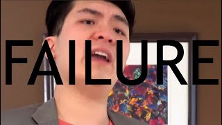
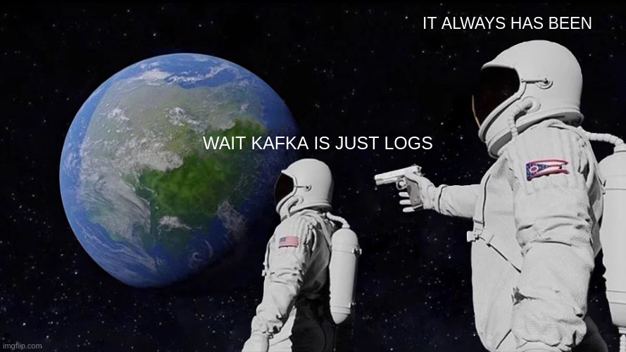

# Beyond the Happy Path: Failure Recovery with Go and Kafka

<div class="mt-6 text-lg opacity-80">Haseeb Majid · Go Labs</div>

---

## Introduction

- Haseeb Majid
  - Backend Software Engineer at [Nala](https://www.nala.com/)
  - <https://haseebmajid.dev>
- Loves cats 🐱
- Avid cricketer 🏏
- 🌱 Amateur Gardener

<!--
-->

---

<AgendaPreview variant="route" />

<!--
- One payout, four chapters
- Why events → Kafka + Go → failures → recovery
-->

---

<div class="diagram-explanation">

<RoughDiagram diagram="happy-path" :step="$clicks" talk />

<div class="explanation-captions" >
  <div v-click.fade-in="1" class="explanation-heading tone-teal" >1. Charge</div>
  <div v-click.fade-in="1" class="explanation-detail explanation-detail-spaced" >Collections charges the customer.</div>
  <div v-click.fade-in="2" class="explanation-heading tone-mauve" >2. Payout</div>
  <div v-click.fade-in="2" class="explanation-detail explanation-detail-spaced" >Disbursements requests the bank payout.</div>
  <div v-click.fade-in="3" class="explanation-heading tone-green" >3. Receipt</div>
  <div v-click.fade-in="3" class="explanation-detail" >Notifications sends the receipt.</div>
</div>

</div>

<!--
- Happy path

[click]
- Charge

[click]
- Payout; caller waits

[click]
- Receipt
- Coupling, timeouts, retry storms
-->

---
layout: statement
---

# 🎄 Holiday rush

Imagine 1,000 payouts waiting.

<!-- Source: https://giphy.com/gifs/cat-cute-Yvx5ejoI6JqzC -->


<!--
-->

---

<v-switch>
<template #0>

<div class="diagram-explanation">

<RoughDiagram diagram="slow-bank" :step="0" talk />

<div class="explanation-captions" >
  <div class="explanation-heading tone-blue" >Synchronous chain</div>
  <div class="explanation-detail" >More holiday payments. Every caller still waits on downstream work.</div>
</div>

</div>

</template>
<template #1>

<div class="diagram-explanation">

<RoughDiagram diagram="slow-bank" :step="1" talk />

<div class="explanation-captions" >
  <div class="explanation-heading tone-red" >1. Bank failure</div>
  <div class="explanation-detail" >The partner bank is slow or unavailable.</div>
</div>

</div>

</template>
<template #2>

<div class="diagram-explanation">

<RoughDiagram diagram="slow-bank" :step="2" talk />

<div class="explanation-captions" >
  <div class="explanation-heading tone-peach" >2. Timeouts</div>
  <div class="explanation-detail" >Waiting upstream calls time out. Downstream failure spreads through the chain.</div>
</div>

</div>

</template>
<template #3>

<div class="diagram-explanation">

<RoughDiagram diagram="slow-bank" :step="3" talk />

<div class="explanation-captions" >
  <div class="explanation-heading tone-peach" >3. Retry storm</div>
  <div class="explanation-detail" >Client retries add load and can repeat the same payment request.</div>
</div>

</div>

</template>
</v-switch>

<!--
- Illustrative counts
- Overlapping, not additive

[click]
- Timeout: outcome unknown
- Receipts wait

[click]
- Timeouts spread upstream

[click]
- Retry storm
- Duplicate-payment risk
-->

---



---

## Event-driven architecture

---
zoom: 0.8
---

<div class="diagram-explanation">

<RoughDiagram diagram="event-flow" :step="$clicks" talk />

<div v-show="$clicks < 4" class="explanation-captions" >
  <div v-click.fade-in="1" class="explanation-heading tone-teal" >1. Publish completion</div>
  <div v-click.fade-in="1" class="explanation-detail explanation-detail-spaced" >Collections publishes completion.</div>
  <div v-click.fade-in="2" class="explanation-heading tone-mauve" >2. Request payout</div>
  <div v-click.fade-in="2" class="explanation-detail explanation-detail-spaced" >Disbursements calls the bank.</div>
  <div v-click.fade-in="3" class="explanation-heading tone-green" >3. Send receipt</div>
  <div v-click.fade-in="3" class="explanation-detail" >Notifications sends the receipt.</div>
</div>

<div v-click="4" v-show="$clicks >= 4" class="explanation-captions" >
  <div class="explanation-heading tone-red" >4. Bank down</div>
  <div class="explanation-detail" >Collections keeps working. Payouts and receipts wait.</div>
</div>

</div>

<!--
- Decouple services

[click]
- Charge confirmed → publish

[click]
- Consume → bank payout

[click]
- Payout confirmed → receipt

[click]
- Bank down
- Collections continues
- Payout backlog
- Receipts wait
-->

---
class: go-audience
---


<style>
.go-audience h2 { font-size: 48px; text-align: center; }
</style>

<!--
- Quick show of hands: who knows Kafka?
-->

---

# Kafka Crash Course

<p class="slide-subtitle">without Otters 🦦</p>


---

<p v-click="1"><strong class="tone-yellow">Event</strong>: a <span class="marked-phrase" v-mark="{ at: 1, type: 'underline', color: '#f9e2af', padding: 2 }">fact</span> that happened in the past.</p>

<!--
[click]
- A fact that happened
-->

---
class: code-fit
---

<div class="code-focus code-reserve-tall" :style="{ '--focus-start': $clicks < 2 ? 1 : $clicks === 2 ? 2 : 6, '--focus-lines': $clicks < 3 ? 1 : 3 }">

````md magic-move {at:1, duration:500}
```go {2}
type Event struct {
    Payload       json.RawMessage `json:"payload"`
}
```
```go {2}
type Event struct {
    ID            uuid.UUID       `json:"id"`
    Payload       json.RawMessage `json:"payload"`
}
```
```go {3|7-9}
type Event struct {
    ID            uuid.UUID       `json:"id"`
    Type          string          `json:"type"`
    Payload       json.RawMessage `json:"payload"`
}

const (
    TypeCollectionCompleted = "collections.completed.v1"
)
```
````

</div>

<div v-click.fade-in="4" class="event-name-breakdown mt-4 text-center">
  <span class="inline-block" v-mark="{ at: 4, type: 'box', color: '#94e2d5', padding: 3 }">collections</span>.<span class="inline-block" v-mark="{ at: 4, type: 'underline', color: '#a6e3a1', padding: 2 }">completed</span>.<span class="inline-block" v-mark="{ at: 4, type: 'circle', color: '#b4befe', padding: 3 }">v1</span>
</div>


<!--
- Payload

[click]
- Stable event ID

[click]
- Type ≠ topic

[click]
- Named event type constant

[click]
- Domain · fact · version
-->

---
class: code-fit
---

```json
{
  "id": "92bf4e5a-3a1e-4d6f-8db8-1f7d865bd46a",
  "type": "collections.completed.v1",
  "source": "collections",
  "correlation_id": "collection-a",
  "time": "2026-06-01T10:30:00Z",
  "schema_version": 1,
  "payload": {
    "collection_id": "collection-42",
    "amount_minor": 10000,
    "currency": "GBP"
  }
}
```

<!--
- GBP 100; minor units
- Collection complete ≠ payout complete
-->

---
class: px-8 py-6 reveal-fade
---

<p v-click="1"><strong class="tone-peach">Topics</strong>: How <span class="marked-phrase" v-mark="{ at: 1, type: 'circle', color: '#fab387', padding: 3 }">events</span> are organised</p>


<!--
[click]
- collections topic
- Type ≠ topic
-->

---
class: diagram-preview-slide
---

<RoughDiagram diagram="topic-overview" :step="$clicks" talk />

<!--
- Same topic
- Different event types
-->

---
class: px-8 py-6 reveal-fade
---

<p v-click="1"><strong class="tone-teal">Producer</strong>: <span class="marked-phrase" v-mark="{ at: 1, type: 'circle', color: '#94e2d5', padding: 4 }">publishes</span> event to topic</p>

<p v-click="2"><strong class="tone-mauve">Consumer</strong>: <span class="marked-phrase" v-mark="{ at: 2, type: 'box', color: '#cba6f7', padding: 4 }">receives events</span> from a topic</p>


<!--
[click]
- Collections publishes

[click]
- Disbursements consumes
-->

---
class: diagram-preview-slide
clicks: 3
---

<RoughDiagram diagram="producer-consumer" :step="Math.min($clicks, 2)" talk />

<!-- Source: https://giphy.com/gifs/cat-food-pizza-mZWAgG8U4sXzW -->
= 3" class="consumer-cat" src="/consumer-cat.gif" alt="A hungry cat consuming pizza" />

<style>
.slidev-layout .consumer-cat { position: absolute; right: 90px; bottom: 24px; width: 220px; height: 140px; max-height: none; margin: 0; }
</style>

<!--
- Collections produces
- Disbursements consumes

[click]
- Publish to collections

[click]
- Consume
- Kafka keeps record

[click]
- Hungry consumer
-->

---

<div class="franz-intro">
<div class="franz-install">

```sh
go get github.com/twmb/franz-go
```

</div>


</div>

<style>
.franz-intro { display: grid; grid-template-columns: minmax(0, 7fr) minmax(0, 3fr); align-items: center; gap: 40px; }
.franz-install .shiki { font-size: 30px !important; }
</style>

<!--
- Kafka: broker
- franz-go: client
- kgo: Go package
-->

---
class: franz-reasons
clicks: 4
---

## Why franz-go?

<ul class="franz-main-reasons">
  <li v-click="1"><strong class="tone-teal">Pure Go</strong>: No CGO</li>
  <li v-click="2"><strong class="tone-mauve">Idiomatic API</strong>: contexts and errors</li>
  <li v-click="3"><strong class="tone-blue">Well Supported</strong>: KIPs Implemented</li>
</ul>

<div v-click="4" class="franz-extras">
  <strong style="display: block; color: #f9e2af;">Also useful</strong>
  <ul style="display: block;">
    <li>Manual commits</li>
    <li>Idempotent producer by default</li>
    <li>Prometheus / OpenTelemetry hooks</li>
  </ul>
</div>

<style>
.franz-reasons h2 { font-size: 56px; }
.franz-reasons .franz-main-reasons { font-size: 32px; line-height: 1.6; }
.franz-reasons .franz-extras {
  width: fit-content;
  margin-top: 28px;
  padding: 16px 28px;
  border: 1px solid #45475a;
  border-radius: 12px;
  background: #181825;
  text-align: left;
  font-size: 22px;
  line-height: 1.5;
}
.franz-reasons .slidev-vclick-hidden { transform: none; filter: none; }
</style>

<!--
- Why franz-go?

[click]
- Pure Go
- No C dependency

[click]
- Contexts
- Go errors

[click]
- Broad Kafka support

[click]
- Manual commits: opt in
- Idempotent producer ≠ bank deduplication
- Metrics: hooks/plugins
-->

---
class: code-lg
---


<div class="code-focus" :class="$clicks < 2 ? 'focus-start-2 focus-lines-1' : $clicks < 4 ? 'focus-start-1 focus-lines-3' : 'focus-start-4 focus-lines-1'">

````md magic-move {at:1, duration:500}
```go {all|3}
client, err := kgo.NewClient(
    kgo.SeedBrokers("localhost:9092"),
    kgo.DefaultProduceTopic("collections"),
)
if err != nil { return err }
defer client.Close()
```
```go {all|2-4|5}
err := client.ProduceSync(ctx, &kgo.Record{
    Topic: "collections",
    Key:   []byte(collection.ID.String()),
    Value: eventJSON,
}).FirstErr()
```
````

</div>

<!--
- franz-go client

[click]
- collections topic

[click]
- Publish

[click]
- Key
- Event
- ACK/error
-->

---
class: code-fit
---

<div class="code-focus" :style="{ '--focus-start': [2, 1, 6, 6, 0, 3, 6][Math.min($clicks, 6)], '--focus-lines': [1, 1, 4, 5, 1, 2, 5][Math.min($clicks, 6)] }">

````md magic-move {at:1, duration:500}
```go {3}
client, err := kgo.NewClient(
    kgo.SeedBrokers("localhost:9092"),
    kgo.ConsumeTopics("collections"),
)
if err != nil { return err }
defer client.Close()
```
```go {2|7-10}
for {
    fetches := client.PollFetches(ctx)
    if errs := fetches.Errors(); len(errs) > 0 {
        return errs[0].Err
    }
    for _, r := range fetches.Records() {
        var event Event
        if err := json.Unmarshal(r.Value, &event); err != nil {
            return err
        }
    }
}
```
```go {7-11}
for _, r := range fetches.Records() {
    var event Event
    if err := json.Unmarshal(r.Value, &event); err != nil {
        return err
    }

    switch event.Type {
    case TypeCollectionCompleted:
        if err := handleCollectionCompleted(ctx, r); err != nil {
            return err
        }
    }
}
```
```go {1|4-5|7-11}
func handleCollectionCompleted(
    ctx context.Context, r *kgo.Record,
) error {
    collection, err := decodeCollection(r.Value)
    if err != nil { return err }

    _, err = bank.CreatePayment(ctx, PaymentRequest{
        CollectionID: collection.ID,
        Amount:       collection.Amount,
    })
    return err
}
```
````

</div>

<!--
- Subscribe
- No group yet

[click]
- Poll

[click]
- Decode event

[click]
- Route by type

[click]
- Decode payload → request bank payout
- Return bank error to caller
- Happy path; idempotency and commits later
-->

---
class: diagram-preview-slide
clicks: 4
---

<RoughDiagram diagram="poll-batch" :step="$clicks" talk />

<!--
- Batch size varies

[click]
- Fetched together
- Originals stay

[click]
- Handle A

[click]
- Handle B

[click]
- Handle C
- Sequential loop ≠ global order
-->

---
class: px-8 py-6 reveal-fade
---

<p v-click="1"><strong class="tone-blue">Partition</strong>: an <span class="marked-phrase" v-mark="{ at: 1, type: 'underline', color: '#89b4fa', padding: 2 }">ordered</span>, append-only log within a topic.</p>


<!--
[click]
- Partition-local order
-->

---
class: diagram-compact
clicks: 7
---

<RoughDiagram diagram="partition-log" :step="$clicks" talk />


<!--
- Independent logs
- Illustrative assignment

[click]
- P0: offset 4

[click]
- P1: independent offset 4

[click]
- P2: offset 4; no global order

[click]
- P0: offset 5; earlier record stays

[click]
- P1: offset 5

[click]
- P2: offset 5

[click]
- Collection A: offsets 0, 2
- Same key → same partition
- Replay within retention
- Partition order, not topic-wide order.
-->

---
class: diagram-compact
---

<RoughDiagram diagram="partition-segments" :step="6" talk />

<!--
- Segment files
- 000.log closed → 001.log active
- Earlier records stay
-->

---



---
class: diagram-preview-slide
clicks: 1
---

<RoughDiagram diagram="broker-scaling" :step="$clicks" talk />

<!--
- Three partitions
- One broker’s resources

[click]
- Three brokers → parallel work
- Leaders shown; replicas omitted
- Reassign existing partitions
- Scaling ≠ linear
-->

---

<v-clicks at="1">

- <strong class="tone-sapphire">ISR (In-Sync Replicas)</strong>: replicas of a partition that are <span class="marked-phrase" v-mark="{ at: 1, type: 'underline', color: '#74c7ec', padding: 2 }">caught up</span> with its leader

</v-clicks>

<!--
[click]
- ISR includes leader
- Lagging followers leave
-->

---
class: diagram-preview-slide
clicks: 3
---

<RoughDiagram diagram="isr-overview" :step="$clicks" talk />

<!--
- Three replicas
- acks=all

[click]
- All ISR store → ACK

[click]
- B3 leaves ISR
- Writes continue

[click]
- B2 leaves ISR
- Below min ISR → reject
-->

---
class: code-fit
---

<div class="code-focus" :style="{ '--focus-start': [3, 3, 3, 0, 1, 4, 5, 6, 7][Math.min($clicks, 8)], '--focus-lines': $clicks === 0 ? 2 : 1 }">

````md magic-move {at:1, duration:500}
```go {4-5}
client, err := kgo.NewClient(
    kgo.SeedBrokers("localhost:9092"),
    kgo.DefaultProduceTopic("collections"),
    kgo.RequiredAcks(kgo.NoAck()), // acks=0
    kgo.DisableIdempotentWrite(),
)
if err != nil { return err }
defer client.Close()
```
```go {4}
client, err := kgo.NewClient(
    kgo.SeedBrokers("localhost:9092"),
    kgo.DefaultProduceTopic("collections"),
    kgo.RequiredAcks(kgo.LeaderAck()), // acks=1
    kgo.DisableIdempotentWrite(),
)
if err != nil { return err }
defer client.Close()
```
```go {4}
client, err := kgo.NewClient(
    kgo.SeedBrokers("localhost:9092"),
    kgo.DefaultProduceTopic("collections"),
    kgo.RequiredAcks(kgo.AllISRAcks()), // acks=all
)
if err != nil { return err }
defer client.Close()
```
```go {1|2|5|6|7|8}
admin := kadm.NewClient(client)
minISR := "2"

_, err = admin.CreateTopic(ctx,
    3, // partitions
    3, // replication factor
    map[string]*string{"min.insync.replicas": &minISR},
    "collections",
)
if err != nil { return err }
```
````

</div>

<!--
- NoAck: sent on wire; no broker reply
- NoAck and LeaderAck require disabling producer idempotency

[click]
- LeaderAck: leader writes; no wait for followers
- Leader failure before replication can lose acknowledged records

[click]
- All current ISR must acknowledge
- Remove DisableIdempotentWrite: restore default producer idempotency

[click]
- kadm admin client
- Three brokers
- RF=3; min ISR=2
- Below two → write errors
- Durability ≠ payment deduplication
-->

---
class: px-8 py-6 reveal-fade
---

<p v-click="1"><strong class="tone-lavender">Consumer Group</strong>: a set of consumers that <span class="marked-phrase" v-mark="{ at: 1, type: 'box', color: '#b4befe', padding: 3 }">share</span> a topic’s <span class="marked-phrase" v-mark="{ at: 1, type: 'highlight', color: 'rgba(180,190,254,0.25)', padding: 2 }">partitions</span>.</p>


<!--
[click]
- One owner per partition/group
-->

---
class: diagram-compact
clicks: 4
---

<RoughDiagram diagram="consumer-scaling" :step="$clicks" talk />

<!-- Source: https://giphy.com/gifs/cat-sad-TZBED1pP5m8N2 -->
<figure v-click="4" v-show="$clicks >= 4" class="idle-cat">
  
  <figcaption>No work for me…</figcaption>
</figure>

<style>
.slidev-layout .idle-cat { position: absolute; left: 47%; top: 70%; width: 180px; margin: 0; }
.slidev-layout .idle-cat img { width: 180px; height: 110px; margin: 0; }
.idle-cat figcaption { margin-top: 8px; font-family: 'Patrick Hand', cursive; font-size: 22px; color: #a6adc8; }
</style>

<!--
- One owner per partition/group
- One consumer; three partitions

[click]
- Consumer 2 → P1

[click]
- Consumer 3 → P2

[click]
- Consumer 4 idle; partition limit

[click]
- No work for Consumer 4
-->

---
clicks: 2
---

<div class="offset-board">
  <div class="offset-log">
    <strong class="offset-topic">collections · partition 0</strong>
    <span v-click="2" class="offset-log-end">log end = 5</span>
    <div v-click="2" class="offset-lag-selection"><span>Lag</span></div>
    <div class="offset-records">
      <div
        v-for="(event, offset) in ['created', 'completed', 'updated', 'completed', 'created']"
        :key="offset"
        class="offset-record"
        :class="{
          'is-disbursement': offset === 1,
          'is-reconciliation': offset === ($clicks >= 1 ? 4 : 3),
          'is-lag': $clicks >= 2 && offset >= 1,
        }"
      >
        <div class="offset-node" v-mark="{ at: true, type: 'box', color: 'var(--node-color)', padding: 0, strokeWidth: 2.5, animationDuration: 1 }">
          <strong>offset {{ offset }}</strong>
          <span>{{ event }}</span>
        </div>
      </div>
    </div>
  </div>
  <div class="offset-bookmark offset-bookmark-disbursements">
    <div class="offset-bookmark-tip"></div>
    <div class="offset-bookmark-stem"></div>
    <div class="offset-bookmark-label offset-node" v-mark="{ at: true, type: 'box', color: 'var(--bookmark-color)', padding: 0, strokeWidth: 2.5, animationDuration: 1 }">
      <strong>Disbursements</strong>
      <span>committed next = 1</span>
    </div>
  </div>
  <div
    v-motion
    :initial="{ x: 0 }"
    :enter="{ x: 0 }"
    :click-1="{ x: 220, transition: { duration: 550 } }"
    :click-2="{ x: 220 }"
    class="offset-bookmark offset-bookmark-reconciliation"
  >
    <div class="offset-bookmark-tip"></div>
    <div class="offset-bookmark-stem"></div>
    <div class="offset-bookmark-label offset-node" v-mark="{ at: true, type: 'box', color: 'var(--bookmark-color)', padding: 0, strokeWidth: 2.5, animationDuration: 1 }">
      <strong>Reconciliation</strong>
      <span>committed next = {{ $clicks >= 1 ? 4 : 3 }}</span>
    </div>
  </div>
</div>


<!--
- Offset = bookmark, not event ID
- Independent group checkpoints

[click]
- Reconciliation at 4
- Disbursements stuck
- Fetched ≠ committed

[click]
- Disbursements lag: 5 − 1 = 4
- Offsets 1–4 pending
-->

---
class: code-fit
---

<div class="code-focus focus-lines-3" :class="$clicks === 0 ? 'focus-start-1' : 'focus-start-5'">

````md magic-move {at:1, duration:500}
```go {2-4}
for _, r := range fetches.Records() {
    if err := handleCollectionCompleted(ctx, r); err != nil {
        return err
    }
}
```
```go {6-8}
for _, r := range fetches.Records() {
    if err := handleCollectionCompleted(ctx, r); err != nil {
        return err
    }

    if err := client.CommitRecords(ctx, r); err != nil {
        return err
    }
}
```
````

</div>

<!--
- Handle first
- Failure → stop

[click]
- Commit next offset
- Auto-commit off
- Commit failure → replay
-->

---

<div class="consumer-death-slide">
  <h1>What if a<br>consumer <span>dies?</span></h1>
  
</div>

<style>
.consumer-death-slide { display: grid; grid-template-columns: 1fr auto; align-items: center; gap: 64px; height: 100%; max-width: 1100px; margin: 0 auto; }
.consumer-death-slide h1 { margin: 0; font-size: 64px; line-height: 1.2; letter-spacing: -0.03em; }
.consumer-death-slide h1 span { color: #f38ba8; }
.consumer-death-slide img { display: block; height: 540px; width: auto; border-radius: 16px; box-shadow: 0 18px 48px rgba(0,0,0,.3); }
</style>

<!--
- GIF: ViralHog via Tenor https://tenor.com/view/playing-dead-pew-dramatic-finger-gun-cat-gif-13568033
-->

---
clicks: 3
---

<RoughDiagram diagram="consumer-failure" :step="$clicks" talk />

<!--
- One partition each
- A in flight
- Committed next: 42

[click]
- Consumer 1 dies; P0 waits

[click]
- P0 → Consumer 2
- P1/P2 unchanged

[click]
- Resume at 42
- A replayed
- Payment may exist
- Idempotency
-->

---
clicks: 3
---

<RoughDiagram diagram="bank-crash" :step="$clicks" talk />

<div class="explanation-captions" >
  <div class="explanation-heading"  :class="['tone-green', 'tone-red', 'tone-red', 'tone-green'][Math.min($clicks, 3)]">{{ ['Bank paid', '1. Crash before commit', '2. Replay without a key', '3. With a stable key'][Math.min($clicks, 3)] }}</div>
  <div class="explanation-detail" >{{ ['Payment succeeded. The offset is not committed yet.', 'Disbursements crashes. Kafka still has offset 42 as the next record to read.', 'After restart, Kafka delivers Collection A again. The bank pays twice.', 'Use the same key on the original call and replay. The bank returns the original result; then commit.'][Math.min($clicks, 3)] }}</div>
</div>

<!--
- Bank paid; commit pending

[click]
- Crash
- Restart at 42
- Replay A

[click]
- No bank-enforced key → paid twice

[click]
- Same bank key
- Original result returned
- Commit
- Prevent, not undo
-->

---


<!--
- Duplicate delivery is expected; duplicate side effects are not.
- Reuse the same bank idempotency key on the first attempt and every replay.
- Source: https://media.beehiiv.com/cdn-cgi/image/fit=scale-down,format=auto,onerror=redirect,quality=80/uploads/asset/file/a34ee0f8-2e26-4d34-a7bd-69effda29cd7/0123xcnkaljdfioquoer.jpg?t=1749255663
-->

---
class: diagram-compact
clicks: 3
---

<RoughDiagram diagram="rebalance-eager" :step="$clicks" talk />

<!--
- Round robin
- Two consumers
- Three partitions

[click]
- Consumer 3 joins

[click]
- Revoke all partitions; P0/P1/P2 pause

[click]
- P0 → Consumer 1
- P1 → Consumer 2
- P2 → Consumer 3
- Everyone paused first
-->

---
class: diagram-compact reveal-fade
clicks: 3
---

<RoughDiagram diagram="rebalance" :step="$clicks" talk />


<!--
- Same join
- Cooperative-sticky assignor
- Slow handlers can lose ownership

[click]
- Consumer 3 joins; assignments initially stay

[click]
- Release P2
- P0/P1 continue

[click]
- P2 → Consumer 3
- Fewer moves ≠ handler safety
-->

---
class: code-lg
---

<h2>{{ $clicks < 1 ? 'Eager · round robin' : 'Cooperative · sticky' }}</h2>

<div class="group-balancer-example code-focus focus-start-5 focus-lines-1">

````md magic-move {at:1, duration:500}
```go {6}
client, err := kgo.NewClient(
    kgo.SeedBrokers("localhost:9092"),
    kgo.ConsumerGroup("disbursements"),
    kgo.ConsumeTopics("collections"),
    kgo.DisableAutoCommit(),
    kgo.Balancers(kgo.RoundRobinBalancer()),
)
```
```go {6}
client, err := kgo.NewClient(
    kgo.SeedBrokers("localhost:9092"),
    kgo.ConsumerGroup("disbursements"),
    kgo.ConsumeTopics("collections"),
    kgo.DisableAutoCommit(),
    kgo.Balancers(kgo.CooperativeStickyBalancer()),
)
```
````

</div>

<!--
- Round robin: eager

[click]
- Cooperative sticky: fewer moves; default
-->


---
class: diagram-preview-slide
clicks: 5
---

<RoughDiagram diagram="shutdown-service" :step="$clicks" talk />

<!--
- Separate poll/work contexts
- Manual commits

[click]
- A processing; one record per poll
- B/C buffered inside client

[click]
- SIGTERM stops new work
- Current work keeps its own deadline

[click]
- A paid

[click]
- Commit next: 43
- B/C uncommitted

[click]
- Allow rebalance + close
- B/C remain uncommitted
- Work + commit + close within shutdown grace
-->

---
class: code-fit
---

```go {5-7,10}
client, err := kgo.NewClient(
    kgo.SeedBrokers("localhost:9092"),
    kgo.ConsumerGroup("disbursements"),
    kgo.ConsumeTopics("collections"),
    kgo.DisableAutoCommit(),
    kgo.BlockRebalanceOnPoll(),
    kgo.RebalanceTimeout(30*time.Second),
)
if err != nil { return err }
defer client.CloseAllowingRebalance()
```

<!--
- Finish work and commit before partitions move
- DisableAutoCommit: commit manually after successful handling
- BlockRebalanceOnPoll: delay reassignment until AllowRebalance
- RebalanceTimeout: 30s rebalance budget, not a bank-call timeout
- Keep processing + commit comfortably below 30s; aim for 10s
- Blocking too long can get this consumer removed
- Poll → process → commit → AllowRebalance → repeat
- CloseAllowingRebalance: unblock rebalancing and close on exit
- Finish processing and manual commits before closing
- This slide configures the client; the loop is elsewhere
- Still need idempotency: bank paid + crash before commit → replay
-->

---

## What if the bank stays down?


<!--
- Transient → retry
- Permanent → DLQ
- Timeout: outcome unknown
- Same bank key
- Buffering ≠ recovery
-->

---
class: diagram-compact
---

<div class="retry-overview">

<RoughDiagram diagram="retry" :step="$clicks" talk />

<div class="retry-captions">
  <div v-click.fade-in="1" class="retry-step retry-failure">
    <strong>1. Bank call fails</strong>
    <p>Payment unfinished.</p>
  </div>
  <div v-click.fade-in="2" class="retry-step retry-publish">
    <strong>2. Publish retry</strong>
    <p>Wait for acknowledgement.</p>
  </div>
  <div v-click.fade-in="3" class="retry-step retry-commit">
    <strong>3. Commit offset</strong>
    <p>Advance the original checkpoint.</p>
  </div>
  <div v-click.fade-in="4" class="retry-step retry-publish">
    <strong>4. Retry when due</strong>
    <p>A scheduler releases due events.</p>
  </div>
</div>

</div>

<!--
- Minimum delay: 5m
- Jitter: randomized due times
- Retention covers outage + catch-up

[click]
- Bank unavailable → handler fails

[click]
- Publish retry; wait for ack

[click]
- Ack → commit original

[click]
- Worker waits until due
- Same handler/IDs
- Retries can reorder
-->

---
class: diagram-preview-slide
clicks: 3
---

<AnimationSuggestion example="timeline" :step="$clicks" talk />

<!--
- Fail 10:00:00; due 10:05:00

[click]
- 10:02:30: worker waits
- Not Kafka

[click]
- 10:05:00: eligible

[click]
- Same handler/IDs
- Main consumer continues
-->

---
class: diagram-preview-slide
clicks: 6
---

<RoughDiagram diagram="unordered-retry" :step="$clicks" />

<!--
- Independent collections

[click]
- A fails

[click]
- Retry publish
- ACK → commit

[click]
- B handled

[click]
- C handled

[click]
- D handled

[click]
- A retry succeeds
- Same-key order next
-->

---
class: code-lg
---

## What travels with a retry?

```yaml {all|4|5-6|7-8|9|all}
topic: disbursements.retry.5m
key:   collection-a
headers:
  retry-count:     "2"
  original-topic:  collections
  original-offset: "1842"
  error:           "bank timeout after 30s"
  retry-at:        "2026-12-18T10:05:00Z"
  traceparent:     "00-4bf92f3577b34da6a3ce929d0e0e4736-00f067aa0ba902b7-01"
```

<!--
- Same key/value
- Headers change

[click]
- Retry count
- Attempt cap

[click]
- Original topic/offset
- Set once

[click]
- Error context
- Due time

[click]
- Trace across retries
-->

---
class: diagram-compact
clicks: 3
---

<RoughDiagram diagram="dlq" :step="$clicks" talk />

<!--
- Final retry: disbursements.retry.1h
- Earlier attempts exhausted

[click]
- Consume the one-hour retry; bank call still fails

[click]
- Publish to DLQ; wait for acknowledgement

[click]
- ACK → commit retry offset
- No more automatic retries
-->

---
class: diagram-preview-slide
clicks: 2
---

<DlqBackoffice :step="$clicks" />

<!--
- Inspect failure + original payload

[click]
- Fix first; bank recovered
- Confirm replay → retry.5m
- Same event ID + bank key
- Fresh retry budget

[click]
- Publish acknowledged + audit recorded
- Queued ≠ resolved
- Success → resolve
- Respect parked-key order
-->

---

## What about ordered retries?

---
class: diagram-preview-slide
clicks: 4
---

<h2 style="font-size: 42px; line-height: 1.15;">Compaction & tombstones</h2>

<CompactionLog :step="$clicks" />

<!-- Source: https://tenor.com/view/squeezed-into-a-bowl-viralhog-get-inside-the-bowl-if-i-fit-i-sit-flexible-gif-25084225 -->
= 4" class="compaction-cat" src="/compaction-cat.gif" alt="A cat squeezing itself into a small glass bowl" />

<style>
.slidev-layout .compaction-cat { position: absolute; right: 80px; top: 220px; width: 180px; height: 280px; max-height: none; margin: 0; }
</style>

<!--
- Latest value per key
- Redirect topic · Collection A
- Key: collection + event ID

[click]
- Created succeeds → append matching null (tombstone)
- Same key: collection-a:evt-1
- Null clears live state; no need to wait for compaction

[click]
- Background cleanup; not immediate
- Compaction removes old created entry; null stays
- Latest per event ID, not per collection
- Updated and completed still pending; offsets stay

[click]
- Created tombstone eventually expires
- Updated and completed still pending
- Rebuild state before tombstones expire

[click]
- Cat compaction

[Reference](https://docs.confluent.io/kafka/design/log_compaction.html)
-->

---
class: diagram-preview-slide
clicks: 8
---

<RoughDiagram diagram="ordered-retry" :step="$clicks" />

<!--
- Failed key waits
- Other keys flow

[click]
- A created fails

[click]
- Park in retry
- Add redirect

[click]
- A updated queues

[click]
- B handled

[click]
- A completed queues

[click]
- Created succeeds
- Clear redirect

[click]
- Updated succeeds
- Clear redirect

[click]
- Completed succeeds
- Last null → release A
-->

---
class: diagram-preview-slide
clicks: 4
---

<h2 style="font-size: 42px; line-height: 1.15;">Redirect state</h2>

<RoughDiagram diagram="redirect-compaction" :step="$clicks" />

<!--
- Restart loses local map

[click]
- Replay three pending IDs

[click]
- Created clears
- Two remain

[click]
- Updated clears
- Completed still pending

[click]
- Completed clears
- Release A
-->

---
layout: statement
---

# Need per-key order?

Redirect. Otherwise, plain retry.

---

## What if we lose the event?

<!--
- State saved, event lost?
- State + event: one transaction
-->

---
clicks: 3
---

<div class="retry-overview">

<RoughDiagram diagram="dual-write" :step="$clicks" talk />

<div class="retry-captions" style="grid-template-columns: repeat(2, minmax(0, 1fr));">
  <div v-click.fade-in="1" v-show="$clicks < 3" class="retry-step retry-commit">
    <strong>1. DB committed</strong>
    <p>Collection completion is saved.</p>
  </div>
  <div v-click.fade-in="2" v-show="$clicks < 3" class="retry-step retry-failure">
    <strong>2. Publication fails</strong>
    <p>Event not published.</p>
  </div>
  <div v-show="$clicks >= 3" class="retry-step retry-failure" style="grid-column: 1 / -1;">
    <strong>3. Publish first?</strong>
    <p>DB write fails → ghost event.</p>
    <p>Either order breaks.</p>
  </div>
</div>

</div>

<!--
- Two independent writes

[click]
- DB commits

[click]
- Kafka fails → missing event

[click]
- Publish first: ghost event
- Neither order safe
- Outbox
-->

---
class: diagram-compact
clicks: 7
---

<div class="outbox-heading">
  <h2>Transactional Outbox Pattern</h2>
  <!-- Source: https://giphy.com/gifs/maru-cat-jumping-wQI5H4jtqZEPK -->
  = 7" src="/outbox-cat-jump.gif" alt="Maru the cat jumping into a cardboard box" />
</div>

<RoughDiagram diagram="outbox" :step="$clicks" talk />

<p v-show="$clicks >= 5" style="font-size: 24px; margin: 0;">Alternative: crash after Kafka ACK, before delete commits.</p>

<style>
.slidev-layout .outbox-heading { display: flex; justify-content: space-between; align-items: center; height: 120px; flex-shrink: 0; }
.outbox-heading h2 { font-size: 40px; margin: 0; }
.outbox-heading img { width: 250px; height: 170px; max-height: none; margin: 0; }
</style>

<!--
- DB transaction
- Kafka outside it

[click]
- Update + outbox insert
- Both or neither

[click]
- Relay polls committed rows

[click]
- Publish → ACK

[click]
- Delete → DB commit
- Publish failure: keep row

[click]
- Crash after ACK
- Row still pending

[click]
- Republish same IDs
- Duplicates possible
- Idempotent consumer

[click]
- Cat in a box
-->

---
class: code-fit
---

<div class="code-focus" :style="{ '--focus-start': 0, '--focus-lines': 14, '--focus-mask': $clicks === 0 ? 'linear-gradient(to bottom, #000 0 1lh, transparent 1lh 2lh, #000 2lh 4lh, transparent 4lh 7lh, #000 7lh 9lh, transparent 9lh 13lh, #000 13lh 14lh)' : 'linear-gradient(to bottom, transparent 0 4lh, #000 4lh 5lh, transparent 5lh 9lh, #000 9lh 12lh, transparent 12lh)' }">

````md magic-move {at:1, duration:500}
```go {1,3-4,8-9,14|5,10-12}
err := pgx.BeginFunc(ctx, db, func(tx pgx.Tx) error {
    tag, err := tx.Exec(ctx,
        `UPDATE collections SET status='completed'
         WHERE id=$1`,
        collection.ID,
    )
    _, err = tx.Exec(ctx,
        `INSERT INTO outbox (topic, key, value)
         VALUES ($1, $2, $3)`,
        "collections",
        collection.ID.String(),
        collectionCompletedJSON,
    )
}
```
````

</div>

<!--
- Charge confirmed
- Update + insert together

[click]
- Update argument: collection ID
- Outbox arguments: topic, key, serialized event
-->

---
class: code-lg
---

<div class="code-focus focus-lines-1" :class="['focus-start-5', 'focus-start-1', 'focus-start-1', 'focus-start-2', 'focus-start-8'][Math.min($clicks, 4)]">

````md magic-move {at:1, duration:500}
```go
const pollOutbox = `
SELECT id, topic, key, value, headers
FROM outbox
ORDER BY created_at
LIMIT $1`
```
```go {2}
// Inside pgx.BeginFunc: errors roll back the transaction.
rows, err := tx.Query(ctx, pollOutbox, 100)
if err != nil {
    return err
}

messages, err := pgx.CollectRows(rows, scan)
if err != nil {
    return err
}
```
```go {2}
// For each message, inside the same transaction.
if err := publish(ctx, client, m); err != nil {
    return err
}
```
```go {3}
// After Kafka acknowledges this message.
if _, err := tx.Exec(ctx,
    `DELETE FROM outbox WHERE id=$1`, m.ID,
); err != nil {
    return err
}

// After the loop: return nil from the transaction callback.
return nil // BeginFunc commits
```
```go {9}
for {
    if err := drainBatch(ctx); err != nil {
        logErrs(err)
    }

    select {
    case <-ctx.Done():
        return ctx.Err()
    case <-time.After(time.Second):
    }
}
```
````

</div>

<!--
- Batch inside transaction
- SKIP LOCKED: separate rows

[click]
- Lock + read
- Error → rollback

[click]
- Publish → ACK
- Failure: keep row

[click]
- Delete → DB commit
- Crash gap → duplicate

[click]
- Poll delay
- Cancellation exits
- Relays can reorder
-->

---
layout: statement
---

# Is recovery working?

---
clicks: 3
---

<h2>{{ ['Consumer lag', 'Outbox age', 'Retry backlog', 'Unresolved DLQ'][Math.min($clicks, 3)] }}</h2>

<RoughDiagram diagram="metric-overview" :step="$clicks" talk />

<p class="slide-summary">{{ ['47 − 42 = 5 records behind.', 'Oldest unpublished row: 09:00 → 09:05 = 5 minutes.', '12 events waiting to retry.', '12 unresolved events need investigation.'][Math.min($clicks, 3)] }}</p>

<!--
- Illustrative metrics
- Lag: 47 − 42 = 5
- Includes in-flight work

[click]
- Outbox age: 5m
- Rising → relay trouble

[click]
- Backlog ≠ attempt count
- Watch due times/drain rate

[click]
- DLQ: unresolved work
- Inspect → fix → replay
-->

---
clicks: 4
---

<figure class="tempo-recovery">
  <div class="tempo-waterfall">
    <div class="tempo-pan" :style="{ transform: $clicks > 0 ? `translateY(${50 - 1.6 * [15, 69, 80.8125, 92.625][Math.min($clicks, 4) - 1]}%) scale(1.6)` : 'none' }">
    
    <div
      v-if="$clicks > 0"
      class="tempo-spotlight"
      aria-hidden="true"
      :style="{ top: ['8.25%', '62.25%', '75.75%', '85.875%'][Math.min($clicks, 4) - 1], height: ['13.5%', '13.5%', '10.125%', '13.5%'][Math.min($clicks, 4) - 1] }"
    ></div>
    </div>
    <div v-if="$clicks > 0" class="tempo-time-window" aria-hidden="true">
      <div class="tempo-pan" :style="{ transform: `translate(${[-768, -1340, -1488, -1488][Math.min($clicks, 4) - 1]}px, ${(50 - 1.6 * [15, 69, 80.8125, 92.625][Math.min($clicks, 4) - 1]) * 6.3}px) scale(1.6)` }">
        
        <div class="tempo-spotlight" :style="{ top: ['8.25%', '62.25%', '75.75%', '85.875%'][Math.min($clicks, 4) - 1], height: ['13.5%', '13.5%', '10.125%', '13.5%'][Math.min($clicks, 4) - 1] }"></div>
      </div>
    </div>
  </div>
</figure>

<style>
.tempo-recovery { width: 1200px; margin: 0; text-align: left; }
.tempo-recovery img { display: block; width: 1200px; height: 630px; max-width: 100%; max-height: none; margin: 0; object-fit: contain; box-shadow: none; }
.tempo-waterfall { position: relative; height: 630px; overflow: hidden; }
.tempo-pan { position: relative; width: 1200px; transform-origin: left top; transition: transform 400ms ease; }
/* Pan the time pane independently, keeping span names and their bars in view. */
.tempo-time-window { position: absolute; top: 0; bottom: 0; left: 64%; right: 0; overflow: hidden; background: #11111b; }
/* Bands and zoom centers match the rows in the fixed Tempo capture. */
.tempo-spotlight { position: absolute; left: 0; right: 0; border: 2px solid #89b4fa; box-shadow: 0 0 0 2000px rgba(17,17,27,.72); pointer-events: none; transition: top 250ms ease, height 250ms ease; }
@media (prefers-reduced-motion: reduce) { .tempo-pan, .tempo-spotlight { transition: none; } }
</style>

<!--
- One trace; same event ID + bank key
- Synthetic example; waits compressed

[click]
- Timeout → retry publish ACK → commit

[click]
- Final 1h retry → DLQ → commit

[click]
- Fix → approve replay → retry.5m

[click]
- Payment succeeds → commit → resolve
-->

---
class: code-fit kaf-inspection
---

## Inspect Kafka with `kaf`

<div class="code-focus" :style="{ '--focus-start': 0, '--focus-lines': $clicks === 2 ? 11 : 4, '--focus-mask': $clicks < 2 ? 'linear-gradient(to bottom, #000 0 1lh, transparent 1lh 2lh, #000 2lh 3lh, transparent 3lh)' : $clicks === 2 ? 'linear-gradient(to bottom, #000 0 1lh, transparent 1lh 9lh, #000 9lh 11lh)' : 'linear-gradient(#000, #000)' }">

````md magic-move {at:1, duration:500}
```console {1,3}
$ kaf topics
NAME            PARTITIONS   REPLICAS
collections     3            3
disbursements   3            3
```
```console {1,3}
$ kaf groups
NAME             STATE    CONSUMERS
disbursements    Stable   3
reconciliation   Stable   1
```
```console {1,10-11}
$ kaf group describe disbursements --no-members
Group ID:        disbursements
State:           Stable
Protocol:        cooperative-sticky
Protocol Type:   consumer
Offsets:
  collections:
    Partition  Group Offset  High Watermark  Lag  Metadata
    ---------  ------------  --------------  ---  --------
    0          42            47              5
    Total      42                            5
```
```console {1-4}
$ kaf consume collections -p 0 --offset 42 -l 1
Key:         collection-a
Partition:   0
Offset:      42
Timestamp:   2026-12-18 10:05:00 +0000 UTC
{
  "collection_id": "collection-a"
}
```
````

</div>

<style>
.kaf-inspection h2 { font-size: 36px; margin-bottom: 12px; }
</style>

<!--
- List topics
- Partitions and replicas
- Example output; shortened

[click]
- List consumer groups

[click]
- Inspect disbursements
- Partition 0: 47 − 42 = 5 behind

[click]
- Read one collections record
- Partition 0, offset 42
- No group offsets changed
-->

---

## Takeaways

<div class="takeaway-content">

- Idempotent consumers
- Retries and DLQ
- Order in partitions
- Monitor key metrics

<!-- Source: https://giphy.com/gifs/pizza-gif-cat-iESc3Uc5tqGRy -->


</div>

<style>
.slidev-layout .takeaway-content { display: grid; grid-template-columns: 1.6fr 1fr; gap: 40px; align-items: center; }
.takeaway-content img { width: 360px; height: 360px; margin: 0 auto; box-shadow: none; }
</style>

---

## Thanks!


<!--
-->

---


* Slides: <https://haseebmajid.dev/slides/go-labs-eda-go-kafka>
* Repo: <https://gitlab.com/hmajid2301/blog>

---

## Appendix

* [Gently Down the Stream](https://www.gentlydownthe.stream/) — Kafka, illustrated
* [Error Handling Patterns in Kafka](https://www.confluent.io/blog/error-handling-patterns-in-kafka/)
* [Several Event Types in One Kafka Topic](https://www.confluent.io/blog/put-several-event-types-kafka-topic/)
* [Kafka 101 — Confluent](https://www.youtube.com/watch?v=j4bqyAMMb7o&list=PLa7VYi0yPIH0KbnJQcMv5N9iW8HkZHztH)
* [franz-go](https://github.com/twmb/franz-go) — Go Kafka client
* [kaf](https://github.com/birdayz/kaf) — Kafka CLI
