# Building Resilient Event-Driven Architectures with Go and Kafka

<div class="mt-6 text-lg opacity-80">Haseeb Majid · Go Labs</div>


---

## Introduction

- Haseeb Majid
  - Backend Software Engineer at [Nala](https://www.nala.com/)
  - <https://haseebmajid.dev>
- Loves cats 🐱
- Avid cricketer 🏏 #BazBall

<!--
-->

---

## Why EDA?

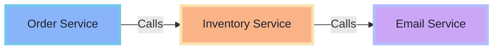

<!--
-->

---


<!--
-->

---
layout: two-cols-header
---

::left::

<div class="text-center text-2xl font-bold mb-2">HTTP</div>

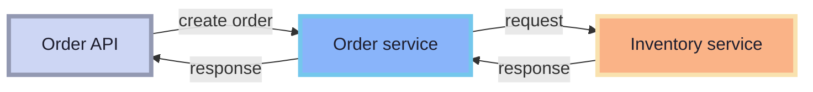

::right::

<div class="text-center text-2xl font-bold mb-2">Kafka</div>

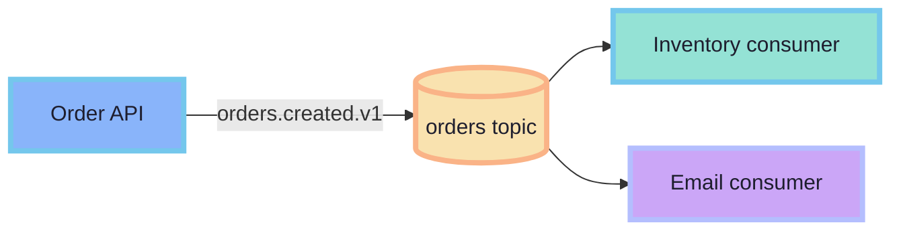

<!--
-->

---

## Kafka Basics

- Events: basic units of data
- Topics: events are organized into topics
- Partitions: allow us to scale topics

---

- Producer: publishes event to topic
- Consumer: subscribes to topic and receives events

<!--
Kafka is a distributed event-streaming platform. It stores events durably in topics, which are split into partitions for scale. Producers publish events; consumers read them. The name comes from writer Franz Kafka.
-->

---

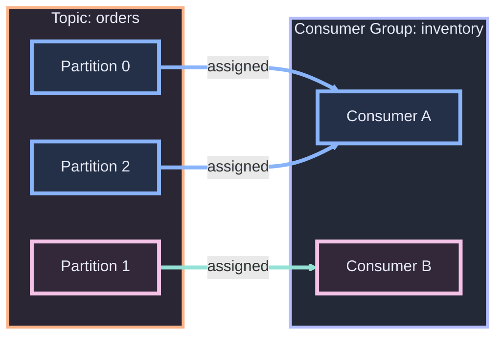

<!--
One consumer group splits the partitions. A partition is assigned to exactly one consumer in the group, but one consumer can handle multiple partitions.
-->

---

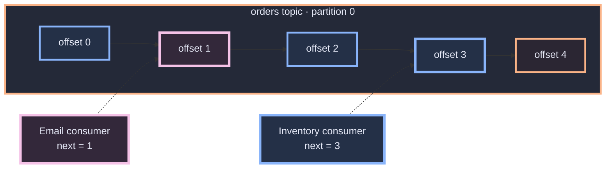

<!--
Each consumer group tracks its own committed offset. Inventory can be at offset 3 while email is still at offset 1. Kafka keeps the same log; each group records a different read position. Lag is unread events after that group's committed offset.
-->

---

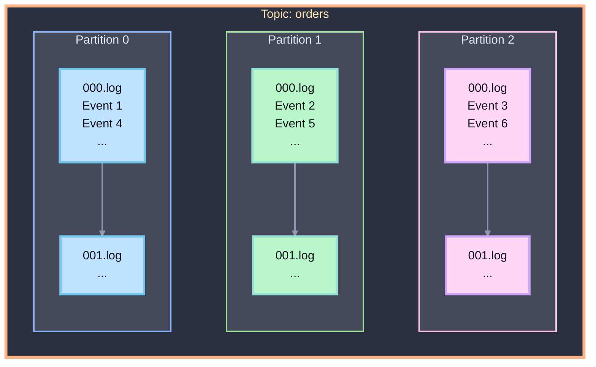


<!--
-->

---

## Delivery semantics

* At most once: may lose records, avoids duplicates
* At least once: retries records, duplicates are possible
* Exactly once: conditional on Kafka transactions

> Exactly-once Kafka delivery does not make external DB writes idempotent.

<!--
-->

---

# Kafka and Go

---

## One producer, many consumers

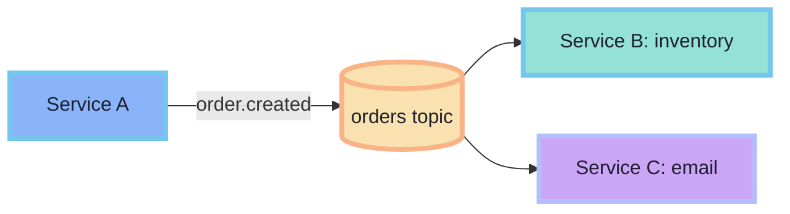

<!--
-->

---
class: code-lg
---

## Event envelope

```go {1-9|all}
type Event struct {
    ID            uuid.UUID       `json:"id"`
    Type          string          `json:"type"`
    Source        string          `json:"source"`
    CorrelationID string          `json:"correlation_id"`
    Time          time.Time       `json:"time"`
    SchemaVersion int             `json:"schema_version"`
    Payload       json.RawMessage `json:"payload"`
}

const (
    TypeOrderCreated    = "orders.created.v1"
    TypeInventoryDeduct = "orders.inventory-deducted.v1"
)
```

<!--
* Switch to Protobuf when you need smaller payloads and a schema registry.
* Payload as `json.RawMessage` / `[]byte` keeps the envelope format-agnostic.
-->

---

## Envelope vs payload

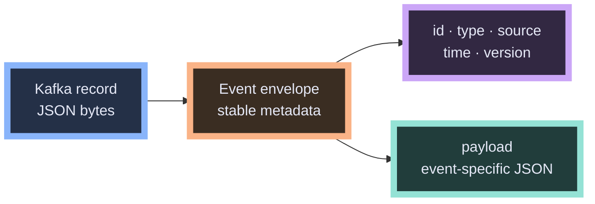

```json
{
  "type": "orders.created.v1",
  "payload": { "order_id": "ord_123", "total": 4200 }
}
```

<!--
* The envelope is the part every event shares.
* The payload is the part that changes depending on what happened.
* JSON is useful here because it is easy to inspect in logs, CLI tools, and demos.
* `json.RawMessage` delays decoding. First decode the envelope, then decode the payload after you know the event type.
* This avoids a giant Go struct containing fields for every possible event.
-->

---
class: code-lg
---

## Decode by event type

```go {1-5|7-10|12-16|all}
type OrderCreated struct {
    OrderID string `json:"order_id"`
    UserID  string `json:"user_id"`
    Total   int64  `json:"total"`
}

var e Event
if err := json.Unmarshal(data, &e); err != nil { return err }

switch e.Type {
case TypeOrderCreated:
    var p OrderCreated
    if err := json.Unmarshal(e.Payload, &p); err != nil { return err }
    return handleOrderCreated(e, p)
}
```

<!--
* Consumers should not guess the payload shape from field names.
* The `type` is the routing key inside the message: `orders.created.v1`, `orders.cancelled.v1`, `orders.shipped.v1`.
* The version suffix matters because events are long-lived contracts.
* Producers and consumers deploy independently. New consumers may replay old events; old consumers may see new messages.
* Adding optional fields is usually safe. Removing fields, renaming fields, or changing meaning is a breaking change.
* For breaking changes, publish a new event type such as `orders.created.v2` and let consumers migrate deliberately.
-->

---
class: code-lg
---

## franz-go: handle records

```go {1-5|7-12|13-16|all}
client, _ := kgo.NewClient(
    kgo.SeedBrokers("localhost:9092"),
    kgo.ConsumerGroup("inventory-service"),
    kgo.ConsumeTopics("orders"),
    kgo.DisableAutoCommit(),
)

fetches := client.PollFetches(ctx)
fetches.EachRecord(func(r *kgo.Record) {
    if err := handle(r.Value); err != nil {
        log.Printf("handle failed: %v", err)
        return // no commit; Kafka will redeliver
    }

    if err := client.CommitRecords(ctx, r); err != nil {
        log.Printf("commit failed: %v", err)
    }
})
```

<!--
* `r.Value` is the raw bytes from Kafka. In our case those bytes are the JSON event envelope.
* The `handle` function from the previous slide decodes the envelope, switches on `e.Type`, and decodes the payload into the right struct.
* Disable auto-commit when you want explicit at-least-once processing.
* Process the message first, then commit the offset.
* If `handle` fails, we return without committing. Kafka can deliver the record again later.
* If processing succeeds but commit fails, the message may be processed again. That is why idempotent consumers matter.
-->

---
class: code-lg
---

## Producer setup

```go {1-8|4|5|6-8|all}
client, err := kgo.NewClient(
    kgo.SeedBrokers("localhost:9092"),
    kgo.DefaultProduceTopic("orders"),
    kgo.RequiredAcks(kgo.AllISRAcks()),
    kgo.ProducerBatchCompression(kgo.ZstdCompression()),
    kgo.RetryBackoffFn(func(_ int) time.Duration {
        return 100 * time.Millisecond
    }),
)
if err != nil { return err }

defer func() {
    client.Flush(ctx) // flush pending records first
    client.Close()
}()
```

<!--
Required acknowledgements, retries, compression, and graceful shutdown are the important producer choices here.
-->

---
class: code-lg
---

## Consume and commit

```go {1-4|6-11|all}
client, _ := kgo.NewClient(
    kgo.ConsumerGroup("inventory-service"),
    kgo.ConsumeTopics("orders"),
    kgo.DisableAutoCommit(),
)

for {
    fetches := client.PollFetches(ctx)
    if errs := fetches.Errors(); len(errs) > 0 { logErrors(errs); continue }

    fetches.EachRecord(func(r *kgo.Record) {
        if err := handle(ctx, r); err != nil { return } // retry; do not commit
        if err := client.CommitRecords(ctx, []*kgo.Record{r}); err != nil {
            logErrors([]error{err})
        }
    })
}
```

<!--
At-least-once processing: handle the record first, then commit its offset.
-->

---

## Cooperative rebalancing

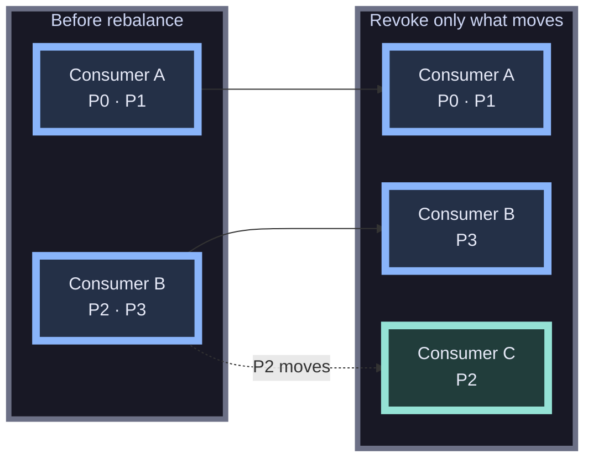

<!--
-->

---
class: diagram-compact
---

## Retry and DLQ topics

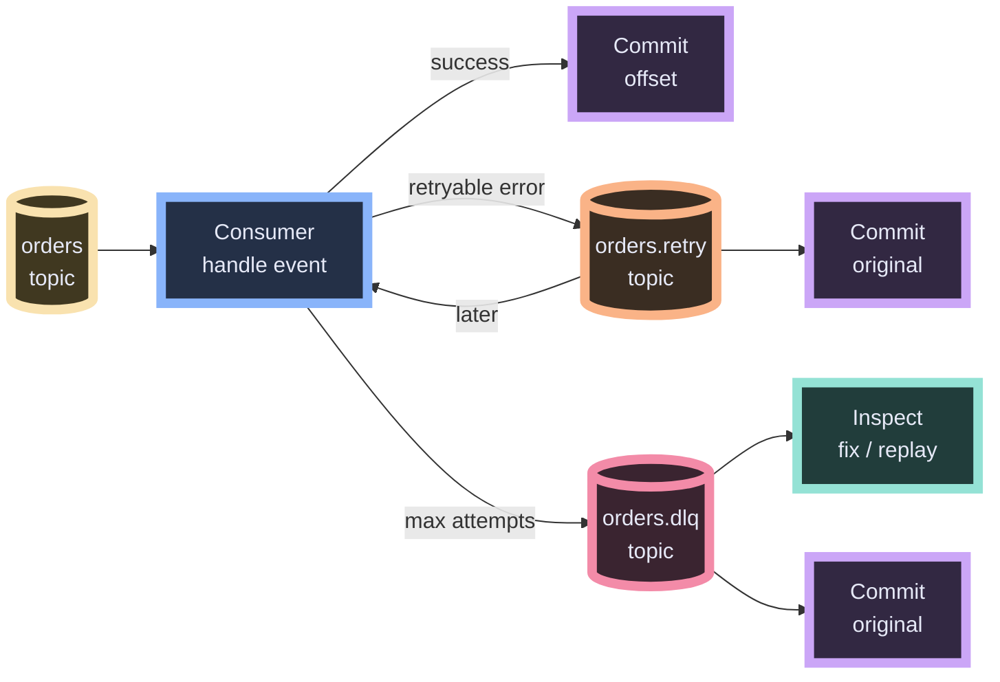

<!--
* This shows retries as topics, not just a loop inside one consumer.
* The normal path is `orders topic -> consumer -> commit`.
* On a retryable error, publish to `orders.retry`, then commit the original offset. That prevents one bad message from blocking the partition forever.
* Keep the main picture linear: normal topic, retry topic, DLQ topic.
* A retry worker can do the delay and send records back to the normal handler.
* After max attempts, publish to `orders.dlq` and commit the original offset.
* The DLQ is not the end of the story. It should be monitored, inspected, fixed, and sometimes replayed.
* If publishing to retry/DLQ fails, do not commit the original record. Otherwise the failure disappears.
-->

---
class: diagram-compact
---

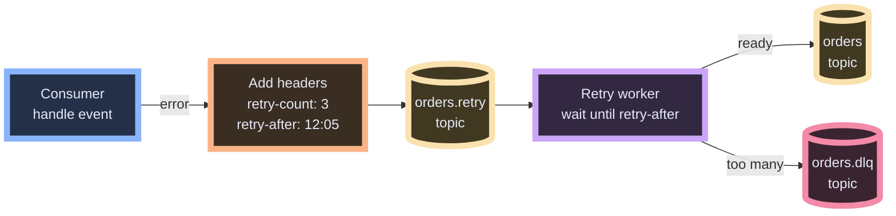

<!--
* The simple version can use a fixed delay. Exponential backoff just changes how we calculate the next `retry-after` timestamp.
* Example: attempt 1 waits 100ms, attempt 2 waits 200ms, attempt 3 waits 400ms, then cap at a max delay.
* Add jitter so all retries do not fire at the same time.
* The retry worker should not process messages before `retry-after`.
* If you keep one retry topic, the worker may need to requeue messages that are not ready yet.
* Another design is retry buckets: `orders.retry.1m`, `orders.retry.5m`, `orders.retry.30m`.
* The slide stays simple; the important idea is that the delay lives in metadata, not in the main consumer loop.
-->

---
class: code-fit
---

## Retry headers in code

```go {1-4|6-11|13-18|all}
attempt := retryCount(r) + 1
retryAt := time.Now().Add(backoff(attempt))
if attempt >= maxAttempts {
    return publishDLQ(ctx, client, r, handleErr)
}

headers := append(r.Headers,
    header("retry-count", strconv.Itoa(attempt)),
    header("retry-after", retryAt.Format(time.RFC3339)),
)

err := client.ProduceSync(ctx, &kgo.Record{
    Topic:   "orders.retry",
    Key:     r.Key,
    Value:   r.Value,
    Headers: headers,
}).FirstErr()
if err != nil { return err } // do not commit if retry publish failed
return client.CommitRecords(ctx, r)
```

<!--
-->

---

## Outbox

---

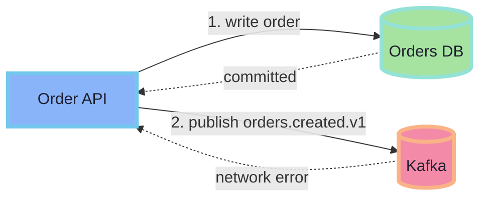


<!--
* Two independent writes: database commit + Kafka publish.
* If the publish fails, the database changed but the event is never sent.
* The outbox makes the event part of the same transaction as the state change.
-->
---

## Outbox pattern

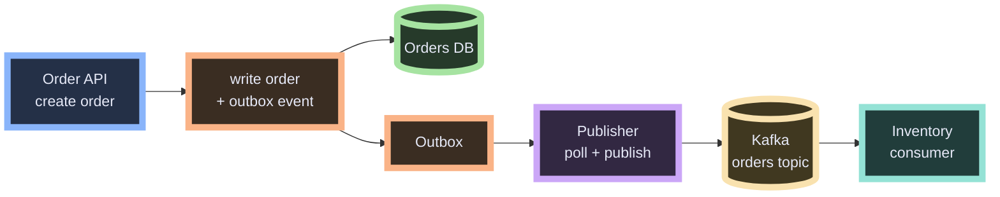

<!--
-->

---

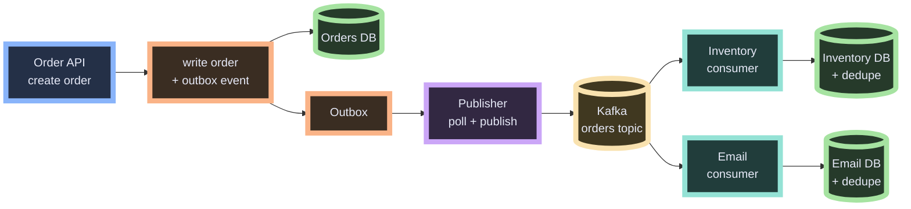


<!--
* Orders DB and outbox row commit together.
* Publisher retries until Kafka accepts event.
* Consumers process idempotently, then commit offsets.
-->

---
class: code-fit
---

## Outbox: atomic write

```sql
CREATE TABLE outbox (
    id         uuid PRIMARY KEY DEFAULT gen_random_uuid(),
    topic      text NOT NULL,
    key        text NOT NULL,
    value      jsonb NOT NULL,
    headers    jsonb,
    created_at timestamptz NOT NULL DEFAULT now()
);
```

```go {1-7|8-11|all}
err := db.BeginFunc(ctx, func(tx pgx.Tx) error {
    if _, err := tx.Exec(ctx,
        "INSERT INTO orders (id, total) VALUES ($1, $2)",
        order.ID, order.Total); err != nil { return err }

    _, err := tx.Exec(ctx,
        "INSERT INTO outbox (topic, key, value) VALUES ($1, $2, $3)",
        "orders", order.ID, orderJSON)
    return err
})
```

<!--
-->

---

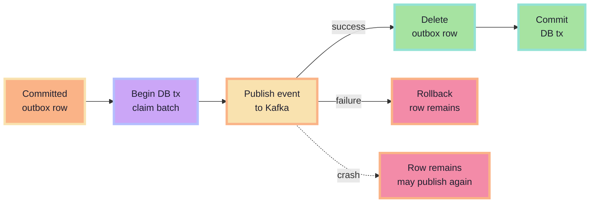

<!--
The forwarder drains durable outbox rows. It locks a batch, publishes each event, deletes successful rows, and commits. If Kafka fails, rollback leaves the row for retry. If the process crashes after Kafka accepts the event but before the delete commits, the row is published again. This is at-least-once delivery, so consumers need idempotency.
-->

---
class: code-fit
---

## Outbox: forwarder

```go {1-4|6-12|all}
const pollOutbox = `SELECT id, topic, key, value, headers
FROM outbox ORDER BY created_at
LIMIT $1 FOR UPDATE SKIP LOCKED`

for {
    tx, _ := db.Begin(ctx)
    rows, _ := tx.Query(ctx, pollOutbox, 100)
    for rows.Next() {
        m := scan(rows)
        if err := publish(ctx, client, m); err != nil { return err }
        tx.Exec(ctx, `DELETE FROM outbox WHERE id=$1`, m.ID)
    }
    tx.Commit(ctx)
}
```

<!--
-->

---

## Operate the system: four signals

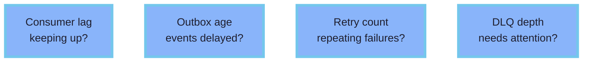

<!--
Consumer lag shows whether consumers keep up. Outbox age shows whether publishing is delayed. Retry count shows recurring downstream failures. DLQ depth and age show failures that need human action. These metrics turn delayed event failures into visible operational signals.
-->

---

## Where EDA bites

* Poison messages
* Out-of-order events
* Duplicate processing
* Schema drift

<!--
-->

---

## When not to use Kafka

- Simple request/response fits HTTP better.
- Low traffic?
  - Postgres (Watermill)

<!--
- Eventually consisten
- Harder to debug
- Postgres
-->

---

## Summary

* EDA can decouple services

<!--
-->

---

## Thanks!

* Slides: <https://haseebmajid.dev/slides/go-labs-eda-go-kafka>
* Repo: <https://gitlab.com/hmajid2301/blog>
* Questions?

<!--
-->
