# Beyond the Happy Path: Failure Recovery with Go and Kafka

<div class="mt-6 text-lg opacity-80">Haseeb Majid · Go Labs</div>

---

## Introduction

- Haseeb Majid
  - Backend Software Engineer at [Nala](https://www.nala.com/)
  - <https://haseebmajid.dev>
- Loves cats 🐱
- Avid cricketer 🏏
- 🌱 Amateur Gardener

<!--
-->

---

<div style="display: grid; grid-template-columns: minmax(0, 3fr) minmax(0, 2fr); align-items: center; gap: 32px;">

<v-switch>
<template #0>

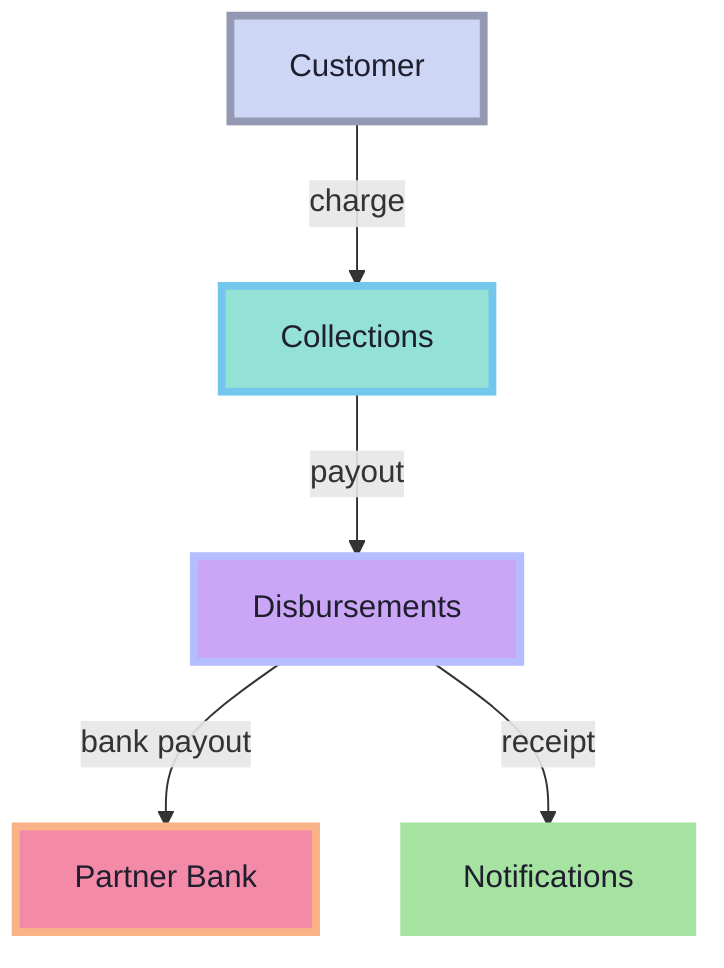

</template>
<template #1>


</template>
<template #2>


</template>
<template #3>


</template>
</v-switch>

<div class="transfer-captions" style="text-align: left; font-size: 24px; line-height: 1.4;">
  <div v-click.fade-in="1" class="transfer-step" style="font-size: 32px; font-weight: 700; color: #94e2d5;">1. Charge</div>
  <div v-click.fade-in="1" class="transfer-detail" style="margin: 8px 0 28px;">Collections charges the customer.</div>
  <div v-click.fade-in="2" class="transfer-step" style="font-size: 32px; font-weight: 700; color: #cba6f7;">2. Payout</div>
  <div v-click.fade-in="2" class="transfer-detail" style="margin: 8px 0 28px;">Disbursements requests the bank payout.</div>
  <div v-click.fade-in="3" class="transfer-step" style="font-size: 32px; font-weight: 700; color: #a6e3a1;">3. Receipt</div>
  <div v-click.fade-in="3" class="transfer-detail" style="margin-top: 8px;">Notifications sends the receipt.</div>
</div>

</div>

<!--
- Happy path: charge → payout → receipt.

[click]
- Collections charges the customer.

[click]
- Disbursements calls the bank; caller waits.

[click]
- Notifications sends the receipt.
- Direct calls: coupling, timeouts, retry storms.
-->

---
layout: statement
---

# 🎄 Holiday rush

More transfers. Same synchronous chain.

<!--
- Holiday rush: more transfers, same dependencies.
- What if the bank slows down or goes offline?
-->

---


---

<v-switch>
<template #0>

<div style="display: grid; grid-template-columns: minmax(0, 3fr) minmax(0, 2fr); align-items: center; gap: 32px;">

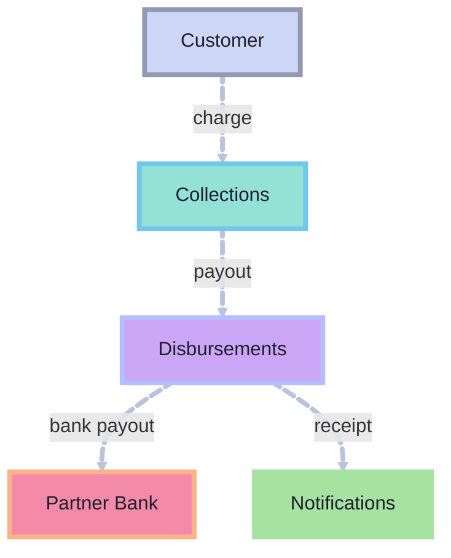

<div class="transfer-captions" style="text-align: left; font-size: 24px; line-height: 1.4;">
  <div class="transfer-step" style="font-size: 32px; font-weight: 700; color: #89b4fa;">Synchronous chain</div>
  <div class="transfer-detail" style="margin-top: 8px;">More holiday transfers. Every caller still waits on downstream work.</div>
</div>

</div>

</template>
<template #1>

<div style="display: grid; grid-template-columns: minmax(0, 3fr) minmax(0, 2fr); align-items: center; gap: 32px;">


<div class="transfer-captions" style="text-align: left; font-size: 24px; line-height: 1.4;">
  <div class="transfer-step" style="font-size: 32px; font-weight: 700; color: #f38ba8;">1. Bank failure</div>
  <div class="transfer-detail" style="margin-top: 8px;">The partner bank is slow or unavailable.</div>
</div>

</div>

</template>
<template #2>

<div style="display: grid; grid-template-columns: minmax(0, 3fr) minmax(0, 2fr); align-items: center; gap: 32px;">

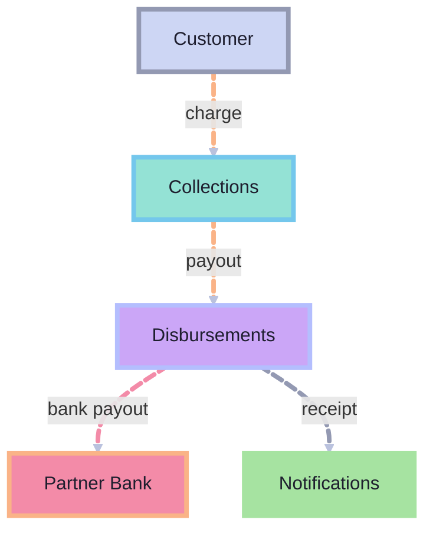

<div class="transfer-captions" style="text-align: left; font-size: 24px; line-height: 1.4;">
  <div class="transfer-step" style="font-size: 32px; font-weight: 700; color: #fab387;">2. Timeouts</div>
  <div class="transfer-detail" style="margin-top: 8px;">Waiting upstream calls time out. Downstream failure spreads through the chain.</div>
</div>

</div>

</template>
<template #3>

<div style="display: grid; grid-template-columns: minmax(0, 3fr) minmax(0, 2fr); align-items: center; gap: 32px;">


<div class="transfer-captions" style="text-align: left; font-size: 24px; line-height: 1.4;">
  <div class="transfer-step" style="font-size: 32px; font-weight: 700; color: #fab387;">3. Retry storm</div>
  <div class="transfer-detail" style="margin-top: 8px;">Client retries add load and can repeat the same payment request.</div>
</div>

</div>

</template>
</v-switch>

<!--
- What can fail? Bank, services, notifications.

[click]
- Bank timeout: payment outcome may be unknown.

[click]
- Downstream failure propagates to waiting callers.
- No confirmed payout → no receipt.

[click]
- Retries add load; payment requests can repeat.
- Need idempotency, not just retries.
-->

---

## Event-driven architecture

---
zoom: 0.8
---

<div style="display: grid; grid-template-columns: minmax(0, 3fr) minmax(0, 2fr); align-items: center; gap: 32px;">

<v-switch>
<template #0>


</template>
<template #1>


</template>
<template #2>


</template>
<template #3>

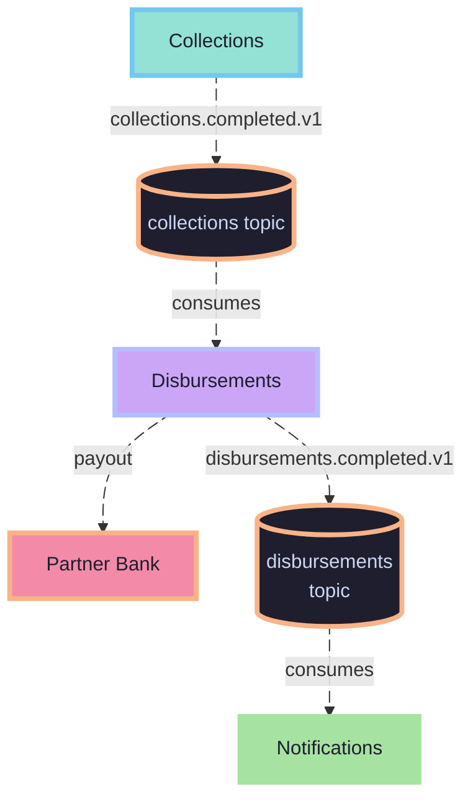

</template>
</v-switch>

<div class="transfer-captions" style="text-align: left; font-size: 24px; line-height: 1.4;">
  <div v-click.fade-in="1" class="transfer-step" style="font-size: 32px; font-weight: 700; color: #94e2d5;">1. Publish completion</div>
  <div v-click.fade-in="1" class="transfer-detail" style="margin: 8px 0 28px;">Collections emits collections.completed.v1.</div>
  <div v-click.fade-in="2" class="transfer-step" style="font-size: 32px; font-weight: 700; color: #cba6f7;">2. Request payout</div>
  <div v-click.fade-in="2" class="transfer-detail" style="margin: 8px 0 28px;">Disbursements consumes independently and calls the bank.</div>
  <div v-click.fade-in="3" class="transfer-step" style="font-size: 32px; font-weight: 700; color: #a6e3a1;">3. Send receipt</div>
  <div v-click.fade-in="3" class="transfer-detail" style="margin-top: 8px;">After confirmed payout, its completion event reaches Notifications.</div>
</div>

</div>

<!--
- Decouple services; Kafka buffers work, not infinite capacity.

[click]
- Confirmed charge → Collections publishes completion.
- No waiting for the bank; reliable publication comes later.

[click]
- Disbursements consumes independently → bank payout.
- Bank outage still needs retries and idempotency.

[click]
- Confirmed payout → disbursement event → receipt.
- Kafka has not fixed the bank.
-->

---

# Kafka Crash Course

<p class="slide-subtitle">without Otters 🦦</p>


---

<v-clicks at="1">

- <strong style="color: #f9e2af;">Events</strong>: basic units of data
- <strong style="color: #fab387;">Topics</strong>: <span style="display: inline-block; white-space: nowrap;" v-mark="{ at: 2, type: 'circle', color: '#fab387', padding: 3 }">events</span> are organized into topics
- <strong style="color: #89b4fa;">Partitions</strong>: allow us to <span style="display: inline-block; white-space: nowrap;" v-mark="{ at: 3, type: 'underline', color: '#89b4fa', padding: 2 }">scale topics</span>

</v-clicks>

<style>
.slidev-vclick-target {
  transition: opacity 220ms ease;
}
.slidev-vclick-hidden {
  transform: none;
  filter: none;
}
</style>

---

<v-clicks at="1">

- <strong style="color: #94e2d5;">Producer</strong>: <span style="display: inline-block; white-space: nowrap;" v-mark="{ at: 1, type: 'underline', color: '#94e2d5', padding: 2 }">publishes</span> event to topic
- <strong style="color: #cba6f7;">Consumer</strong>: subscribes to topic and <span style="display: inline-block; white-space: nowrap;" v-mark="{ at: 2, type: 'underline', color: '#cba6f7', padding: 2 }">receives events</span>
- <strong style="color: #b4befe;">Consumer Group</strong>: Usually multiple instances of the <span style="display: inline-block; white-space: nowrap;" v-mark="{ at: 3, type: 'box', color: '#b4befe', padding: 3 }">same service</span>, consuming events <span style="display: inline-block; white-space: nowrap;" v-mark="{ at: 3, type: 'highlight', color: 'rgba(180,190,254,0.25)', padding: 2 }">in parallel</span>

</v-clicks>

<style>
.slidev-vclick-target {
  transition: opacity 220ms ease;
}
.slidev-vclick-hidden {
  transform: none;
  filter: none;
}
</style>

<!--
- Kafka: durable event log.
- Topics → partitions for scale.
- Producers publish; consumer groups share work.
-->

---
class: code-fit
---

<div class="code-focus code-reserve-tall focus-lines-3" :class="$clicks >= 4 ? 'focus-start-10' : 'focus-start-6'">

````md magic-move {at:1, duration:500}
```go
type Event struct {
    Payload       json.RawMessage `json:"payload"`
}
```
```go
type Event struct {
    ID            uuid.UUID       `json:"id"`
    Payload       json.RawMessage `json:"payload"`
}
```
```go {7-9}
type Event struct {
    ID            uuid.UUID       `json:"id"`
    Type          string          `json:"type"`
    Payload       json.RawMessage `json:"payload"`
}

const (
    TypeCollectionCompleted = "collections.completed.v1"
)
```
```go {all|11-13}
type Event struct {
    ID            uuid.UUID       `json:"id"`
    Type          string          `json:"type"`
    Source        string          `json:"source"`
    CorrelationID string          `json:"correlation_id"`
    Time          time.Time       `json:"time"`
    SchemaVersion int             `json:"schema_version"`
    Payload       json.RawMessage `json:"payload"`
}

const (
    TypeCollectionCompleted = "collections.completed.v1"
)
```
````

</div>

<div v-click.fade-in="4" class="event-name-breakdown mt-4 text-center">
  <span class="inline-block" v-mark="{ at: 4, type: 'box', color: '#94e2d5', padding: 3 }">collections</span>.<span class="inline-block" v-mark="{ at: 4, type: 'underline', color: '#a6e3a1', padding: 2 }">completed</span>.<span class="inline-block" v-mark="{ at: 4, type: 'circle', color: '#b4befe', padding: 3 }">v1</span>
</div>

<style>
.event-name-breakdown {
  font-family: 'MonoLisa', monospace;
  font-size: 28px;
  line-height: 1.5;
  white-space: nowrap;
  transition: opacity 220ms ease;
}
.event-name-breakdown.slidev-vclick-hidden { transform: none; filter: none; }
</style>

<!--
- Envelope wraps the business payload.

[click]
- Stable event ID; preserve across retries and redelivery.

[click]
- Type describes the fact; topic is still collections.

[click]
- Source, time, schema version.
- Correlation ID = workflow; event ID = one event.

[click]
- collections = domain; completed = fact; v1 = contract version.
-->

---
class: code-fit
---

```json
{
  "id": "92bf4e5a-3a1e-4d6f-8db8-1f7d865bd46a",
  "type": "collections.completed.v1",
  "source": "collections",
  "correlation_id": "transfer-42",
  "time": "2026-06-01T10:30:00Z",
  "schema_version": 1,
  "payload": {
    "collection_id": "collection-42",
    "amount_minor": 10000,
    "currency": "GBP"
  }
}
```

<!--
- Confirmed collection: GBP 100.00; amount in minor units.
- Envelope = identity/tracing; payload = business data.
- Preserve event ID on retries; collection complete ≠ payout complete.
-->

---
class: diagram-compact
---

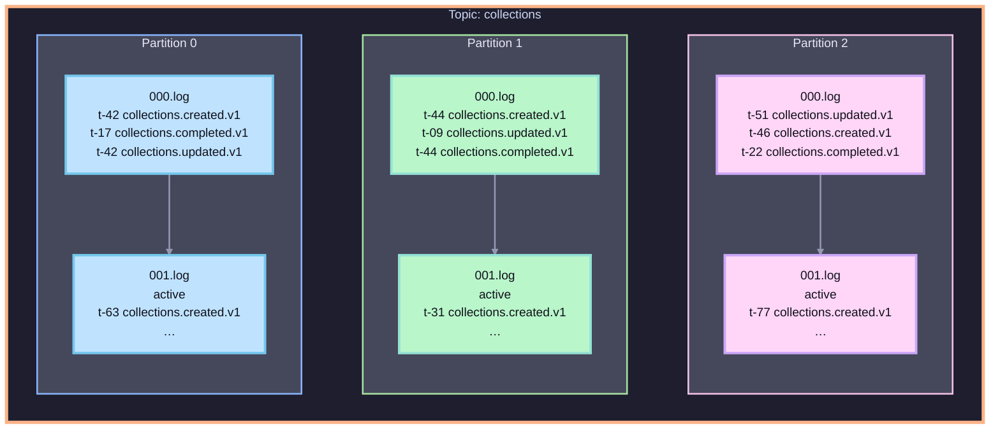


<!--
- Ordering is within a partition, not across the topic.
- Same collection key → same partition (with stable partitioning).
- **Append-only**: records are immutable, never edited
- **Retention**: by time or size — replay = reset the offset
- **Compacted topics**: keep the latest value per key
- Consumer DBs = **eventually consistent projections** of the log; replay rebuilds them
-->

---

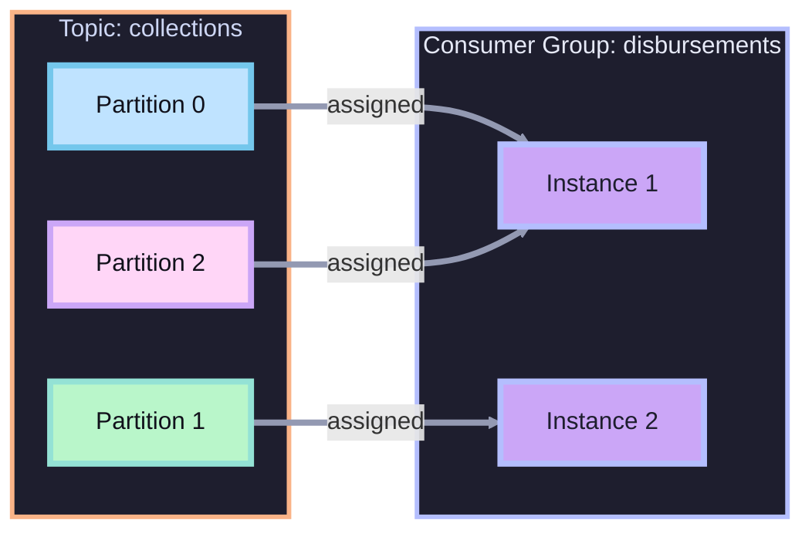

<!--
- One owner per partition, per group.
- One worker can own multiple partitions.
- Three partitions → at most three active workers here.
- Assignment ≠ exactly-once payout.
-->

---

<v-switch>
<template #0>

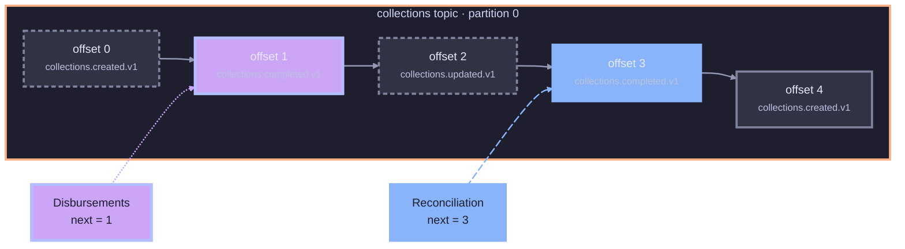

</template>
<template #1>

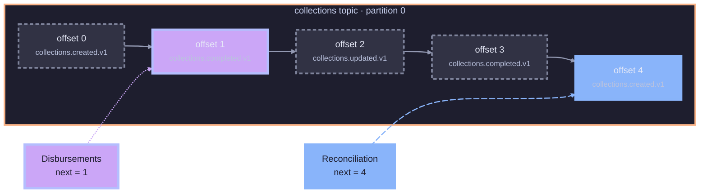

</template>
</v-switch>

<!--
- Offset = next-record bookmark, per group/partition; not event ID.
- Disbursements stuck at 1; Reconciliation at 3.

[click]
- Reconciliation processes 3 → commits 4; Disbursements still at 1.
- Lag = log end − committed; fetched ≠ committed.
- Consumer commit ≠ producer ack.
-->

---
class: code-lg
---

```bash {4}
kafka-topics.sh --create \
  --bootstrap-server localhost:9092 \
  --topic collections \
  --partitions 3 \
  --replication-factor 1
```

<!--
- Create topic explicitly: three partitions.
- Partitions = parallelism; replication = copies.
- RF 1: local demo only.
- --create does not resize; adding partitions can remap keys.
-->

---
class: code-lg
---

## Install the Kafka client

```bash
go get github.com/twmb/franz-go
```

---
class: code-lg
---


```go {none|3|7-11|all}{at:1}
client, err := kgo.NewClient(
    kgo.SeedBrokers("localhost:9092"),
    kgo.DefaultProduceTopic("collections"),
)
defer client.Close()

err := client.ProduceSync(ctx, &kgo.Record{
    Topic: "collections",
    Key:   []byte(collection.ID.String()),
    Value: eventJSON,
}).FirstErr()
```

<div v-click.fade-in="2" class="mt-4 text-xl">
  Collection ID → partition key · Event ID → deduplication
</div>

<!--
- Producer example; check client-construction errors.

[click]
- Topic: collections.

[click]
- Collection ID = partition key; related events share a partition.
- Ordering is per partition, not topic-wide.
- Event ID = deduplication; preserve across retries.

[click]
- ProduceSync waits; check FirstErr.
-->

---
class: code-fit
---

<div class="consumer-example code-focus" :class="$clicks === 0 ? 'focus-start-2 focus-lines-3' : $clicks === 1 ? 'focus-start-7 focus-lines-6' : 'focus-start-2 focus-lines-9'">

````md magic-move {at:1, duration:500}
```go {3-5}
client, err := kgo.NewClient(
    kgo.SeedBrokers("kafka:9092"),
    kgo.ConsumerGroup("disbursements"),
    kgo.ConsumeTopics("collections"),
    kgo.DisableAutoCommit(),
)
defer client.Close()
```

```go {8-13}
func consume(ctx context.Context, client *kgo.Client) error {
    defer client.Close()
    for {
        fetches := client.PollFetches(ctx)
        if errs := fetches.Errors(); len(errs) > 0 {
            return errs[0].Err
        }
        for _, r := range fetches.Records() {
            if err := handleCollectionCompleted(ctx, r); err != nil {
                return err // stop all processing
            }
            if err := client.CommitRecords(ctx, r); err != nil {
                return err
            }
        }
    }
}
```

```go {3-11}
func handleCollectionCompleted(ctx context.Context, r *kgo.Record) error {
    var event Event
    if err := json.Unmarshal(r.Value, &event); err != nil {
        return err
    }

    if event.Type != TypeCollectionCompleted {
        return nil // not an event this handler processes
    }

    return disburse(ctx, event.ID, event.Payload)
}
```
````

</div>

<!--
- Manual commits; restart resumes from committed offsets.

[click]
- Poll → handle → commit; check errors.
- Failure → stop/close; never commit past failed work.
- Restart can replay; no commit does not rewind live fetches.

[click]
- handleCollectionCompleted: decode → filter type → disburse.
- Invalid JSON or bank error → no commit; other types skipped here.
- Validate payload; bank-side idempotency uses stable event ID.
- Next: how Kafka replicates the log.
-->

---
class: diagram-compact
---

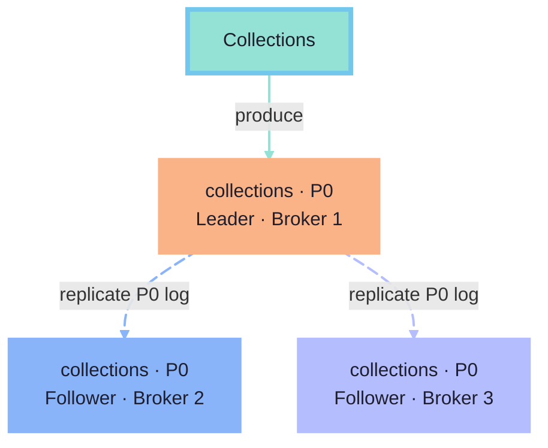

<!--
- RF 3: leader + two followers; same partition log.
- Producer writes to leader; followers replicate.
- Leader fails → eligible in-sync replica elected.
-->

---
class: code-lg
---

```go {4}
client, err := kgo.NewClient(
    kgo.SeedBrokers("localhost:9092"),
    kgo.DefaultProduceTopic("collections"),
    kgo.RequiredAcks(kgo.AllISRAcks()),
)
```

---

# Consumer goes down

---

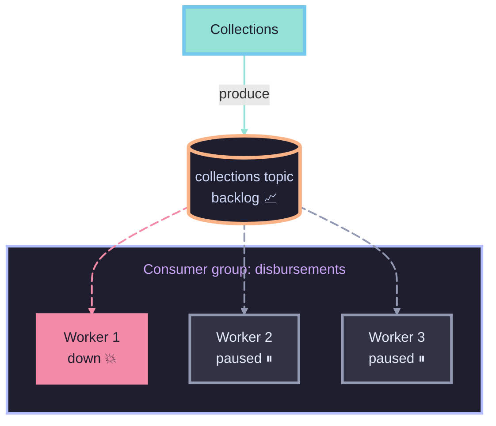

<!--
- Worker down → rebalance.
- Eager: revoke all; consumption pauses, backlog grows.
- Cooperative: only moving partitions pause.
-->

---

<v-switch :at="1">
<template #0>

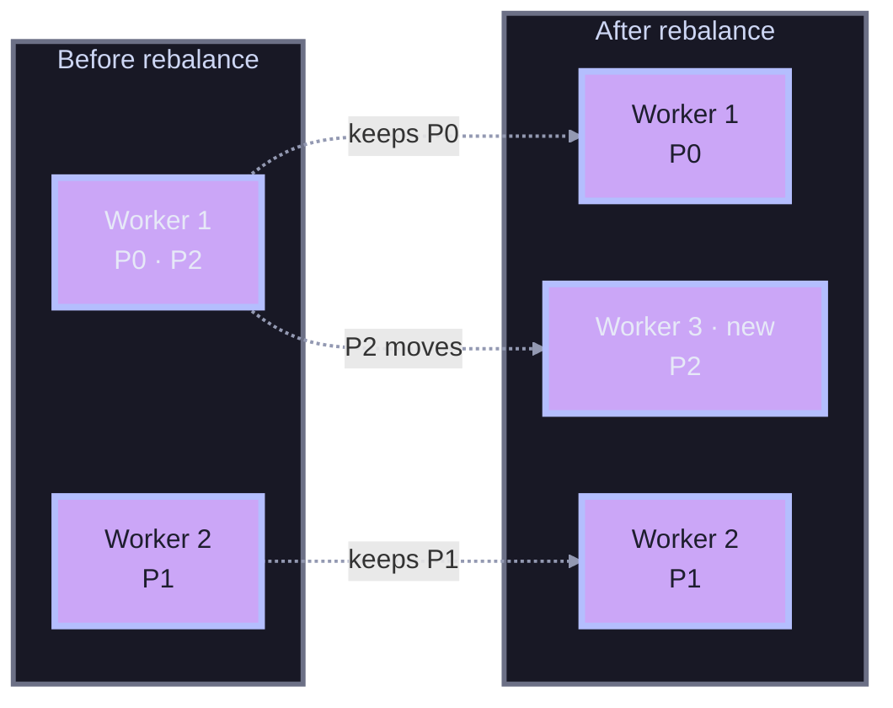

</template>
<template #1>

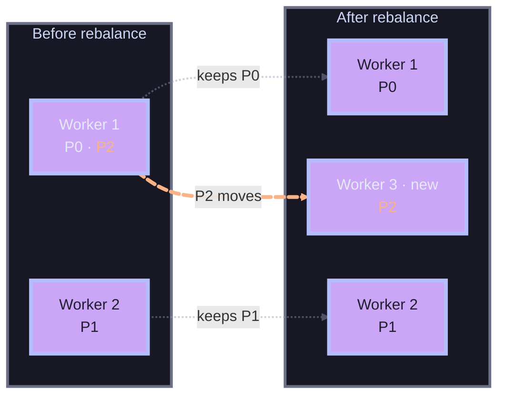

</template>
</v-switch>

<div v-click.fade-in="1" class="mt-4 text-2xl">
  <span style="display: inline-block; line-height: 1.2;" v-mark="{ at: 1, type: 'underline', color: '#fab387', padding: 2 }">P2 moves</span>; the other assignments stay
</div>

<style>
.slidev-vclick-target { transition: opacity 220ms ease; }
.slidev-vclick-hidden { transform: none; filter: none; }
</style>

<!--
- Same consumer group.

[click]
- Worker 3 joins; P2 moves from Worker 1.
- Old owner releases P2 first; P0/P1 unchanged.
-->

---
class: code-lg
---

<div class="group-balancer-example code-focus focus-start-5 focus-lines-1">

````md magic-move {at:1, duration:500}
```go {6}
client, err := kgo.NewClient(
    kgo.SeedBrokers("kafka:9092"),
    kgo.ConsumerGroup("disbursements"),
    kgo.ConsumeTopics("collections"),
    kgo.DisableAutoCommit(),
    kgo.Balancers(kgo.RoundRobinBalancer()),
)
```
```go {6}
client, err := kgo.NewClient(
    kgo.SeedBrokers("kafka:9092"),
    kgo.ConsumerGroup("disbursements"),
    kgo.ConsumeTopics("collections"),
    kgo.DisableAutoCommit(),
    kgo.Balancers(kgo.CooperativeStickyBalancer()),
)
```
````

</div>

<!--
- Balancer = consumer ownership, not producer partitioning.
- Round robin: eager revocation; equal counts ≠ equal load.

[click]
- Cooperative sticky: fewer moves; franz-go default.
- Eager migration: compatible strategies, two rolling deploys.
- Still need bank-side idempotency.
-->


---

## Delivery semantics

<v-clicks at="1">

* <strong style="color: #f9e2af;">At most once</strong>: possible loss, no duplicates
* <strong style="color: #fab387;">At least once</strong>: retries, possible duplicates
* <strong style="color: #89b4fa;">Exactly once</strong>: requires Kafka transactions

</v-clicks>

<div v-click.fade-in="3" style="font-size: 24px; margin-top: 28px; color: #bac2de;">
  <span style="display: inline-block;" v-mark="{ at: 3, type: 'box', color: '#fab387', padding: 4 }">Kafka transactions</span>
  do not make
  <span style="display: inline-block;" v-mark="{ at: 3, type: 'underline', color: '#f38ba8', padding: 2 }">bank payments</span> exactly once.
</div>

<style>
.slidev-vclick-target { transition: opacity 220ms ease; }
.slidev-vclick-hidden { transform: none; filter: none; }
</style>

<!--
- Kafka exactly-once ≠ exactly-once DB writes or bank payouts.
- External side effects still need idempotency.
-->

---
class: code-fit
---

```go {7-9,12-14}
func handleCollectionCompleted(ctx context.Context, r *kgo.Record) error {
    e := decodeEvent(r.Value)

    // already handled this event?
    var status string
    err := db.QueryRow(ctx,
        `SELECT status FROM processed_events WHERE event_id = $1`,
        e.ID,
    ).Scan(&status)
    if err != nil { return err }

    if status == "paid" {
        return nil // duplicate — skip
    }
```

---

## What if the bank stays down?

- **Retryable:** timeout or unavailable bank → backoff/retry.
- **Permanent:** invalid payload or unsupported schema/version → investigate or DLQ.

<!--
- Classify before routing; not every error deserves another attempt.
- Timeout may mean unknown outcome; retry with the same bank idempotency key.
- Unrelated event types can be ignored; unsupported contracts need a deliberate policy.
-->

---


<!--
- Bank still down; buffering ≠ recovery.
- Recoverable failures → backoff/retry; exhausted → DLQ.
-->

---
class: code-fit
---

```go {9-11}
func consume(ctx context.Context, client *kgo.Client) error {
    defer client.Close()
    for {
        fetches := client.PollFetches(ctx)
        if errs := fetches.Errors(); len(errs) > 0 {
            return errs[0].Err
        }
        for _, r := range fetches.Records() {
            if err := handleCollectionCompleted(ctx, r); err != nil {
                return err // stop all processing
            }
            if err := client.CommitRecords(ctx, r); err != nil {
                return err
            }
        }
    }
}
```

<!--
- Handler error → stop/close; no commit past failure.
- Restart/reassignment → replay from committed offsets.
- Return error ≠ scheduled retry.
- Fetch position ≠ committed checkpoint.
- Uncertain commit → possible replay; bank idempotency still needed.
-->

---
class: diagram-compact
---

<div class="retry-flow">

<v-switch :at="1">
<template #0>

```mermaid
flowchart TD
    ORD[("collections<br/>topic")] consume@--> CON["Disbursements"]
    CON publishRetry@--> RETRY[("disbursements<br/>.retry.5m")]
    CON commitOffset@--> ORD
    RETRY consumeDue@--> CON

    classDef topic fill:#1e1e2e,stroke:#fab387,stroke-width:4px,color:#cdd6f4;
    classDef disbursements fill:#cba6f7,stroke:#b4befe,stroke-width:4px,color:#1e1e2e;
    classDef retry fill:#1e1e2e,stroke:#f9e2af,stroke-width:4px,color:#cdd6f4;
    class ORD topic;
    class RETRY retry;
    class CON disbursements;
    linkStyle default stroke:#585b70,stroke-width:2px;
```

</template>
<template #1>

```mermaid
flowchart TD
    ORD[("collections<br/>topic")] consume@--> CON["Disbursements"]
    CON publishRetry@--> RETRY[("disbursements<br/>.retry.5m")]
    CON commitOffset@--> ORD
    RETRY consumeDue@--> CON

    classDef topic fill:#1e1e2e,stroke:#fab387,stroke-width:4px,color:#cdd6f4;
    classDef disbursements fill:#cba6f7,stroke:#b4befe,stroke-width:4px,color:#1e1e2e;
    classDef retry fill:#1e1e2e,stroke:#f9e2af,stroke-width:4px,color:#cdd6f4;
    class ORD topic;
    class RETRY retry;
    class CON disbursements;
    linkStyle default stroke:#585b70,stroke-width:2px;
    linkStyle 0 stroke:#f38ba8,stroke-width:5px;
```

</template>
<template #2>

```mermaid
flowchart TD
    ORD[("collections<br/>topic")] consume@--> CON["Disbursements"]
    CON publishRetry@--> RETRY[("disbursements<br/>.retry.5m")]
    CON commitOffset@--> ORD
    RETRY consumeDue@--> CON
    publishRetry@{ animation: slow }

    classDef topic fill:#1e1e2e,stroke:#fab387,stroke-width:4px,color:#cdd6f4;
    classDef disbursements fill:#cba6f7,stroke:#b4befe,stroke-width:4px,color:#1e1e2e;
    classDef retry fill:#1e1e2e,stroke:#f9e2af,stroke-width:4px,color:#cdd6f4;
    class ORD topic;
    class RETRY retry;
    class CON disbursements;
    linkStyle default stroke:#585b70,stroke-width:2px;
    linkStyle 1 stroke:#f9e2af,stroke-width:5px;
```

</template>
<template #3>

```mermaid
flowchart TD
    ORD[("collections<br/>topic")] consume@--> CON["Disbursements"]
    CON publishRetry@--> RETRY[("disbursements<br/>.retry.5m")]
    CON commitOffset@--> ORD
    RETRY consumeDue@--> CON

    classDef topic fill:#1e1e2e,stroke:#fab387,stroke-width:4px,color:#cdd6f4;
    classDef disbursements fill:#cba6f7,stroke:#b4befe,stroke-width:4px,color:#1e1e2e;
    classDef retry fill:#1e1e2e,stroke:#f9e2af,stroke-width:4px,color:#cdd6f4;
    class ORD topic;
    class RETRY retry;
    class CON disbursements;
    linkStyle default stroke:#585b70,stroke-width:2px;
    linkStyle 2 stroke:#a6e3a1,stroke-width:5px;
```

</template>
<template #4>

```mermaid
flowchart TD
    ORD[("collections<br/>topic")] consume@--> CON["Disbursements"]
    CON publishRetry@--> RETRY[("disbursements<br/>.retry.5m")]
    CON commitOffset@--> ORD
    RETRY consumeDue@--> CON
    consumeDue@{ animation: slow }

    classDef topic fill:#1e1e2e,stroke:#fab387,stroke-width:4px,color:#cdd6f4;
    classDef disbursements fill:#cba6f7,stroke:#b4befe,stroke-width:4px,color:#1e1e2e;
    classDef retry fill:#1e1e2e,stroke:#f9e2af,stroke-width:4px,color:#cdd6f4;
    class ORD topic;
    class RETRY retry;
    class CON disbursements;
    linkStyle default stroke:#585b70,stroke-width:2px;
    linkStyle 3 stroke:#f9e2af,stroke-width:5px;
```

</template>
</v-switch>

<div class="retry-captions">
  <div v-click.fade-in="1" class="retry-step retry-failure">
    <strong>1. Handling fails</strong>
    <p>The payment remains unfinished.</p>
  </div>
  <div v-click.fade-in="2" class="retry-step retry-publish">
    <strong>2. Publish retry</strong>
    <p>Wait for publication to succeed.</p>
  </div>
  <div v-click.fade-in="3" class="retry-step retry-commit">
    <strong>3. Commit original offset</strong>
    <p>Advance the group's collections checkpoint.</p>
  </div>
  <div v-click.fade-in="4" class="retry-step retry-publish">
    <strong>4. Retry when due</strong>
    <p>A scheduler gates the retry worker.</p>
  </div>
</div>

</div>

<!--
- Preserve failed work without hammering the bank.

[click]
- Handler fails; payment unfinished.

[click]
- Publish to retry bucket; first retry = .5m.
- Check publish result before moving on.

[click]
- Commit original offset only after retry publication succeeds.
- Publish fails → no commit.

[click]
- Scheduler enforces due-time; topic name adds no delay.
- Retry worker → same handler, collection key and event ID; not back to collections.
- Later events can overtake retries: independent collections may proceed; dependent steps must wait for prerequisites.
- Exhausted → publish DLQ, then commit; inspect/fix/replay.
-->

---
class: diagram-compact
---

<div class="retry-flow dlq-flow">

```mermaid
flowchart TD
    RETRY[("disbursements<br/>.retry.5m")] consumeRetry@--> CON["Disbursements"]
    CON publishDLQ@--> DLQ[("disbursements<br/>.dlq")]
    CON commitRetryOffset@--> RETRY
    publishDLQ@{ animation: slow }
    commitRetryOffset@{ animation: slow }

    classDef retry fill:#1e1e2e,stroke:#f9e2af,stroke-width:4px,color:#cdd6f4;
    classDef disbursements fill:#cba6f7,stroke:#b4befe,stroke-width:4px,color:#1e1e2e;
    classDef dlq fill:#1e1e2e,stroke:#f38ba8,stroke-width:4px,color:#cdd6f4;
    class RETRY retry;
    class CON disbursements;
    class DLQ dlq;
    linkStyle 0 stroke:#585b70,stroke-width:2px;
    linkStyle 1 stroke:#f38ba8,stroke-width:5px;
    linkStyle 2 stroke:#a6e3a1,stroke-width:5px;
```

<div class="retry-captions">
  <div class="retry-step retry-failure">
    <strong>1. Retries exhausted</strong>
    <p>The payment still fails; no attempts remain.</p>
  </div>
  <div class="retry-step retry-failure">
    <strong>2. Publish to DLQ</strong>
    <p>Preserve the event for investigation.</p>
  </div>
  <div class="retry-step retry-commit">
    <strong>3. Commit retry offset</strong>
    <p>Only after DLQ publication succeeds.</p>
  </div>
</div>

</div>

<!--
- Attempts exhausted → DLQ; preserve event ID.
- Confirm DLQ publication → commit retry-source offset.
- Publish fails → stop, no commit.
- Monitor → inspect → fix → replay safely.
-->

---
class: code-fit
---

````md magic-move {at:1, duration:500}
```go
if isPermanent(handleErr) {
    return publishDLQAndCommit(ctx, client, r, handleErr)
}

attempt := retryCount(r) + 1
if attempt >= maxAttempts {
    return publishDLQAndCommit(ctx, client, r, handleErr)
}
```
```go
// Replace the retry-count header.
headers := setHeader(r.Headers, "retry-count",
    strconv.Itoa(attempt))
topic := retryBucket(attempt) // first failure: 5m
err := client.ProduceSync(ctx, &kgo.Record{
    Topic:   topic,
    Key:     r.Key,
    Value:   r.Value,
    Headers: headers,
}).FirstErr()
```
```go
if err != nil { return err } // do not commit if retry publish failed
return client.CommitRecords(ctx, r)
```
````

<!--
- routeFailure: classify → attempt limit → retry headers → publish → commit.
- isPermanent: invalid payload/unsupported contract; helper implementation omitted.
- Permanent → DLQ now; timeout/unavailable bank → retry.
- Initial count 0; first bucket .5m; replace retry-count header.
- Preserve event/key; DLQ uses the same publish-before-commit rule.
- Routing/commit error → stop; scheduler must enforce due-time.
-->

---
class: code-fit
---

````md magic-move {at:1, duration:500}
```go
kgo.ConsumerGroup("disbursements-retry-worker"),
kgo.ConsumeTopics(
    "disbursements.retry.5m",
    "disbursements.retry.30m",
),
kgo.DisableAutoCommit(),
```
```go
if err := handleCollectionCompleted(ctx, r); err != nil {
    // routeFailure sends permanent errors directly to DLQ.
    return routeFailure(ctx, client, r, err)
}
return client.CommitRecords(ctx, r)
```
````

<!--
- Separate retry group; subscribe to all retry buckets.
- Enforce due-time → handleCollectionCompleted; stable ID, bank idempotency.
- Success → commit; permanent failure → DLQ; retryable failure → next bucket.
- Fetch/publish/commit error → stop; restart from committed offsets.
-->

---
class: code-lg
clicks: 0
---

```bash
kcat -b localhost:9092 -C -t disbursements.dlq \
  -o beginning -c 5
```

<div class="dlq-reminder">
  Inspect → fix → <span class="inline-block" v-mark="{ at: true, type: 'underline', color: '#f38ba8', padding: 2 }">replay deliberately</span>
</div>

<!--
- kcat: inspect a sample, not replay.
- Repair first; replay with stable IDs and bank idempotency.
-->

---

## What if we save the state but lose the event?

Transactional outbox

<!--
- State saved, event lost?
- State + outbox event in one DB transaction; relay publishes.
- Relay can duplicate; idempotency still needed.
-->

---

<div class="diagram-explanation">

<v-switch :at="1">
<template #0>

```mermaid
flowchart TD
    API["Collections"] save@--> DB[("Collections<br/>DB")]
    API publish@--> KAFKA[("Kafka")]
    DB committed@--> API
    KAFKA failed@--> API

    classDef collections fill:#94e2d5,stroke:#74c7ec,stroke-width:4px,color:#1e1e2e;
    classDef db fill:#a6e3a1,stroke:#94e2d5,stroke-width:4px,color:#1e1e2e;
    classDef kafkaBroker fill:#1e1e2e,stroke:#89b4fa,stroke-width:4px,color:#cdd6f4;
    class API collections;
    class DB db;
    class KAFKA kafkaBroker;
    linkStyle default stroke:#585b70,stroke-width:2px;
```

</template>
<template #1>

```mermaid
flowchart TD
    API["Collections"] save@--> DB[("Collections<br/>DB")]
    API publish@--> KAFKA[("Kafka")]
    DB committed@--> API
    KAFKA failed@--> API

    classDef collections fill:#94e2d5,stroke:#74c7ec,stroke-width:4px,color:#1e1e2e;
    classDef db fill:#a6e3a1,stroke:#94e2d5,stroke-width:4px,color:#1e1e2e;
    classDef kafkaBroker fill:#1e1e2e,stroke:#89b4fa,stroke-width:4px,color:#cdd6f4;
    class API collections;
    class DB db;
    class KAFKA kafkaBroker;
    linkStyle default stroke:#585b70,stroke-width:2px;
    linkStyle 0,2 stroke:#a6e3a1,stroke-width:5px;
    save@{ animation: slow }
    committed@{ animation: slow }
```

</template>
<template #2-4>

```mermaid
flowchart TD
    API["Collections"] save@--> DB[("Collections<br/>DB")]
    API publish@--> KAFKA[("Kafka")]
    DB committed@--> API
    KAFKA failed@--> API

    classDef collections fill:#94e2d5,stroke:#74c7ec,stroke-width:4px,color:#1e1e2e;
    classDef db fill:#a6e3a1,stroke:#94e2d5,stroke-width:4px,color:#1e1e2e;
    classDef kafkaBroker fill:#1e1e2e,stroke:#89b4fa,stroke-width:4px,color:#cdd6f4;
    class API collections;
    class DB db;
    class KAFKA kafkaBroker;
    linkStyle default stroke:#585b70,stroke-width:2px;
    linkStyle 1,3 stroke:#f38ba8,stroke-width:5px;
    publish@{ animation: slow }
    failed@{ animation: slow }
```

</template>
</v-switch>

<div class="retry-captions">
  <div v-click.fade-in="1" class="retry-step retry-commit">
    <strong>1. DB committed</strong>
    <p>Collection completion is saved.</p>
  </div>
  <div v-click.fade-in="2" class="retry-step retry-failure">
    <strong>2. Publication fails</strong>
    <p><span class="inline-block" v-mark="{ at: 3, type: 'underline', color: '#f38ba8', padding: 2 }">event not published</span></p>
  </div>
</div>

</div>

<!--
- Charge confirmed; DB and Kafka are separate writes.

[click]
- DB commits collection completion.

[click]
- Kafka publish fails; Disbursements never learns about it.

[click]
- Outbox closes the gap: state + event in one transaction.
-->
---
class: diagram-compact
---

<div class="diagram-explanation">

<v-switch :at="1">
<template #0>

```mermaid {scale: 0.8}
flowchart TD
    COL["Collections"] save@--> DB[("Collections<br/>DB")]
    DB poll@--> PUB["Outbox<br/>publisher"]
    PUB publish@--> T[("collections<br/>topic")]
    T consume@--> CON["Disbursements"]

    classDef collections fill:#94e2d5,stroke:#74c7ec,stroke-width:4px,color:#1e1e2e;
    classDef disbursements fill:#cba6f7,stroke:#b4befe,stroke-width:4px,color:#1e1e2e;
    classDef db fill:#a6e3a1,stroke:#94e2d5,stroke-width:4px,color:#1e1e2e;
    classDef infrastructure fill:#45475a,stroke:#9399b2,stroke-width:4px,color:#cdd6f4;
    classDef topic fill:#1e1e2e,stroke:#fab387,stroke-width:4px,color:#cdd6f4;
    class COL collections;
    class CON disbursements;
    class DB db;
    class PUB infrastructure;
    class T topic;
```

</template>
<template #1-3>

```mermaid {scale: 0.8}
flowchart TD
    COL["Collections"] save@--> DB[("Collections<br/>DB")]
    DB poll@--> PUB["Outbox<br/>publisher"]
    PUB publish@--> T[("collections<br/>topic")]
    T consume@--> CON["Disbursements"]
    save@{ animation: slow }
    poll@{ animation: slow }
    publish@{ animation: slow }
    consume@{ animation: slow }

    classDef collections fill:#94e2d5,stroke:#74c7ec,stroke-width:4px,color:#1e1e2e;
    classDef disbursements fill:#cba6f7,stroke:#b4befe,stroke-width:4px,color:#1e1e2e;
    classDef db fill:#a6e3a1,stroke:#94e2d5,stroke-width:4px,color:#1e1e2e;
    classDef infrastructure fill:#45475a,stroke:#9399b2,stroke-width:4px,color:#cdd6f4;
    classDef topic fill:#1e1e2e,stroke:#fab387,stroke-width:4px,color:#cdd6f4;
    class COL collections;
    class CON disbursements;
    class DB db;
    class PUB infrastructure;
    class T topic;
```

</template>
</v-switch>

<div class="retry-captions">
  <div v-click.fade-in="1" class="retry-step retry-commit">
    <strong>1. Save state + event</strong>
    <p><span class="inline-block" v-mark="{ at: 2, type: 'box', color: '#94e2d5', padding: 6 }">same DB transaction</span></p>
  </div>
  <div v-click.fade-in="1" class="retry-step retry-publish">
    <strong>2. Relay the event</strong>
    <p>Relay polls the outbox and publishes collections.completed.v1.</p>
  </div>
</div>

</div>

<!--
- Confirmed charge → completion state + event in one transaction.
- Outbox relay publishes; Disbursements consumes → bank payout.
-->

---
class: code-fit
---

````md magic-move {at:1, duration:500}
```sql
CREATE TABLE outbox (
    id         uuid PRIMARY KEY DEFAULT gen_random_uuid(),
    topic      text NOT NULL,
    key        text NOT NULL,
    value      jsonb NOT NULL,
    headers    jsonb,
    created_at timestamptz NOT NULL DEFAULT now()
);
```
```go
err := pgx.BeginFunc(ctx, db, func(tx pgx.Tx) error {
    tag, err := tx.Exec(ctx,
        `UPDATE collections SET status='completed'
         WHERE id=$1`,
        collection.ID,
    )
    if err != nil { return err }
    if tag.RowsAffected() != 1 {
        return errors.New("collection missing")
    }
```
```go
    _, err = tx.Exec(ctx,
        `INSERT INTO outbox (topic, key, value)
         VALUES ($1, $2, $3)`,
        "collections", collection.ID.String(), collectionCompletedJSON,
    )
    return err
})
if err != nil { return err }
```
````

<!--
- Charge already confirmed; existing collection.
- One pgx.BeginFunc: update state + insert event; commit/rollback together.
- Check affected rows; collection ID is the Kafka key, event ID stays in the envelope.
- External charge is outside this transaction; separate recovery needed.
-->

---

<div class="diagram-explanation">

<v-switch :at="1">
<template #0>

```mermaid {scale: 0.7}
flowchart TD
    DB[("Postgres<br/>outbox")] read@--> PUB["Outbox<br/>publisher"]
    PUB publish@--> T[("collections<br/>topic")]
    PUB commit@--> DB

    classDef outboxDb fill:#a6e3a1,stroke:#94e2d5,stroke-width:4px,color:#1e1e2e;
    classDef outboxPublisher fill:#94e2d5,stroke:#74c7ec,stroke-width:4px,color:#1e1e2e;
    classDef topic fill:#1e1e2e,stroke:#fab387,stroke-width:4px,color:#cdd6f4;
    class DB outboxDb;
    class PUB outboxPublisher;
    class T topic;
    linkStyle default stroke:#585b70,stroke-width:2px;
    linkStyle 0 stroke:#94e2d5,stroke-width:5px;
    linkStyle 1 stroke:#fab387,stroke-width:5px;
    linkStyle 2 stroke:#a6e3a1,stroke-width:5px;
```

</template>
<template #1>

```mermaid {scale: 0.7}
flowchart TD
    DB[("Postgres<br/>outbox")] read@--> PUB["Outbox<br/>publisher"]
    PUB publish@--> T[("collections<br/>topic")]
    PUB commit@--> DB
    read@{ animation: slow }
    publish@{ animation: slow }

    classDef outboxDb fill:#a6e3a1,stroke:#94e2d5,stroke-width:4px,color:#1e1e2e;
    classDef outboxPublisher fill:#94e2d5,stroke:#74c7ec,stroke-width:4px,color:#1e1e2e;
    classDef topic fill:#1e1e2e,stroke:#fab387,stroke-width:4px,color:#cdd6f4;
    class DB outboxDb;
    class PUB outboxPublisher;
    class T topic;
    linkStyle default stroke:#585b70,stroke-width:2px;
    linkStyle 0 stroke:#94e2d5,stroke-width:5px;
    linkStyle 1 stroke:#fab387,stroke-width:5px;
    linkStyle 2 stroke:#a6e3a1,stroke-width:5px;
```

</template>
<template #2>

```mermaid {scale: 0.7}
flowchart TD
    DB[("Postgres<br/>outbox")] read@--> PUB["Outbox<br/>publisher"]
    PUB publish@--> T[("collections<br/>topic")]
    PUB commit@--> DB
    commit@{ animation: slow }

    classDef outboxDb fill:#a6e3a1,stroke:#94e2d5,stroke-width:4px,color:#1e1e2e;
    classDef outboxPublisher fill:#94e2d5,stroke:#74c7ec,stroke-width:4px,color:#1e1e2e;
    classDef topic fill:#1e1e2e,stroke:#fab387,stroke-width:4px,color:#cdd6f4;
    class DB outboxDb;
    class PUB outboxPublisher;
    class T topic;
    linkStyle default stroke:#585b70,stroke-width:2px;
    linkStyle 0 stroke:#94e2d5,stroke-width:5px;
    linkStyle 1 stroke:#fab387,stroke-width:5px;
    linkStyle 2 stroke:#a6e3a1,stroke-width:5px;
```

</template>
<template #3>

```mermaid {scale: 0.7}
flowchart TD
    DB[("Postgres<br/>outbox")] read@--> PUB["Outbox<br/>publisher"]
    PUB publish@--> T[("collections<br/>topic")]
    PUB commit@--> DB
    read@{ animation: slow }

    classDef outboxDb fill:#a6e3a1,stroke:#94e2d5,stroke-width:4px,color:#1e1e2e;
    classDef outboxPublisher fill:#94e2d5,stroke:#74c7ec,stroke-width:4px,color:#1e1e2e;
    classDef topic fill:#1e1e2e,stroke:#fab387,stroke-width:4px,color:#cdd6f4;
    class DB outboxDb;
    class PUB outboxPublisher;
    class T topic;
    linkStyle default stroke:#585b70,stroke-width:2px;
    linkStyle 0 stroke:#f38ba8,stroke-width:5px;
    linkStyle 1 stroke:#fab387,stroke-width:5px;
    linkStyle 2 stroke:#a6e3a1,stroke-width:5px;
```

</template>
<template #4>

```mermaid {scale: 0.7}
flowchart TD
    DB[("Postgres<br/>outbox")] read@--> PUB["Outbox<br/>publisher"]
    PUB publish@--> T[("collections<br/>topic")]
    PUB commit@--> DB
    read@{ animation: slow }
    publish@{ animation: slow }

    classDef outboxDb fill:#a6e3a1,stroke:#94e2d5,stroke-width:4px,color:#1e1e2e;
    classDef outboxPublisher fill:#94e2d5,stroke:#74c7ec,stroke-width:4px,color:#1e1e2e;
    classDef topic fill:#1e1e2e,stroke:#fab387,stroke-width:4px,color:#cdd6f4;
    class DB outboxDb;
    class PUB outboxPublisher;
    class T topic;
    linkStyle default stroke:#585b70,stroke-width:2px;
    linkStyle 0 stroke:#f38ba8,stroke-width:5px;
    linkStyle 1 stroke:#fab387,stroke-width:5px;
    linkStyle 2 stroke:#a6e3a1,stroke-width:5px;
```

</template>
</v-switch>

<div class="retry-captions">
  <div v-click.fade-in="1" class="retry-step retry-publish">
    <strong>1. Publish</strong>
    <p>Relay polls durable outbox rows.</p>
  </div>
  <div v-click.fade-in="2" class="retry-step retry-commit">
    <strong>2. Delete + commit</strong>
    <p>Only after Kafka accepts the event.</p>
  </div>
  <div v-click.fade-in="3" class="retry-step retry-failure">
    <strong>3. Keep + retry</strong>
    <p>Publication fails → rollback; row stays.</p>
  </div>
  <div v-click.fade-in="4" class="retry-step retry-failure">
    <strong>4. Duplicate risk</strong>
    <p>Crash before delete commits → may publish twice.</p>
  </div>
</div>

</div>

<!--
- Durable outbox rows await publication.

[click]
- Lock batch → publish; check Kafka result.

[click]
- Delete published rows → commit Postgres.

[click]
- Failure before DB commit → rows remain for retry.

[click]
- Kafka accepted before crash → duplicate publication.
- At-least-once; consumers need idempotency.
-->

---
class: code-fit
---

````md magic-move {at:1, duration:500}
```go
const pollOutbox = `SELECT id, topic, key, value, headers
FROM outbox ORDER BY created_at
LIMIT $1 FOR UPDATE SKIP LOCKED`

func drainBatch(ctx context.Context) error {
    return pgx.BeginFunc(ctx, db, func(tx pgx.Tx) error {
        rows, err := tx.Query(ctx, pollOutbox, 100)
        if err != nil { return err }
        messages, err := pgx.CollectRows(rows, scan)
        if err != nil { return err }
```
```go
        for _, m := range messages {
            if err := publish(ctx, client, m); err != nil {
                return err
            }
            if _, err := tx.Exec(ctx,
                `DELETE FROM outbox WHERE id=$1`, m.ID,
            ); err != nil { return err }
        }
        return nil
    })
}
```
```go
for {
    if err := drainBatch(ctx); err != nil {
        logErrs(err)
    }
    select {
    case <-ctx.Done():
        return ctx.Err()
    case <-time.After(time.Second):
    }
}
```
````

<div class="mt-4 text-lg">
  Same key preserves Kafka append order, not business-event order; concurrent relays need per-collection sequencing if order matters.
</div>

<!--
- drainBatch: lock → collect/close rows → publish → delete → commit.
- SKIP LOCKED lets later events overtake earlier ones across relay workers.
- Wait for Kafka result; enqueue ≠ published.
- Error → rollback, retry; propagate commit errors too.
- Worker retries after 1s; investigate poison rows.
- Kafka accepted + DB rollback/crash → duplicate; preserve event IDs.
-->

---
class: diagram-compact
---

<div class="diagram-explanation">

<v-switch :at="1">
<template #0>

```mermaid {scale: 0.8}
flowchart TD
    OUTBOX[("Postgres<br/>outbox")] logged@--> WAL["Postgres WAL"]
    WAL decode@--> CDC["Debezium<br/>CDC"]
    CDC publish@--> KAFKA["Kafka"]

    classDef db fill:#a6e3a1,stroke:#94e2d5,stroke-width:4px,color:#1e1e2e;
    classDef wal fill:#f9e2af,stroke:#fab387,stroke-width:4px,color:#1e1e2e;
    classDef infrastructure fill:#45475a,stroke:#9399b2,stroke-width:4px,color:#cdd6f4;
    classDef kafkaBroker fill:#1e1e2e,stroke:#89b4fa,stroke-width:4px,color:#cdd6f4;
    class OUTBOX db;
    class WAL wal;
    class CDC infrastructure;
    class KAFKA kafkaBroker;
    linkStyle default stroke:#585b70,stroke-width:2px;
    linkStyle 0 stroke:#a6e3a1,stroke-width:5px;
    linkStyle 1 stroke:#f9e2af,stroke-width:5px;
    linkStyle 2 stroke:#89b4fa,stroke-width:5px;
```

</template>
<template #1>

```mermaid {scale: 0.8}
flowchart TD
    OUTBOX[("Postgres<br/>outbox")] logged@--> WAL["Postgres WAL"]
    WAL decode@--> CDC["Debezium<br/>CDC"]
    CDC publish@--> KAFKA["Kafka"]
    logged@{ animation: slow }

    classDef db fill:#a6e3a1,stroke:#94e2d5,stroke-width:4px,color:#1e1e2e;
    classDef wal fill:#f9e2af,stroke:#fab387,stroke-width:4px,color:#1e1e2e;
    classDef infrastructure fill:#45475a,stroke:#9399b2,stroke-width:4px,color:#cdd6f4;
    classDef kafkaBroker fill:#1e1e2e,stroke:#89b4fa,stroke-width:4px,color:#cdd6f4;
    class OUTBOX db;
    class WAL wal;
    class CDC infrastructure;
    class KAFKA kafkaBroker;
    linkStyle default stroke:#585b70,stroke-width:2px;
    linkStyle 0 stroke:#a6e3a1,stroke-width:5px;
    linkStyle 1 stroke:#f9e2af,stroke-width:5px;
    linkStyle 2 stroke:#89b4fa,stroke-width:5px;
```

</template>
<template #2>

```mermaid {scale: 0.8}
flowchart TD
    OUTBOX[("Postgres<br/>outbox")] logged@--> WAL["Postgres WAL"]
    WAL decode@--> CDC["Debezium<br/>CDC"]
    CDC publish@--> KAFKA["Kafka"]
    decode@{ animation: slow }

    classDef db fill:#a6e3a1,stroke:#94e2d5,stroke-width:4px,color:#1e1e2e;
    classDef wal fill:#f9e2af,stroke:#fab387,stroke-width:4px,color:#1e1e2e;
    classDef infrastructure fill:#45475a,stroke:#9399b2,stroke-width:4px,color:#cdd6f4;
    classDef kafkaBroker fill:#1e1e2e,stroke:#89b4fa,stroke-width:4px,color:#cdd6f4;
    class OUTBOX db;
    class WAL wal;
    class CDC infrastructure;
    class KAFKA kafkaBroker;
    linkStyle default stroke:#585b70,stroke-width:2px;
    linkStyle 0 stroke:#a6e3a1,stroke-width:5px;
    linkStyle 1 stroke:#f9e2af,stroke-width:5px;
    linkStyle 2 stroke:#89b4fa,stroke-width:5px;
```

</template>
<template #3>

```mermaid {scale: 0.8}
flowchart TD
    OUTBOX[("Postgres<br/>outbox")] logged@--> WAL["Postgres WAL"]
    WAL decode@--> CDC["Debezium<br/>CDC"]
    CDC publish@--> KAFKA["Kafka"]
    publish@{ animation: slow }

    classDef db fill:#a6e3a1,stroke:#94e2d5,stroke-width:4px,color:#1e1e2e;
    classDef wal fill:#f9e2af,stroke:#fab387,stroke-width:4px,color:#1e1e2e;
    classDef infrastructure fill:#45475a,stroke:#9399b2,stroke-width:4px,color:#cdd6f4;
    classDef kafkaBroker fill:#1e1e2e,stroke:#89b4fa,stroke-width:4px,color:#cdd6f4;
    class OUTBOX db;
    class WAL wal;
    class CDC infrastructure;
    class KAFKA kafkaBroker;
    linkStyle default stroke:#585b70,stroke-width:2px;
    linkStyle 0 stroke:#a6e3a1,stroke-width:5px;
    linkStyle 1 stroke:#f9e2af,stroke-width:5px;
    linkStyle 2 stroke:#89b4fa,stroke-width:5px;
```

</template>
</v-switch>

<div class="retry-captions">
  <div v-click.fade-in="1" class="retry-step retry-commit">
    <strong>1. Commit event</strong>
    <p>Outbox insert enters the Postgres WAL.</p>
  </div>
  <div v-click.fade-in="2" class="retry-step retry-yellow">
    <strong>2. Decode WAL</strong>
    <p>Debezium reads committed changes via logical replication.</p>
  </div>
  <div v-click.fade-in="3" class="retry-step retry-blue">
    <strong>3. Publish to Kafka</strong>
    <p>CDC can redeliver; consumers must be idempotent.</p>
  </div>
</div>

</div>

<!--
- CDC instead of polling: committed outbox → WAL → Debezium → Kafka.
- Outbox Event Router maps inserts to domain events.
- wal_level=logical; publication, slot, permissions.
- Watch slot lag/retained WAL: stalled connector can fill disk.
- Same state/outbox transaction; redelivery still needs idempotency.
-->

---

<div class="metric-reveals">
  <div class="metric-row metric-lag">
    <div class="metric-label">Consumer lag</div>
    <div class="retry-step">
      <strong>1. Consumer lag</strong>
      <p>Rising lag: inspect throughput.</p>
    </div>
  </div>
  <div v-click.fade-in="1" class="metric-row metric-age">
    <div class="metric-label">Outbox age</div>
    <div class="retry-step">
      <strong>2. Outbox age</strong>
      <p>Old rows: inspect publisher.</p>
    </div>
  </div>
  <div v-click.fade-in="2" class="metric-row metric-retry">
    <div class="metric-label">Retry count</div>
    <div class="retry-step">
      <strong>3. Retry count</strong>
      <p>High retries: inspect dependencies.</p>
    </div>
  </div>
  <div v-click.fade-in="3" class="metric-row metric-dlq">
    <div class="metric-label">DLQ depth</div>
    <div class="retry-step">
      <strong>4. DLQ depth</strong>
      <p>Investigate and replay safely.</p>
    </div>
  </div>
</div>

<!--
- Rising lag → blocked consumer or insufficient throughput?

[click]
- Old outbox rows → publisher/Kafka problem?

[click]
- High retries → failing bank/dependency?

[click]
- DLQ depth/age → inspect, fix, replay with same IDs.
-->

---

## Takeaways

- Handle safely before committing.
- Retry safely with stable identities.
- Save state + event atomically; monitor recovery.

---

## Thanks!


<!--
-->

---


* Slides: <https://haseebmajid.dev/slides/go-labs-eda-go-kafka>
* Repo: <https://gitlab.com/hmajid2301/blog>

---

## Appendix

* <https://www.gentlydownthe.stream/> — Kafka, illustrated
