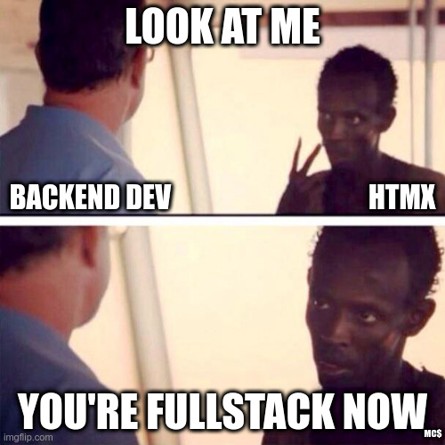

+++
title = "What I learnt building a web app with Go and HTMX"
outputs = ["Reveal"]
[logo]
src = "images/gophercon.svg"
diag = "90%"
width = "5%"
[reveal_hugo]
custom_theme = "stylesheets/reveal/catppuccin.css"
highlight_theme = "catppuccin"
slide_number = true
+++

# What I learnt building a web app with Go and HTMX

---

{}


## Introduction

- Haseeb Majid
  - Backend Software Engineer at [Nala](https://www.nala.com/)
- Loves cats 🐱
- Avid cricketer 🏏 ~#BazBall~
- 🌱 Amateur Gardener

{}
{}

---

## Who Is This For?

- Backend engineers
- Simple Stack

{}
- Best fit when backend already owns most of the flow
{}

---


{}
{}

---


{}
{}

---


{}
{}

---


{}
{}

{}

---

{}

> Banter Bus got me here, LettuceGo made the same lessons easier to show.

{}
{}

---

## What is HTMX?

- Small library
- Interact with backend
  - Using HTML attributes

{}
- Raise your hands
{}

---


sequenceDiagram
    participant User
    participant HTMX
    participant Server

    User->>HTMX: Click / submit
    HTMX->>Server: HTTP request
    Server-->>HTMX: HTML fragment
    HTMX-->>User: DOM swap


{}
{}

---

```html{1-3|5-9|11}
<form hx-post="/plants/timeline"
      hx-target="#timeline"
>
   <div class="flex flex-col gap-4">
       <input name="event_type"
              type="radio"
              value="repotted"
              checked />
       <textarea name="notes" rows="3"></textarea>

       <button type="submit">Add Event</button>
   </div>
</form>
```

{}
{}

---

<video data-autoplay loop muted playsinline preload="none" data-src="images/lettucego_timeline_event.mp4"></video>

{}
- Same pattern.
- Small action.
- Clear update.
{}

---

## Why HTMX?

- State on backend
- Simpler tooling

{}

- LLMs generating react?

{}

---


{}
{}


---

```html{3|4|5|6}
<input
    name="q"
    hx-get="/plants"
    hx-trigger="input changed delay:300ms"
    hx-target="#plants-list"
    hx-push-url="true"
/>
```

{}
- Real app example.
- Search state lives in URL.
- No client store.
- No router.
{}

---

<video data-autoplay loop muted playsinline preload="none" data-src="images/lettucego_search.mp4"></video>

{}
- URL changes too.
- Server sends filtered HTML back.
{}

---

## Svelte

```html{1|2-5}
<input bind:value={q} placeholder="Search plants" />
```

{}
{}

---

```ts{2-3|5}
<script lang="ts">
  let q = ''
  let plants = []

  $: params = new URLSearchParams({ q })
</script>
```

{}
- Need query params too.
{}

---

```ts{2-5|7-10}
<script lang="ts">
  $: if (q || location) {
    loadPlants()
    history.replaceState({}, '', `?${params}`)
  }

  async function loadPlants() {
    const res = await fetch(`/plants?${params}`)
    plants = await res.json()
  }
</script>
```

{}
{}

---

```html{|7-9}
{#if loading}
  <p>Loading...</p>
{:else if error}
  <p>{error}</p>
{:else}
  <ul>
    {#each plants as plant}
      <li>{plant.name}</li>
    {/each}
  </ul>
{/if}
```

{}
- `plants` change => Svelte re-renders list.
- Handle loading and error states in template.
- Svelte has its use cases as well
{}

---

```html{2|3|5}
<div
    hx-get="/plants/plant_1_id/timeline"
    hx-trigger="load"
>
    <p class="text-sm text-muted">Loading...</p>
</div>
```

{}
- Cheap first render.
- Expensive bit comes after.
{}

---



flowchart LR
    A[POST health entry]
    B[record health]
    C[toast]
    D[health dot]
    E[timeline]
    F[last event]
    G[history]

    A --> B
    B --> C
    B --> D
    B --> E
    B --> F
    B --> G


---

```html{|1|5|9}
<div id="toast-container" hx-swap-oob="true">
  Health recorded!
</div>

<div id="health-dot-plant-1-id" hx-swap-oob="true">
  <span class="bg-health-4"></span>
</div>

<div id="timeline-section" hx-swap-oob="true">
  <!-- updated timeline -->
</div>

<div id="last-event-oob" hx-swap-oob="true">
  Repotted — just now
</div>
```

{}
- One response, many fragments.
- Each `hx-swap-oob` targets a page element by id.
- HTMX swaps them all in one round trip.
- No client knows about the others.
{}

---

<video data-autoplay loop muted playsinline preload="none" data-src="images/lettucego_oob_health.mp4"></video>

{}
- One health submit.
- Top summary changes.
- Health history changes.
- Timeline changes.
{}

---

## AlpineJS

```html{1|2|4|6-8|9}
<div x-data="{ open: false }">
  <button @click="open = true">Delete plant</button>

  <dialog x-show="open">
    <p>Are you sure?</p>
    <button hx-delete="/plants/123"
            hx-target="#plants-list">Yes
    </button>
    <button @click="open = false">Cancel</button>
  </dialog>
</div>
```

{}
- Alpine handles tiny UI state.
- Modal open and close does not need server round trip.
{}

---

```go{7|8|10-13}
func ErrorWithToast(
    w http.ResponseWriter,
    r *http.Request,
    statusCode int,
    message string,
) {
    w.Header().Set("HX-Retarget", "#toast-container")
    w.Header().Set("HX-Reswap", "innerHTML")
    w.WriteHeader(statusCode)
    _ = components.Toast(
        message,
        components.ToastError,
    ).Render(r.Context(), w)
}
```

{}
- One shared error path.
- Handler decides message.
- Layout decides where it lands.
{}

---

##  Redirects

```go{2|3-5|8}
func authRedirect(w http.ResponseWriter, r *http.Request) {
    if r.Header.Get("HX-Request") == "true" {
        w.Header().Set("HX-Redirect", "/login")
        w.WriteHeader(http.StatusOK)
        return
    }

    http.Redirect(w, r, "/login", http.StatusFound)
}
```

{}
- HTMX is still just HTTP.
- Browser redirect and HTMX redirect are not the same thing.
- Common case: token or session expires during an HTMX form/button request.
- Normal browser navigation can use 302.
- HTMX request should use HX-Redirect or login page may get swapped into part of current page.
- Good example that complexity moves, it does not disappear.
{}

---

## What About JSON?

- Separate Data API
  - Generic
      - N+1 query problem
- Mobile vs Web App

{}
- Split data API from app API.
- Data API: stable, public, generic.
- App API: changes fast, page-specific.
- Why HTML for app API?
  - Client just renders it, no rebuild.
  - One request per page, no N+1.
  - New endpoints = new HTML, no client update.
  - Reuse server cache, SQL, templating.
  - Less glue: no DTO, no fetch.
{}

---

## When not to use HTMX?

- Lots of frontend reactivity
- Separate frontend/backend teams
- Design System

---


{}

---

{}

## Backend

---


flowchart LR
    subgraph Browser
        A[DOM]
        H[HTMX]
        A -->|User event| H
        H -->|Swap target| A
    end

    subgraph GoApp[Go application]
        B[Handler]
        C[Service]
        D[sqlc]
        F[templ]

        B --> C
        C --> D
        B --> F
    end

    E[(Postgres)]

    H -->|HTTP request| B
    D <--> E
    F -->|HTML fragment| H


{}
{}

---

## Handler


```go{1-4|7-9|20-23}
func (h *EventHandler) UpdateTimeline(
    w http.ResponseWriter,
    r *http.Request,
) {
    // ...

    timeline, err := h.service.UpdatePlantTimeline(
        r.Context(),
        plantID,
    )
    if err != nil {
        response.ErrorWithToast(
            w, r,
            http.StatusInternalServerError,
            "Failed to load timeline",
        )
        return
    }

    err = plantcomponents.Timeline(
        plantID,
        timeline,
    ).Render(r.Context(), w)
    if err != nil {
        h.logger.ErrorContext(
            r.Context(),
            "failed to render timeline content",
            slog.Any("error", err),
        )
    }
}
```

---


---

## Templ

- HTML Templates
- LSP
- Components


{}
- Components: reuse
- Downside: extra tooling, another CLI
{}

---

<video data-autoplay loop muted playsinline preload="none" data-src="images/lsp.mp4"></video>

---

```go{1|3|5|6|8|10}
package components

import "gitlab.com/.../service"

templ HealthHistory(entries []service.HealthEntry) {
    for _, entry := range entries {
        <div class="flex gap-3 items-center py-2">
            @Health(entry.Rating)
            <span class="text-sm font-medium text-text">
                { entry.Rating }
            </span>
        </div>
    }
}
```

{}
{}

---

```html
<div class="flex gap-3 items-center py-2">
    <span class="inline-block w-3 h-3 rounded-full bg-health-3"></span>
    <span class="text-sm font-medium text-text">
        3
    </span>
</div>
```

---


```bash
templ generate
```

---

```go
// Code generated by templ - DO NOT EDIT.
func HealthHistory(entries []service.HealthEntry) templ.Component {
	return templruntime.GeneratedTemplate(func(...) (err error) {
		for _, entry := range entries {
			templruntime.WriteString(buf, 1, "<div class=\"flex gap-3 items-center py-2\">")
			Health(entry.Rating).Render(ctx, buf)
			templruntime.WriteString(buf, 2, "<span class=\"text-sm font-medium text-text\">")
			buf.WriteString(entry.Rating)
			templruntime.WriteString(buf, 3, "</span></div>")
		}
		return
	})
}
```

{}
{}

---

```go{10-12|11}
package layouts

import "gitlab.com/.../http/views/components"

templ Base(title string, environment string) {
	<!DOCTYPE html>
	<html lang="en">
		<head>
		</head>
		<body class="bg-base-200 text-neutral">
			{ children... }
		</body>
	</html>
}
```

---

```go{2|3-5}
templ PlantPage(title string, environment string) {
	@Base(title, environment) {
          <div>plant1</div>
          // ...
    }
}
```

---

```html{1-6|7}
<!DOCTYPE html>
<html lang="en">
  <head>
    <title>Basil</title>
  </head>
  <body class="bg-base-200 text-neutral">
      <div>plant1</div>
  </body>
</html>
```

{}

---

{}

## Postgres

{}
{}

---

## SQLC

```sql{1|2-6}
-- name: ListHealthByPlant :many
SELECT id, plant_id, rating, recorded_at
FROM health_entries
WHERE plant_id = $1
ORDER BY recorded_at DESC
LIMIT $2 OFFSET $3;
```

---

```bash
sqlc generate
```

---

## sqlc.yaml

```yaml{4-5}
version: "2"
sql:
  - engine: "postgresql"
    queries: "internal/store/db/sqlc/queries"
    schema: "internal/store/db/sqlc/migrations"
    gen:
      go:
        package: "db"
        out: "internal/store/db"
        sql_package: "pgx/v5"
```

{}
{}

---

```go{1-10|12-15|18-21|22-25|31-42}
type HealthEntry struct {
    ID         uuid.UUID
    PlantID    uuid.UUID
    UserID     uuid.UUID
    Rating     int32
    Notes      *string
    RecordedAt pgtype.Timestamptz
    CreatedAt  pgtype.Timestamptz
    UpdatedAt  pgtype.Timestamptz
}

type ListHealthByPlantParams struct {
    PlantID uuid.UUID
    Limit   int32
    Offset  int32
}

func (q *Queries) ListHealthByPlant(
    ctx context.Context,
    arg ListHealthByPlantParams,
) ([]HealthEntry, error) {
    rows, err := q.db.Query(
        ctx, listHealthByPlant,
        arg.PlantID, arg.Limit, arg.Offset,
    )
    if err != nil {
        return nil, err
    }
    defer rows.Close()

    var items []HealthEntry
    for rows.Next() {
        var i HealthEntry
        if err := rows.Scan(
            &i.ID, &i.PlantID, &i.UserID, &i.Rating,
            &i.Notes, &i.RecordedAt, &i.CreatedAt,
            &i.UpdatedAt,
        ); err != nil {
            return nil, err
        }
        items = append(items, i)
    }
    if err := rows.Err(); err != nil {
        return nil, err
    }
    return items, nil
}
```

{}
- sqlc dynamic queries
  - query builders
{}

{}

---

{}

## DevEx


---

## Taskfile

```yaml{|4-7|9-13}
version: "3"

tasks:
  dev:
    cmds:
      - docker compose up -d
      - concurrently "air" "task watch"

  watch:
    cmds:
      - templ generate -watch &
      - tailwindcss -i ./static/css/tailwind.css \
          -o ./static/css/styles.css --minify --watch
```

---

<video data-autoplay loop muted playsinline preload="none" data-src="images/air.mp4"></video>

---

## Live Reload

```go{1-3|5|6-9|11}
import (
    "github.com/aarol/reload"
)

func (s *Server) wrapWithReload(handler http.Handler) http.Handler {
    reloader := reload.New(
        "internal/transport/http/views",
        "static/css",
    )
    s.logger.Debug("starting reload server")
    return reloader.Handle(handler)
}
```

---

<video data-autoplay loop muted playsinline preload="none" data-src="images/reload.mp4"></video>

---

## flake.nix

```nix{1|2-12|12|15-17}
myPackages = with pkgs; [
  go
  goose
  air
  golangci-lint
  gofumpt
  go-task
  playwright-driver
  playwright-cli
  templ
  sqlc
  tailwindcss_4
];

devShellPackages =
  with pkgs;
  myPackages;
```

---

## Nix

```bash{2|5|8-9}
example on main via 🐹 v1.22.8
❯ which golangci-lint

example on main via 🐹 v1.22.8
❯ nix develop

example on main via 🐹 v1.22.8 ❄️ impure (nix-shell-env)
❯ which golangci-lint
/nix/store/kcd...golangci-lint-1.56.2/bin/golangci-lint
```

{}
{}

---

## Playwright

```go{1|4-7|8-10|11-13|15-16}
func TestTimelineRefreshesAfterAddEvent(t *testing.T) {
    // setup ...

    page.Locator(
        "a:has-text('Timeline Refresh Plant')",
    ).First().Click()

    timelineSection := page.Locator(
        "#timeline-section",
    )
    expect.Locator(timelineSection).ToContainText(
        "Repotted",
    )

    lastEventOOB := page.Locator("#last-event-oob")
    expect.Locator(lastEventOOB).ToContainText("—")
}
```

{}

---

{}



---

## Takeaways

- HTMX
- Go + Templ
- sqlc

---


- https://haseebmajid.dev/slides/gophercon-htmx-go-web-app/

---

## Useful Links

- Banter Bus: https://gitlab.com/hmajid2301/banterbus
- Splitting Your Data & Application APIs: https://htmx.org/essays/splitting-your-apis/
- Nix Dev Shell: https://www.youtube.com/watch?v=bdGfn_ihHOk
- Playwright: https://www.youtube.com/watch?v=XdBhYt3-bbU

{}
