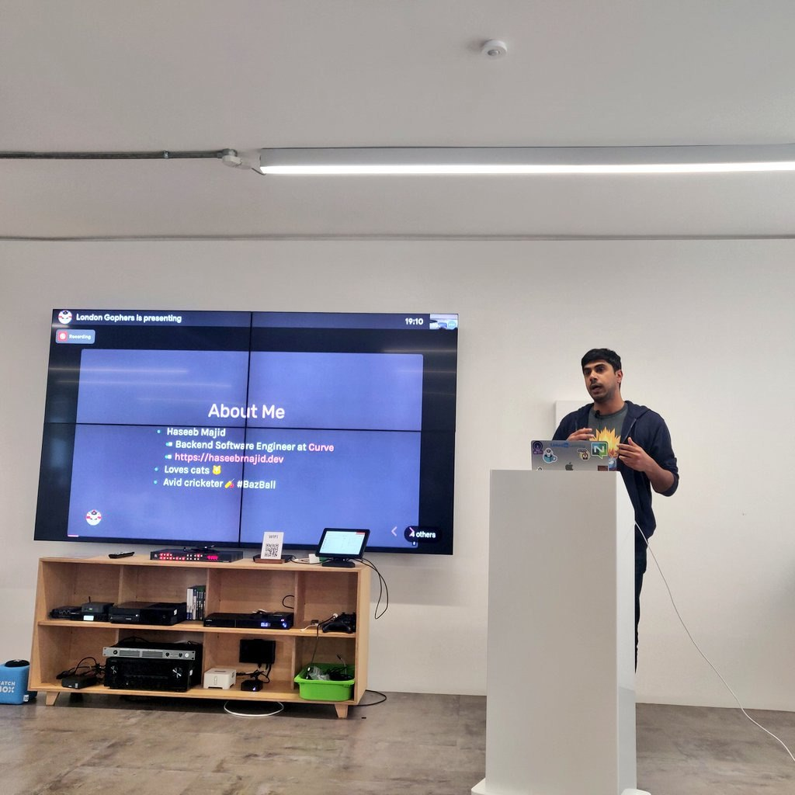



- [Abstract](https://www.meetup.com/londongophers/events/292486307/)
- [Related Code](https://gitlab.com/hmajid2301/talks/-/tree/main/an-intro-to-pocketbase)
- [Slides](https://slides.haseebmajid.dev/an-intro-to-pocketbase/2023-05-31-london-gophers/)
- [PDF](https://slides.haseebmajid.dev/an-intro-to-pocketbase/2023-05-31-london-gophers/slides.pdf)

## Photo from meetup

