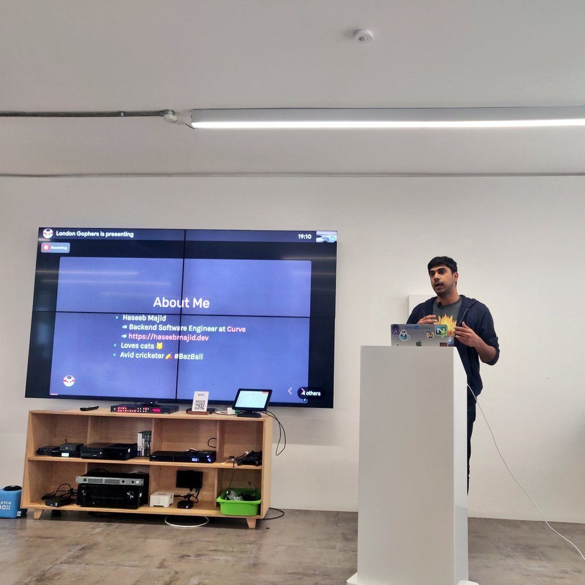

An introduction to PocketBase, a Go-based backend that bundles authentication,
a database and an admin dashboard into a single binary. I show how to extend it
with Go routes and build a small web application.

- [Abstract](https://www.meetup.com/londongophers/events/292486307/)
- [Related Code](https://gitlab.com/hmajid2301/talks/-/tree/main/an-intro-to-pocketbase)
- [Slides](https://slides.haseebmajid.dev/an-intro-to-pocketbase/2023-05-31-london-gophers/)
- [PDF](https://slides.haseebmajid.dev/an-intro-to-pocketbase/2023-05-31-london-gophers/slides.pdf)
- [Recording](https://www.youtube.com/watch?v=y5E1dox9ZEA)



## Photo from meetup

