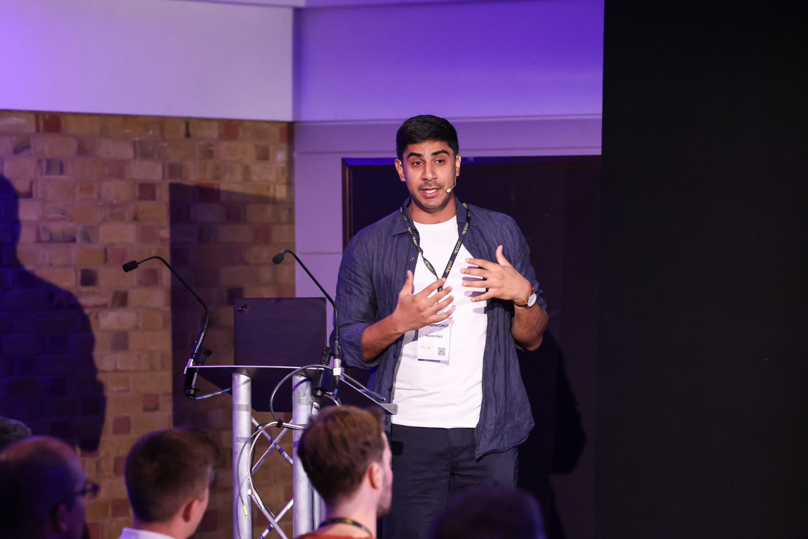
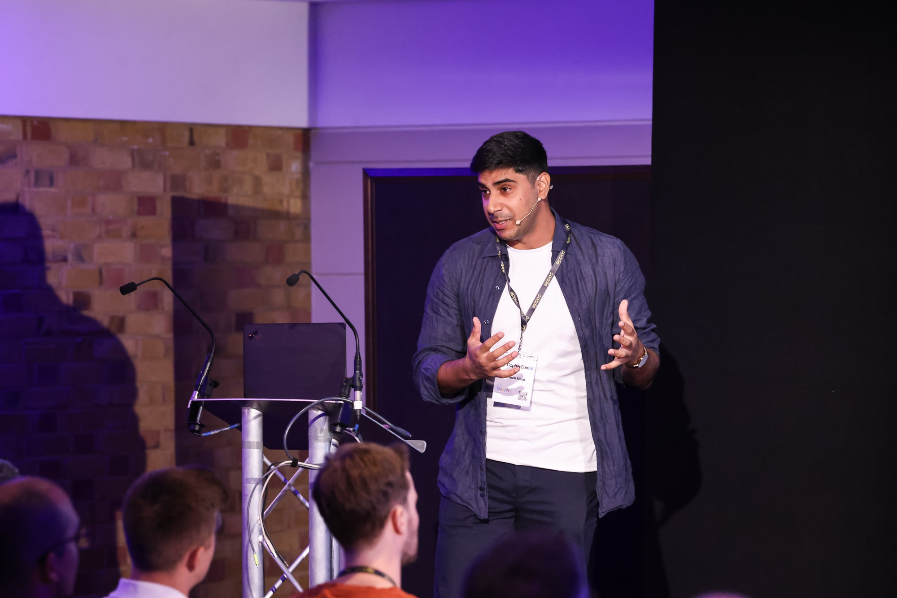
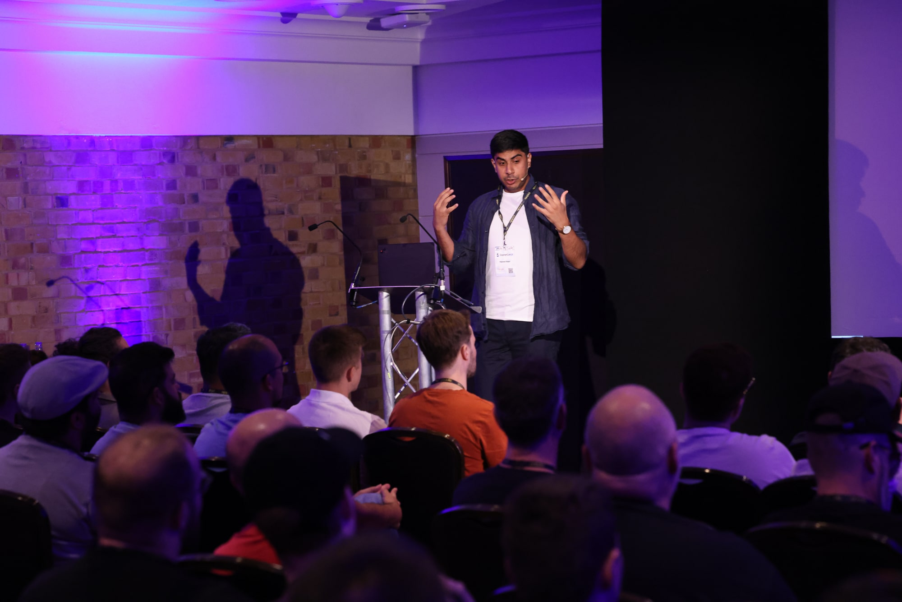
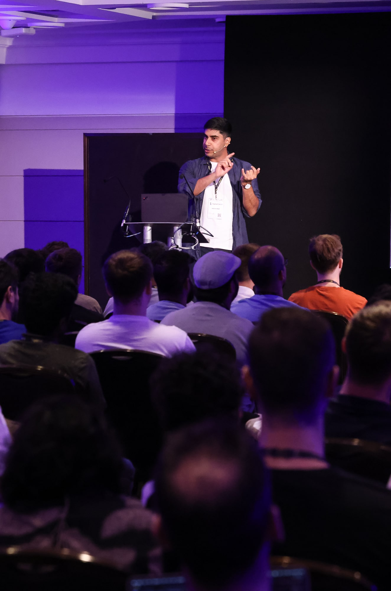



- [Abstract](https://www.gophercon.com/agenda/session/1234567)
- [Example Service](https://gitlab.com/hmajid2301/banterbus)
- [Slides](https://slides.haseebmajid.dev/otel-go/2025-07-15-gophercon-uk/)
- [PDF](https://slides.haseebmajid.dev/otel-go/2025-07-15-gophercon-uk/slides.pdf)

## Photo from conference

