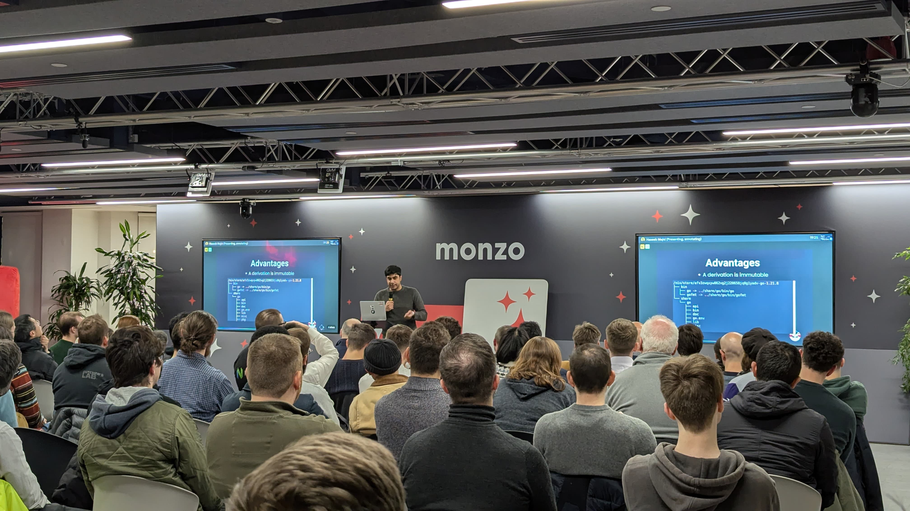
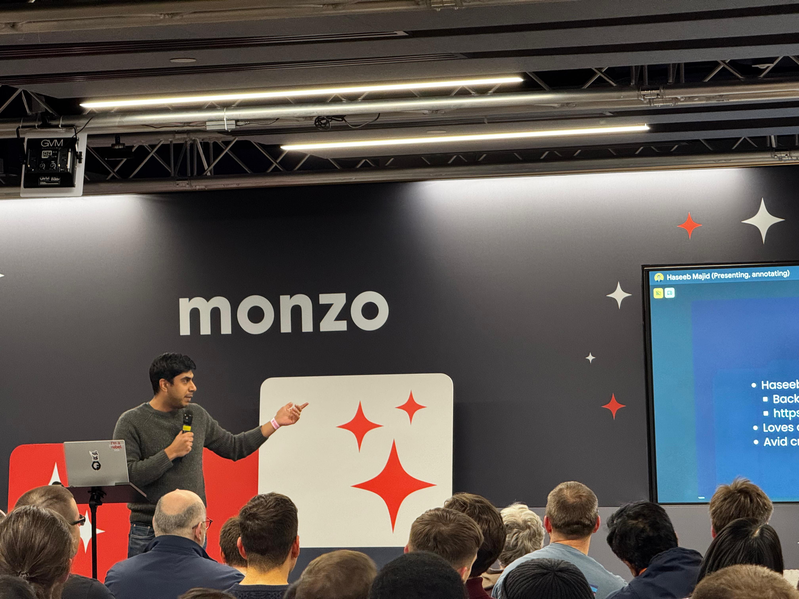
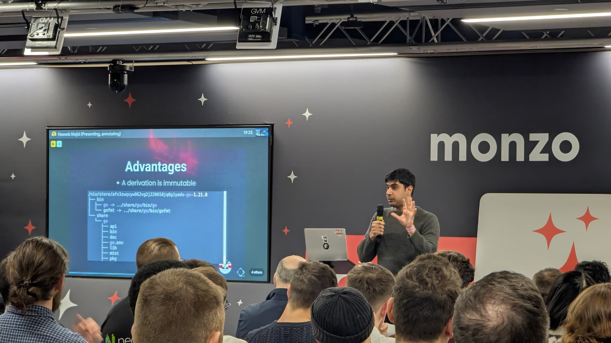

- [Abstract](https://www.meetup.com/londongophers/events/303598426/)
- [Slides](https://slides.haseebmajid.dev/reproducible-envs-with-nix/2024-11-20-london-gophers/)
- [PDF](https://slides.haseebmajid.dev/reproducible-envs-with-nix/2024-11-20-london-gophers/slides.pdf)

## Photo from conference

