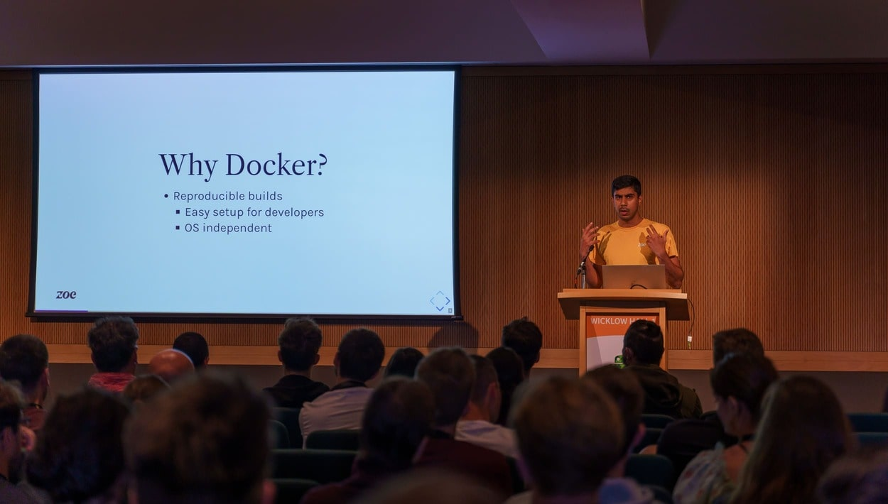

How my use of Docker grew from running a local application to supporting a
reproducible development and CI workflow. Using a FastAPI service and Postgres,
I work through building images and introducing multistage builds.

- [Abstract](https://ep2022.europython.eu/session/my-journey-using-docker-as-a-development-tool)
- [Related Code](https://gitlab.com/hmajid2301/talks/-/tree/main/docker-as-a-dev-tool/example)
- [Slides](https://slides.haseebmajid.dev/my-journey-using-docker-as-a-developer-tool/2022-07-13-europython/)
- [PDF](https://slides.haseebmajid.dev/my-journey-using-docker-as-a-developer-tool/2022-07-13-europython/slides.pdf)
- [Recording](https://www.youtube.com/watch?v=JSSG4FqKaGI)



## Photo from conference

