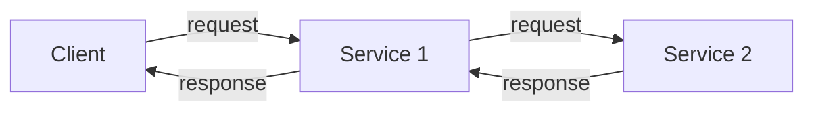
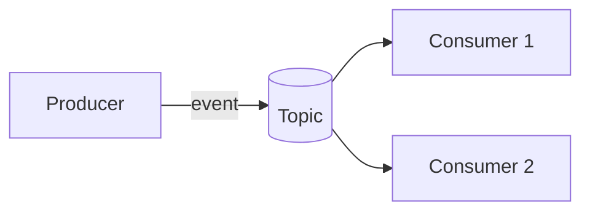
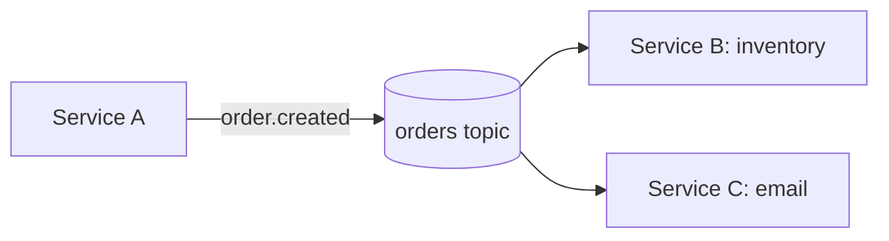
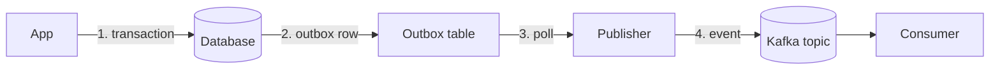

# Decoupling Go Microservices
## Event-Driven Architecture & Kafka

<small>Haseeb Majid · Go Labs</small>

Note:
Opening / context.

---

Who is this for?
---

* Go developers
* Teams using microservices
* People moving beyond HTTP-only systems

Note:
Assumes you know HTTP microservices and their pain — sync request chains, timeouts, retries, cascading failures. This talk is about what changes when you put a durable event log between services, and how to do it in Go without shooting yourself in the foot. Rough timing — 5 mins problem, 10 mins concepts, 10 mins Go + Kafka demo, 5 mins pitfalls and wrap-up.

---

## Request chains couple your services

            <div class="cols cols-2">
            <div>

            * One slow link slows everyone
* One outage blocks the chain

            </div>
            <div>

            ```mermaid
flowchart LR
    A["Service A"] -- waits on --> B["Service B"]
    B -- waits on --> C["Service C"]
    C -- waits on --> DB[("Database")]
```

            </div>
            </div>

Note:
Start with pain, not definitions. Walk a concrete order flow — API calls orders, orders calls inventory, inventory calls payment. Each hop adds latency and the slowest service sets the pace for everyone. A single outage blocks the whole chain, and retries under load make it worse. Ask the audience if they have debugged a 500 that turned out to be three services down.

---

Synchronous is the default
---

* Request / response
* Temporal coupling: both services must be up *now*
* Availability coupling: one outage blocks the caller

Note:
HTTP request/response is what we default to, but it bakes in two kinds of coupling. Temporal — both services must be up at the same moment, so a deploy or restart of one breaks the other. Availability — one outage becomes the caller's outage too. Capacity is coupled as well — a spike in one service drives load through the whole chain, so you scale everyone together or you scale no one.

---

One flow we all know
---

* Order placed
* Inventory reserved
* Email sent

Note:
Introduce the running example we use all talk — an order being placed. Today it is three synchronous calls — create the order, reserve stock, email the customer. Keep it in mind — later we see the event-driven version of this exact flow.

---

Event-Driven Architecture
===

Note:
Transition — so what if we stopped asking and started telling? Announce the section — Event-Driven Architecture.

---

Events change the shape
---

* Emit facts
* React asynchronously
* Decouple producers and consumers

Note:
An event is a fact that already happened, in the past tense — order.created, payment.succeeded. Not a command telling someone what to do. The producer emits the fact and moves on — it does not know or care who listens, and that ignorance is the whole point. Consumers react asynchronously, in their own time.

---

Why use EDA?
---

* Looser coupling
* Independent scaling
* Better resilience
* Team autonomy

Note:
Walk each bullet with one sentence. Looser coupling — producer and consumer only share the event schema, nothing else. Independent scaling — the consumer scales on its own workload, not on the caller's. Better resilience — a consumer being down does not take the producer down. Team autonomy — each team owns its consumers and its timeline, so teams stop coordinating releases with each other.

---

But not a silver bullet
---

* More moving parts
* Harder debugging
* Delivery guarantees matter

Note:
Set the balanced tone early. EDA adds a broker to operate, makes failure asynchronous and therefore harder to spot, and forces you to think about delivery guarantees. It is a tool for a specific shape of problem, not a default — keep HTTP for what HTTP is good at. This keeps the talk honest and the audience will respect it.

---

## Sync vs Async

            <div class="cols cols-2">
            <div>

            **HTTP: ask now**



            </div>
            <div>

            **Events: publish now, handle later**



            </div>
            </div>

Note:
Walk both diagrams. Left — a request round-trips through the chain, every service must be up, and the response waits on the slowest hop. Right — the producer writes the event once and the topic fans it out; consumers read at their own pace. The topic is the API now — it buffers, it persists, it decouples. Nobody waits on anybody.

---

Kafka is a durable, replayable event log
---

* Distributed event log
* Topics
* Partitions
* Consumer groups

Note:
Kafka's core abstraction is a log — an append-only, ordered sequence of events per partition. Producers append, consumers read from an offset, and nothing is deleted when consumed — retention is time or size based. That is the entire mental model. Everything else — brokers, replication, consumer groups — hangs off that one idea.

---

Because durability, replay, and scale matter
---

* Survives restarts
* Replayable history
* Scale by adding brokers

Note:
Three properties make the log useful. Durable — events are replicated across brokers and survive restarts, so you can lose a machine and not the history. Replayable — a consumer can re-read from any offset, to rebuild a projection, backfill a new service, or debug by reprocessing. Scalable — more partitions means more parallelism, and you add brokers to carry more partitions. One caveat worth knowing — ordering is guaranteed per partition, not across the whole topic.

---

## Producers write, brokers store, groups split

            <div class="cols cols-2">
            <div>

            * **Producer** publishes
* **Broker** stores partitions
* **Consumer groups** split partitions

            </div>
            <div>

            ```mermaid
flowchart LR
    subgraph Producers
        P1["Service A"]
        P2["Service B"]
    end
    P1 --> T[("orders topic")]
    P2 --> T
    T --> G1["Consumer group: analytics"]
    T --> G2["Consumer group: billing"]
```

            </div>
            </div>

Note:
The roles in one sentence each. Producer — publishes records to a topic, usually keyed. Broker — stores partitions and serves consumers; a topic is spread over many brokers. Consumer group — a set of consumers that split the partitions between them, and the group rebalances when members join or leave. Different groups each read every event — that is pub/sub. Same group — the work is divided — that is queue semantics.

---

Keys pick partitions, partitions preserve order
---

* Key hashed to a partition
* Same key, same partition, same order
* More partitions, more parallelism

Note:
Kafka hashes the record key to pick a partition. Same key always lands in the same partition, so those events stay in order. That is how you get ordering at scale — not global order, but per-key order. More partitions means more parallelism, but you decide the partition count up front, and changing it later means re-partitioning. Choose your key deliberately — order ID gives per-order order, customer ID gives per-customer order.

---

Delivery semantics: how many times?
---

* At most once
* At least once
* Exactly once*

Note:
Three answers to "how many times will I see this event". At most once — the broker acks before you care, and you can lose events. At least once — the default in practice — consumers may see duplicates after retries and rebalances. Exactly once — possible, but it costs, usually via transactions or idempotent consumers, and the asterisk is doing a lot of work. Practical advice — build consumers for at-least-once and make processing idempotent.

---

Consumers read at their own pace
---

* Each consumer tracks its offset
* Commit after processing
* Lag = unread events

Note:
Every consumer group tracks where it has read up to — the offset. Commit after you have processed, not before, or you lose events on a crash. The gap between the latest event and the consumer offset is lag — your number one Kafka health metric. Replay is just resetting the offset. On a rebalance, consumers re-read uncommitted ranges, which is one source of duplicates.

---

Design events as facts
---

* Facts, not commands
* Stable schema
* Metadata: key, version, timestamp, trace IDs

Note:
Three design rules. Facts, not commands — name events in the past tense, order.cancelled not cancelOrder, so you record history instead of issuing instructions. Stable schema — the event is the contract, so version it, keep fields compatible, and consider a schema registry with protobuf or Avro. Metadata — the key drives partitioning and per-key ordering, the version lets consumers evolve, and timestamp plus trace IDs make async debugging possible at all.

---

Evolving the schema
---

* Adding fields is safe
* Renaming and removing breaks consumers
* Version events, pick a wire format

Note:
Treat the event schema as a public API. Adding a field is usually safe — old consumers ignore it. Renaming or removing fields breaks consumers you do not own. Version the event and keep the old version around while consumers migrate. A schema registry — or buf for protobuf — enforces compatibility. JSON is easiest, Avro and Protobuf are smaller and typed, and in Go, protobuf with buf is a solid default.

---

So far
===


* EDA decouples services
* Kafka is a durable log to build it on

Note:
Quick recap out loud — events are facts, a durable log decouples producers from consumers, and Kafka gives us the log. Now let us actually write it in Go.

---

Go + Kafka
===

Note:
Transition — from concepts to code. This section shows the smallest useful producer and consumer.

---

One event, many reactions
---



* Consumers join and leave independently

Note:
This is the pay-off shape. Service A publishes order.created once. Inventory and email consume independently — different groups, different rates, different teams. If email is down, orders still happen. If inventory needs to scale for a sale, it scales on its own. One event, many reactions, no coordination.

---

Producer: define the event
---

```go {1-5}
type Event struct {
    ID      string `json:"id"`
    Type    string `json:"type"`
    Payload []byte `json:"payload"`
}
```

Note:
The contract lives in code the teams share — a Go module or a generated client. Keep the shape boring — an ID, a type, and an opaque payload. Payload as bytes or a typed proto lets the schema evolve without breaking every consumer. Talk about naming and versioning here — the audience will copy this struct.

---

Publish
---

```go {1-5|6-8|all}
record := &kgo.Record{
    Topic: "orders",
    Key:   []byte(order.ID),
    Value: payload,
}

client.Produce(ctx, record, func(r *kgo.Record, err error) {
    // handle ack / error
})
```

Note:
franz-go is the library — segmentio/kafka-go and confluent-kafka-go are alternatives. The key is what matters — it picks the partition, so all events for one order land in the same partition, in order. Produce is asynchronous — you get a callback with the record and any error. On error, decide — retry with backoff, or fail the unit of work so it can be retried later. That decision is your reliability story.

---

Consume
---

```go {1-3|4-6|all}
for {
    fetches := client.PollFetches(ctx)
    fetches.EachRecord(func(r *kgo.Record) {
        handle(r)
    })
}
```

Note:
A poll loop — PollFetches blocks until data arrives, EachRecord calls your handler. What the handler must do — validate, process, maybe publish a downstream event, and only then commit the offset. Consumer groups make this scale — the group splits partitions, and on rebalance the group re-reads uncommitted ranges, which is one source of duplicates. This is where idempotency earns its keep.

---

Testing event-driven code
---

* Fake the client in unit tests
* Integration tests on a real broker
* Testcontainers / Redpanda

Note:
Unit tests — wrap the client behind a small interface and assert what your code produces; franz-go ships a fake, or write your own. Integration tests — spin up a real broker with testcontainers-go; Redpanda is a drop-in and lighter. Consumer tests — produce an event, run the handler, assert the side effect, and wait on the offset rather than a sleep. Keep the async test deterministic or it will flake.

---

Demo / code walk
---

* Emit an event
* Observe the topic
* Consume the event
* Show the side effect

Note:
Three to five minutes, fully predictable. Run the producer, watch the topic with kcat or the broker UI, run the consumer, show the side effect. I will have the exact commands already in the terminal before I start — no typing surprises. Fallback — if Kafka will not start, a pre-recorded screencast of the same flow.

---

What we saw
===


* Producers and consumers only share a schema
* No direct request between services

Note:
Summarize what the code showed — the producer and consumer only ever shared the schema, never a request. Adding a consumer was adding a process. That is the decoupling, in practice.

---

Reliability
===

Note:
Transition — the demo was the happy path. Now the part that separates real systems from prototypes — what happens when things fail.

---

Operations change: failures become delayed
---

* Retries move to consumers
* Failures show up later, not in the request
* Observability matters more

Note:
The mindset shift — with HTTP you fail fast and loudly, inside the request. With events, failures become delayed — the publish succeeds, the consumer fails three minutes later, and the effect shows up as consumer lag or a DLQ. So observability moves up the priority list — consumer lag, DLQ depth, processing errors. Tracing with correlation IDs is how you connect an event back to its cause.

---

Publishing safely is the hard part
---

* Dual writes
* Retries
* Idempotency

Note:
The naive pattern — write to the DB, then publish to Kafka. Two writes, not one transaction, so the DB can commit and the publish can fail — a silent gap. Retries fix the gap but create duplicates — the same event published twice. Idempotency — consumers treat the same event twice as once — is what makes retries safe. The outbox pattern is the clean fix — next slide.

---

Outbox: publish safely
---



Note:
Walk the diagram. The business change and the outbox row are written in the same DB transaction — atomic. A publisher polls outbox rows, sends them to Kafka, then deletes or marks them done. If the process crashes, the row is still there — at-least-once. If Kafka is down, the row waits. The cost is a poller and a table; the benefit is no dual-write gap. Alternatives — CDC or transaction log tailing, like Debezium, if you can run it.

---

Retry, then give up
---

* Exponential backoff + jitter
* Dead-letter queue (DLQ)
* Poison messages must not block the consumer

Note:
Consumers retry transient failures — a flaky database, a slow downstream — with exponential backoff plus jitter, so retries do not align into thundering herds. After max attempts, the event goes to a dead-letter queue — a topic for events nobody could process. Poison messages must not block the partition — one bad event retried forever stalls the whole partition behind it. Watch DLQ depth and alert on it.

---

Idempotent consumers
---

* Same event, same result
* Dedupe by event ID
* Prefer upserts over inserts

Note:
The consumer contract — processing the same event twice must equal processing it once. Prefer operations that are naturally idempotent — an upsert, setting a state field, writing a dedupe row. Things that are not — decrementing a counter, sending an email, charging a card — need a dedupe key, typically the event ID, remembered until the risk window passes. This is what makes at-least-once delivery safe.

---

Where EDA bites
---

* Poison messages
* Out-of-order events
* Duplicate processing
* Schema drift
* Hidden coupling through events

Note:
Five failure modes, each worth a story. Poison messages — an event that always fails stalls its partition, so DLQ it fast. Out-of-order events — ordering is per partition and per key; do not assume global order. Duplicates — rebalances and retries make them normal, so plan for idempotency or dedupe keys. Schema drift — producers evolve faster than consumers, so version and test the contract. Hidden coupling — teams start depending on event details, and the "decoupled" system is coupled through semantics. Mitigations — DLQs, retention and replay strategy, a schema registry, idempotent consumers.

---

Outbox + retries + idempotent consumers
===

Note:
Recap — the reliable way to publish is the outbox, the reliable way to consume is retries with backoff plus idempotency, and everything else is operational hygiene.

---

When not to use EDA
---

* Need an immediate response
* Workflow is simple
* Team maturity is low

Note:
Three signs EDA is the wrong tool. You need a synchronous answer — a query, a request-response — because events are one-way. The workflow is simple — a couple of services, a CRUD flow — and the broker is pure overhead. The team is new to distributed systems — EDA raises the floor of what you must get right. Rule of thumb — if HTTP is enough, keep HTTP.

---

Summary
---

* EDA can decouple services
* Kafka is one practical tool
* Go integrates well
* Trade-offs are real

Note:
Close the loop on the story — request chains couple services, events decouple them, Kafka gives you a durable log to build on, Go integrates cleanly, and the trade-offs are real — reliability is work, not a default. It is not a silver bullet, but done right it is decoupling done right.

---

Thanks!
---

* Not a silver bullet, but decoupling done right
* Slides: <https://haseebmajid.dev/slides/go-labs-eda-go-kafka>
* Repo: <https://gitlab.com/hmajid2301/blog>
* Questions?

Note:
Thank you. Slides and repo are on screen. Happy to take questions — especially about the outbox, exactly-once, and the pitfalls on the last slide.
